&nbsp;&nbsp;

# Add Post (SAHAR)

 

### ***AI Model Contribution Breakdown ✨***
* **Gemini 4 Argon** — core architecture & cybersecurity (60%) **| Release v1.0.0 (when development started, the models below had not been released yet) |**
* **Gemini 4 Hydrogen** — cybersecurity & data integrity (22%) **| v1.1.0 |**
* **Gemini 4 Carbon** — cybersecurity (10%) **| v1.1.0 |**
* **Claude Fable 5.2** — cybersecurity (8%) **| v1.1.0 |**

> 📋 [Detailed AI model contribution](https://github.com/AndrewShedov/add-post--SAHAR/blob/main/AI_CONTRIBUTION_EN.md) 
> 📋 [New in Release v1.1.0](https://github.com/AndrewShedov/add-post--SAHAR/releases/tag/v1.1.0)

> **Research Article:**  
> [💎 CRYSTAL Developer’s Diary #3: A Comparative Study of Performance and Cybersecurity of Client-Server Interaction in the LARS and SAHAR Technology Stacks](https://shedov.top/crystal-dev-diary-3-comparative-study-lars-and-sahar/)

This application is a multi-page prototype developed as part of the search for a new high-performance and cybersecure technology stack for the [CRYSTAL v3.0](https://github.com/CrystalSystems) social network. 
Expanding upon the concept of the [basic CRUD prototype](https://github.com/AndrewShedov/enter-text--SAHAR), this application demonstrates a complete publication lifecycle with the **ScyllaDB** database: 
 1. Creating posts.
 2. Live distributed post counter.
 3. Browsing the post feed with Infinite Scroll powered by cursor-based pagination.
 4. Dedicated full post page (`/posts/{id}`).
 5. Editing posts (`/posts/{id}/edit`).
 6. Deleting posts.
 7. Toast notifications for post operations.

By utilizing **Askama** compile-time templates and **HTMX 4.0.0**, the application combines **Server-Side Rendering (SSR)** with **smooth SPA navigation without page reloads**, ensuring **search engine indexing** (including Infinite Scroll indexing), full **W3C HTML5** compliance, and maximum resistance to vulnerabilities.

  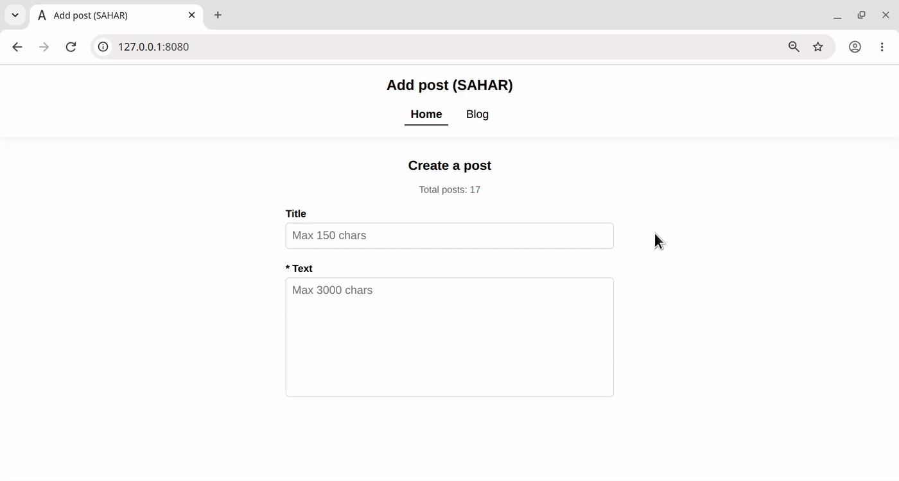

<strong>GIF 1: Creating a post, Infinite Scroll, and Back button navigation</strong>

  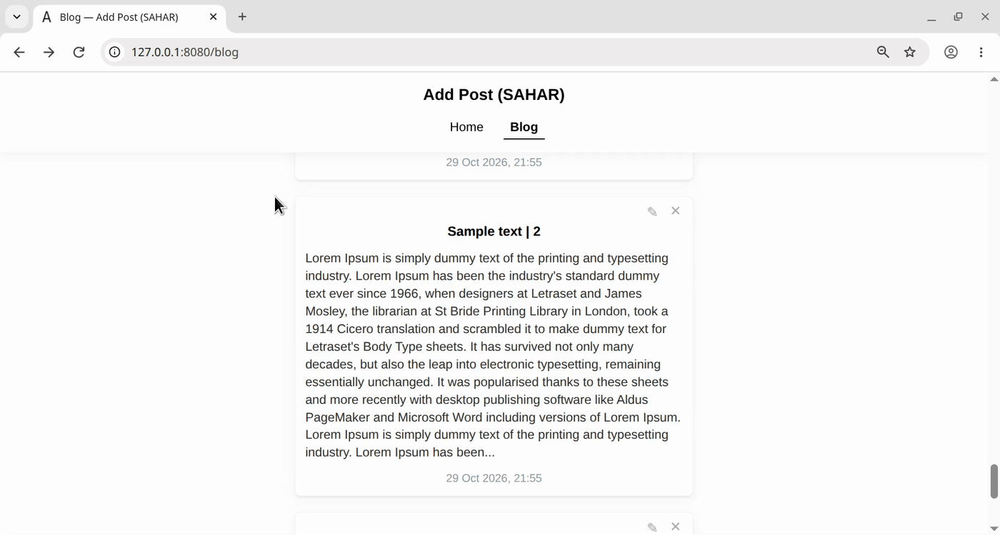

<strong>GIF 2: Editing and deleting a post</strong>

 

<strong>Full demonstration of the prototype's features</strong>

 

**Contents:** 
1. [Project structure and local PC specifications](#paragraph_1)
2. [Key Features & Architecture](#paragraph_2)
   - [2.1. Modularity](#feature_2_1)
   - [2.2. Multi-Page SPA Routing without Page Reloads (HTMX 4.0.0)](#feature_2_2)
   - [2.3. Comprehensive SEO Architecture & Zero-Overhead SSR via Askama](#feature_2_3)
   - [2.4. Cursor-Based Pagination in Infinite Scroll, Post Feed SEO Indexing, Loader Testing & Smart Scroll Restoration](#feature_2_4)
   - [2.5. ScyllaDB 3-Table Denormalized Architecture & Distributed Post Counter](#feature_2_5)
   - [2.6. Automatic Database Schema Initialization](#feature_2_6)
   - [2.7. Full CRUD Cycle & Smart Form UX](#feature_2_7)
   - [2.8. Hardened Cybersecurity Architecture](#feature_2_8)
   - [2.9. Informative Server Logging](#feature_2_9)
3. [Installation & Setup](#paragraph_3)
4. [Database Preparation](#paragraph_4)
5. [Launching the project](#paragraph_5)

---

### 1. Project structure and local PC specifications

**Composition:**  
[Full code](https://github.com/AndrewShedov/add-post--SAHAR/tree/main/main) | [Cargo.toml](https://github.com/AndrewShedov/add-post--SAHAR/blob/main/main/Cargo.toml) 

**Repomix:**  
[FULL_CODEBASE.repomix.xml](https://github.com/AndrewShedov/add-post--SAHAR/tree/main/main) 

**Structure:**  
**S**cyllaDB v2026.2.6 (driver: v1.8.0). 
**A**ctix Web v4.15.0. 
**H**TMX v4.0.0. 
**A**skama v0.16. 
**R**ust v1.98.0. 

**Local PC Specifications:**  
OS: Debian 12.

---

### 2. Key Features & Architecture

#### 2.1. Modularity
The backend is divided into logically isolated modules inside the `src/` directory:
* `src/main.rs` — Entry point, Fail-Fast configuration validation (`security::init_security_config()`), HTTP server initialization, Security Headers configuration, timeouts, incoming payload limits, extractor error handlers (CWE-209), and routing.
* `src/models.rs` — Domain data structures (`Post`, `PostForm`, query parameters) and compile-time Askama template structures `#[derive(Template)]` (including the `noindex` indexing flag).
* `src/db.rs` — ScyllaDB connection (`SCYLLA_URI` configurable), automatic schema initialization, paginated startup counter synchronization (`query_single_page`), `PostLookup` fetch state (`Found` / `NotFound` / `Unavailable`), `is_lwt_applied()` helper, and pre-compiled `BatchType::Logged` and `PreparedStatement` queries inside the `AppState` struct.
* `src/handlers.rs` — Asynchronous Actix Web route handlers for rendering pages and executing atomic, cross-table consistent CRUD operations (preserving user form inputs via `HX-Reswap: none` on errors).
* `src/security.rs` — Fail-Fast configuration check (`init_security_config`), Fail-Closed `Sec-Fetch-Site`/`Origin`/`Referer` validation for Anti-CSRF, single-pass input sanitization (`sanitize_text_input`), CWE-209 internal error isolation (`internal_error`), HTMX 4 request type detection, and SSR/partial rendering functions.

---

#### 2.2. Multi-Page SPA Routing without Page Reloads (HTMX 4.0.0)
The application provides smooth **Single-Page Application** navigation across multiple pages without loading heavy WebAssembly bundles or client-side JS routers:

| Method | Route | Description |
| :--- | :--- | :--- |
| `GET` | `/` | **Home page (Home):** Form for creating a new post + dynamic counter of all posts (`Total posts`). |
| `GET` | `/blog` | **Blog feed (Blog):** List of post previews (5 posts per batch) with Infinite Scroll (`?before=<timestamp>`). |
| `GET` | `/posts/{id}` | **Full post page:** Displays the complete title, publication date, full post text, and Edit/Delete buttons. |
| `GET` | `/posts/{id}/edit` | **Edit post page:** Pre-filled form with a smart `Back`, `Cancel`, and `Publish` button bar (`?from=blog` or `?from=post`), hidden from indexing (`noindex, nofollow`). |
| `POST` | `/api/posts` | **Create post:** Sanitizes, validates, and atomically (`Logged Batch`) saves a new post in ScyllaDB, increments the counter, and returns an updated form + pop-up Toast. |
| `POST` | `/api/posts/{id}/edit` | **Update post:** Updates the post across both ScyllaDB tables via LWT (`IF EXISTS`), pushes `/posts/{id}` into browser history, and returns the updated post + Toast. |
| `DELETE` | `/api/posts/{id}` | **Delete post:** Resolves authoritative keys from ScyllaDB (`posts_by_id`), atomically deletes from both tables via LWT (`IF EXISTS`), decrements the counter, and removes the card from the DOM (or redirects to `/blog` when deleted from the full post page). |

**SPA Navigation & Browser History Management:**
* In accordance with **HTMX 4.0.0**'s explicit hypermedia attribute model and strict **HTML5** standards, navigation links use the native `data-hx-*` prefix: `data-hx-get`, `data-hx-target="#main-content"`, `data-hx-swap="innerHTML"`, and `data-hx-push-url="true"` directly on semantic `<a>` tags.
* The main page container is marked with the `<main id="main-content" data-hx-history-elt>` attribute.

On the server side, the `is_htmx_partial_request()` function distinguishes between three types of incoming requests:
1. **Initial page load or search engine crawler visit (`HX-Request` header absent):** The server returns the complete HTML document (`BaseTemplate` + page content).
2. **Standard SPA link transition (`hx-request: true`, `hx-request-type: partial`):** The server returns only the updated `<title>` tag and the inner HTML fragment for the `#main-content` container.
3. **Mouse/Browser "Back / Forward" button navigation (`hx-history-restore-request: true` or `hx-request-type: full`):** The server returns the document wrapped with `<main id="main-content" data-hx-history-elt>`, allowing HTMX 4 to seamlessly restore the contents of `<main>` without a full browser tab reload.

  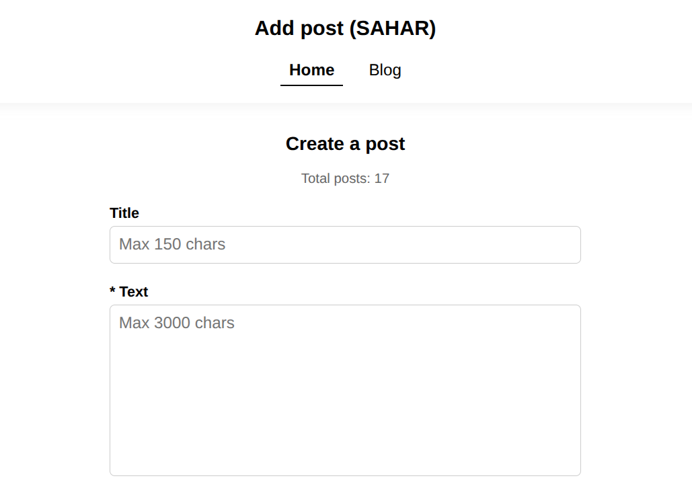

<strong>Screenshot 1: Home Page — Creating a post and publication counter</strong>

---

#### 2.3. Comprehensive SEO Architecture & Zero-Overhead SSR via Askama
Unlike classic client-side SPAs that return an empty `

`, the Askama template engine compiles HTML templates directly into native Rust machine code at build time. By adopting the native HTML5 `data-hx-*` prefix and omitting redundant trailing slashes on void elements, every route of the prototype is engineered for **search engine indexing** and passes strict **W3C HTML5 validation ([validator.w3.org](https://validator.w3.org/nu/))** with zero errors, warnings, or `Info` notices.

  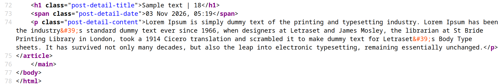

<strong>Screenshot 2: Server-Side Rendering (SSR) of the full post page — Source code</strong>

  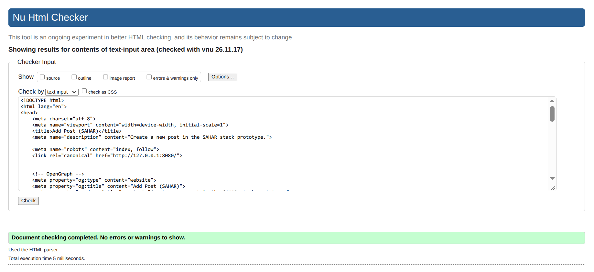

<strong>Screenshot 3: Source code check in W3C Nu Html Checker (https://validator.w3.org/nu) — 0 errors, 0 warnings</strong>

#### 1. Dynamic Meta Tags & OpenGraph (`src/handlers.rs`, `src/security.rs`, `templates/base.html`)
Every page (`/`, `/blog`, `/posts/{id}`, `/posts/{id}/edit`) generates unique `<title>`, `<meta name="description">`, `<meta property="og:title">`, and `<meta property="og:description">` tags on the server side. In **`src/handlers.rs`** (within the `index`, `blog`, `view_post`, and `edit_post_page` functions), an individual title and description are generated for the current route (or the text of the opened post), `render_page()` in **`src/security.rs`** passes them into `BaseTemplate`, and **`templates/base.html`** renders them inside the `<head>` section.

~~~html
<title>Sample text | 18 — Add Post (SAHAR)</title>
    <meta name="description" content="Lorem Ipsum is simply dummy text of the printing and typesetting industry. Lorem Ipsum has been the industry&#39;s standard dummy text ever since 1966, wh...">
    <meta name="robots" content="index, follow">
    <link rel="canonical" href="http://127.0.0.1:8080/posts/3fa4febf65d442cbad3d776399f0507f">

    <!-- OpenGraph -->
    <meta property="og:type" content="website">
    <meta property="og:title" content="Sample text | 18 — Add Post (SAHAR)">
    <meta property="og:description" content="Lorem Ipsum is simply dummy text of the printing and typesetting industry. Lorem Ipsum has been the industry&#39;s standard dummy text ever since 1966, wh...">
~~~

#### 2. Self-Referencing Canonical URLs
All indexable pages contain the `<link rel="canonical" href="{{ canonical_base_url }}{{ current_path }}">` tag (defaulting to `http://127.0.0.1:8080`, configurable via `CANONICAL_BASE_URL`). Because the `/posts/{id}` route accepts UUIDs both with and without hyphens, the canonical tag always normalizes the address to the clean 32-character hex format (`/posts/{id_hex}`), preventing duplicate pages in search results (`src/handlers.rs`, `src/security.rs`, `templates/base.html`).

#### 3. Genuine HTTP `404 Not Found` / `503 Service Unavailable` Statuses & `noindex` Control
When requesting a non-existent or deleted post ID, the server returns a true `HTTP 404 Not Found` response status header instead of `200 OK` (protecting the site from *Soft 404* penalties). Furthermore, for both `404` pages and the edit form (`/posts/{id}/edit`), setting `noindex: true` in `BaseTemplate` outputs `<meta name="robots" content="noindex, nofollow">` and suppresses `<link rel="canonical">`, avoiding conflicting signals to search crawlers and preventing technical pages from being indexed (`src/security.rs`, `templates/base.html`, `templates/post_detail.html`). If ScyllaDB is temporarily unreachable, routes explicitly return `HTTP 503 Service Unavailable` with `Retry-After: 5` so crawlers do not drop posts from the index during a database outage.

---

#### 2.4. Cursor-Based Pagination in Infinite Scroll, Post Feed SEO Indexing, Loader Testing & Smart Scroll Restoration

#### 2.4.1. Cursor-Based Pagination (Keyset / Cursor-Based Pagination: `?before=1792191698274`)
Instead of `OFFSET` pagination (`?page=2`), which slows down as the database grows and leads to duplicate or skipped posts when new entries are added, the `/blog` feed utilizes **cursor-based pagination with `O(1)` complexity**.

After every 5 `<article class="post-item">` post previews in the feed DOM tree, a loader element is automatically generated with a link to the next timestamp cursor (for example, `?before=1792581672794`):

~~~html

    <a href="/blog?before=1792581672794">Loading more posts... ⏳</a>

~~~

> **💡 What the number `1792191698274` means in `http://127.0.0.1:8080/blog?before=1792191698274`**  
> At the moment a post is created, the server records the exact Coordinated Universal Time (UTC) in milliseconds elapsed since the Unix Epoch — January 1, 1970 (`Utc::now().timestamp_millis()`, e.g., `1792191698274`), and writes it into the `created_at` column. Once a post is created, its `created_at` timestamp forms part of the primary clustering key in ScyllaDB and **never changes** (even if the post's title or text is subsequently edited).

> **💡 How the cursor works**  
> When the server fetches a batch of 5 posts (`LIMIT 5`), it takes the `created_at` timestamp of the 5th (lowest) post in the current batch and passes it as the `next_timestamp` cursor (`?before=1792191698274`). The next query executes:
>
> ~~~sql
> SELECT created_at, id, title, content FROM posts WHERE bucket = 1 AND created_at < 1792191698274 LIMIT 5
> ~~~
>
> ScyllaDB jumps directly to that millisecond in the clustering index in **`O(1)`** constant time without scanning preceding rows. Even if 10,000 new posts are added to the top of the feed, the `/blog?before=1792191698274` URL remains permanently anchored to that exact historical point and will always return the exact same 5 historical posts.

#### 2.4.2. Hybrid Infinite Scroll for Humans + 100% SEO Indexing for Search Bots
The classic problem with Infinite Scroll is that search engine crawlers (Googlebot, YandexBot, Bingbot) do not spin the mouse wheel (do not scroll down the page) and do not trigger JS scroll events, leaving older posts unindexed.
In this prototype, this issue is solved using a **hybrid hypermedia pattern** at the end of the `templates/post_items.html` template (using safe `if let Some(ts)` matching without `.unwrap()`):

~~~html

    <!-- Hybrid Infinite Scroll trigger (for humans) + Crawlable SEO link (for search bots) -->
    

        <a href="/blog?before={{ ts }}">Loading more posts... ⏳</a>
    


~~~

1. **For users:** When the user scrolls down the feed and the `
` element enters the viewport, the `data-hx-trigger="revealed"` trigger automatically sends a background request with the `HX-Request` header. The server returns only the next 5 semantic `<article class="post-item">` post previews, and `data-hx-swap="outerHTML"` seamlessly replaces the loading indicator with the new posts.
2. **For search engine crawlers and No-JavaScript mode:** Search crawlers do not execute `revealed`, but they see the standard semantic `<a href="/blog?before=1792191698274">` link inside `
`. By following it without the `HX-Request` header, the bot receives a **complete SSR HTML page** from the Rust backend with a **self-referencing canonical tag** (`<link rel="canonical" href="http://127.0.0.1:8080/blog?before=1792191698274">`) and the next `<a href="/blog?before=...">` link. Thus, search engines traverse the chain of cursors and index the entire publication history from the newest entries down to the very first post in the database.

#### 2.4.3. Loader Testing (`Loader Delay`) & Its SEO Impact
Because on a local server (`127.0.0.1`) the Rust + Actix Web + ScyllaDB stack serves data in a fraction of a millisecond (`~0.3 ms`), the human eye cannot perceive the loading indicators.
To visually test the initial feed loader (**`Loading posts... ⏳`**) and the infinite pagination loader (**`Loading more posts... ⏳`**), the codebase includes dedicated artificial delay blocks wrapped with **`// Loader Delay`** and **`// /Loader Delay`** markers.

By default, these blocks are commented out. To enable visual loader testing mode, simply uncomment the code between `// Loader Delay` and `// /Loader Delay` in the following 3 files:

1. **`src/main.rs`** — delay duration constant in milliseconds (e.g., `800` ms):

~~~rust
// Loader Delay
// pub const LOADER_DELAY_MS: u64 = 800;
// /Loader Delay
~~~

2. **`src/handlers.rs`** (at the beginning of `pub async fn blog`) — artificial server response pause when querying the feed:

~~~rust
// Loader Delay
// if crate::LOADER_DELAY_MS > 0 {
//     tokio::time::sleep(std::time::Duration::from_millis(crate::LOADER_DELAY_MS)).await;
// }
// /Loader Delay
~~~

3. **`static/app.js`** (at the end of the file) — client-side display of the initial `Loading posts... ⏳` loader when navigating to the `/blog` tab and when refreshing the page with `F5`:

~~~javascript
// Loader Delay
// document.addEventListener('htmx:before:request', (e) => {
//     const target =
//         (e.detail && e.detail.ctx && e.detail.ctx.target) ||
//         (e.detail && e.detail.target) ||
//         e.target;
//     const sourceElt =
//         (e.detail && e.detail.ctx && e.detail.ctx.sourceElement) || e.target;
//
//     if (
//         target &&
//         target.id === 'main-content' &&
//         sourceElt &&
//         sourceElt.getAttribute('href') === '/blog' &&
//         !shouldRestoreBlogScroll
//     ) {
//         target.innerHTML =
//             '

Loading posts... ⏳

';
//     }
// });
//
// window.addEventListener('beforeunload', () => {
//     if (window.location.pathname.startsWith('/blog')) {
//         const mainContent = document.getElementById('main-content');
//         if (mainContent) {
//             mainContent.innerHTML =
//                 '

Loading posts... ⏳

';
//         }
//     }
// });
// /Loader Delay
~~~

> **💡 Degrees of Loader Impact on SEO:**
> 1. **Default Baseline Configuration (only the `Loading more posts... ⏳` pagination loader is active, `Loader Delay` blocks are commented out) — 0% Negative Impact on SEO:**
>    The first 5 posts are rendered on the server (SSR) inside semantic `<article class="post-item">` tags and delivered to the search crawler instantaneously without any delay. The `
Loading more posts... ⏳
` block below the 5th post contains a semantic `<a href="/blog?before=...">` link: the search crawler treats it as a standard pagination link, follows it, and just as instantaneously indexes the next batches of posts. Server response speed (**TTFB**) and content rendering (**LCP**) metrics remain at benchmark levels.
> 2. **Enabling `Loader Delay` Mode and the Initial Post Loader (`Loading posts... ⏳`) — Negative Impact on Core Web Vitals Speed Metrics:**
>    Although enabling these blocks preserves SSR post delivery in the page source code (`Ctrl + U`), the artificial `LOADER_DELAY_MS` pause on the server directly increases waiting time for the first byte (**TTFB — Time to First Byte**) and delays final content rendering (**LCP — Largest Contentful Paint**), while the client-side interception showing `Loading posts... ⏳` temporarily replaces content during navigation. Because search algorithms factor server response speed and Core Web Vitals metrics into rankings, the `Loader Delay` blocks are intended **exclusively for local testing and UI demonstration**, and must remain commented out in normal operation and production.

#### 2.4.4. Smart Scroll Position Restoration & Ephemeral Feed Cache (Zero Memory Leak)
In `static/app.js`, default browser scroll jumps are disabled (`history.scrollRestoration = 'manual'`) and replaced with deterministic scroll position management.

**When navigating from the feed into a post (`/blog` -> `/posts/{id}` or `/posts/{id}/edit`):**
1. The current vertical scroll coordinate is saved in RAM (`savedBlogScrollY = window.scrollY`).
2. If the user has scrolled past the initial 5 posts via Infinite Scroll (`loadedPostsCount > 5`), a DOM snapshot of the `#feed-list` container is temporarily stored in RAM (`savedBlogFeedHtml`, with a `< 2 MB` safety limit). If `<= 5` posts are on screen, `savedBlogFeedHtml` remains `null` (`0 bytes`), since the server already returns the first 5 posts.
3. The opened full post page automatically scrolls to the very top (`window.scrollTo(0, 0)`) so the post is always read from its title.

**When returning back to the feed (`← Back to Blog`, `Back` button, or mouse "Back" side button):**
1. If additional batches of posts were loaded via Infinite Scroll, they are instantaneously restored from `savedBlogFeedHtml` into `#feed-list` and re-initialized via `htmx.process(feedList)`.
2. The window immediately returns to the exact scroll pixel (`window.scrollTo(0, savedBlogScrollY)`) from which the user entered the post.
3. **Instant Memory Cleanup & Mutation Reset:** In the exact same millisecond after restoring the feed, the `savedBlogFeedHtml` variable is forcibly reset to `null` (`savedBlogFeedHtml = null`), freeing RAM down to `0 bytes`. When creating, editing, or confirming deletion of a post (`submit` on forms and `htmx:before:request` after accepting `data-hx-confirm`), both the snapshot (`savedBlogFeedHtml = null`) and scroll state (`shouldRestoreBlogScroll = false; savedBlogScrollY = 0;`) are reset simultaneously, guaranteeing fresh ScyllaDB data from the top of the feed without stale scroll jumps.

**Visual Inspection:**
To ensure complete transparency and clarity of how this mechanism operates, cache lifecycle and scroll coordinate logging are preserved in `static/app.js`. By opening the browser Developer Console (`F12`), you can observe in real time: saving the Y coordinate, recording the memory size allocated for the DOM snapshot (in characters/bytes), exact position restoration, and immediate variable nullification (`savedBlogFeedHtml = null`). 
Below are the results of testing navigation in a blog feed consisting of 17 posts:

> **💡 Note:**
> In this prototype, all `console.log(...)` calls (including logging the `savedBlogFeedHtml` content) are intentionally preserved for transparent debugging and visual demonstration in the browser console.

  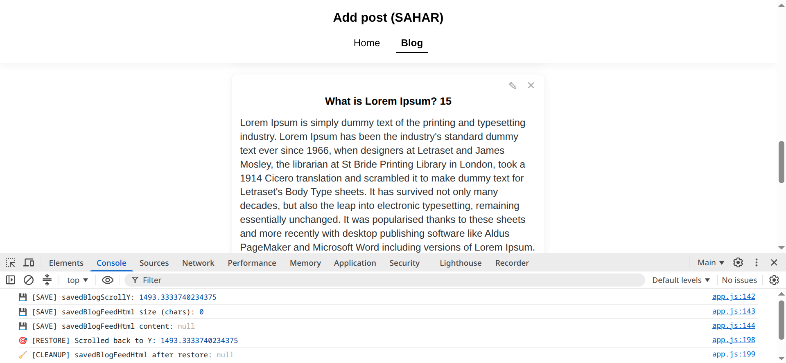

<strong>Screenshot 4: Navigating to the 15th post (upper part of the feed, ≤ 5 posts) and returning to the blog. Since Infinite Scroll has not been triggered yet, no DOM snapshot is created (0 bytes, null); only the scroll offset is saved and successfully restored upon return.</strong>

  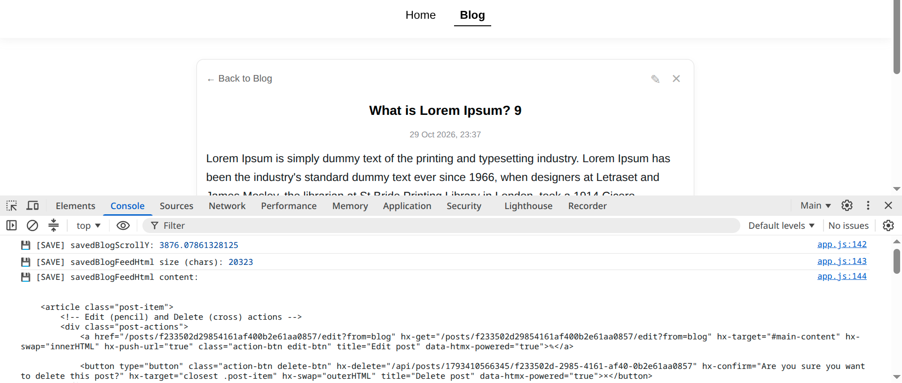

<strong>Screenshot 5: Navigating to the 9th post (deep scroll). The algorithm saves the coordinate (Y: 3738) and records the DOM snapshot size of the loaded feed (28,352 characters), preventing loss of loaded data.</strong>

  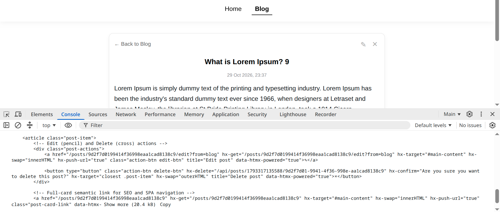

<strong>Screenshot 6: Inspecting the <code>savedBlogFeedHtml</code> variable. The console shows the semantic contents of the cache and its actual footprint in memory (28.4 kB).</strong> <em>(Captured on v1.0.0: starting with v1.1.0, HTMX attributes use the <code>data-</code> prefix and the delete route is simplified to <code>/api/posts/{id}</code>.)</em>

  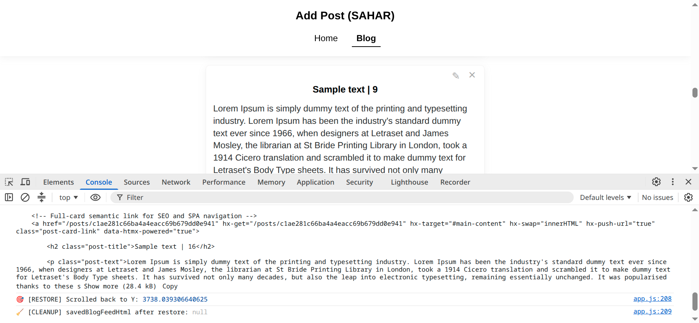

<strong>Screenshot 7: Returning back to the feed. Instantaneous pixel-accurate scroll restoration and forced nullification of the ephemeral cache (<code>🧹 [CLEANUP] savedBlogFeedHtml after restore: null</code>), completely freeing memory.</strong> <em>(Captured on v1.0.0: starting with v1.1.0, HTMX attributes use the <code>data-</code> prefix.)</em>

---

#### 2.5. ScyllaDB 3-Table Denormalized Architecture & Distributed Post Counter
To achieve **constant `O(1)` read and write speed** across all routes without using slow `ALLOW FILTERING` queries, a denormalized 3-table schema is implemented in the `sahar_prototype_add_post` keyspace:

1. **`post_counts`** — Stores the distributed `counter` (`scylla::value::Counter`) for instant display of the total number of posts (`Total posts`) on the Home page (`/`). Automatically synchronizes with the actual row count upon server startup via paginated `query_single_page` traversal (`page_size = 500`):

~~~sql
cqlsh:sahar_prototype_add_post> DESCRIBE TABLE post_counts;

CREATE TABLE sahar_prototype_add_post.post_counts (
    bucket int,
    total counter,
    PRIMARY KEY (bucket)
) WITH bloom_filter_fp_chance = 0.01
    AND caching = {'keys': 'ALL', 'rows_per_partition': 'ALL'}
    AND comment = ''
    AND compaction = {'class': 'IncrementalCompactionStrategy'}
    AND compression = {'sstable_compression': 'LZ4WithDictsCompressor'}
    AND crc_check_chance = 1
    AND default_time_to_live = 0
    AND gc_grace_seconds = 864000
    AND max_index_interval = 2048
    AND memtable_flush_period_in_ms = 0
    AND min_index_interval = 128
    AND speculative_retry = '99.0PERCENTILE'
    AND tombstone_gc = {'mode': 'repair', 'propagation_delay_in_seconds': '3600'};
~~~

2. **`posts`** — Stores the publication feed ordered by time at the clustering key level (`PRIMARY KEY (bucket, created_at, id) WITH CLUSTERING ORDER BY (created_at DESC, id ASC)`), providing `O(1)` feed retrieval for `/blog`:

~~~sql
cqlsh:sahar_prototype_add_post> DESCRIBE TABLE posts;

CREATE TABLE sahar_prototype_add_post.posts (
    bucket int,
    created_at timestamp,
    id uuid,
    content text,
    title text,
    PRIMARY KEY (bucket, created_at, id)
) WITH CLUSTERING ORDER BY (created_at DESC, id ASC)
    AND bloom_filter_fp_chance = 0.01
    AND caching = {'keys': 'ALL', 'rows_per_partition': 'ALL'}
    AND comment = ''
    AND compaction = {'class': 'IncrementalCompactionStrategy'}
    AND compression = {'sstable_compression': 'LZ4WithDictsCompressor'}
    AND crc_check_chance = 1
    AND default_time_to_live = 0
    AND gc_grace_seconds = 864000
    AND max_index_interval = 2048
    AND memtable_flush_period_in_ms = 0
    AND min_index_interval = 128
    AND speculative_retry = '99.0PERCENTILE'
    AND tombstone_gc = {'mode': 'repair', 'propagation_delay_in_seconds': '3600'};
~~~

3. **`posts_by_id`** — Stores posts with `id uuid PRIMARY KEY`, providing instant `O(1)` post lookup when opening the full post page (`/posts/{id}`), the edit page (`/posts/{id}/edit`), and resolving authoritative `bucket` / `created_at` keys for atomic LWT updates and deletions (`IF EXISTS`):

~~~sql
cqlsh:sahar_prototype_add_post> DESCRIBE TABLE posts_by_id;

CREATE TABLE sahar_prototype_add_post.posts_by_id (
    id uuid,
    bucket int,
    content text,
    created_at timestamp,
    title text,
    PRIMARY KEY (id)
) WITH bloom_filter_fp_chance = 0.01
    AND caching = {'keys': 'ALL', 'rows_per_partition': 'ALL'}
    AND comment = ''
    AND compaction = {'class': 'IncrementalCompactionStrategy'}
    AND compression = {'sstable_compression': 'LZ4WithDictsCompressor'}
    AND crc_check_chance = 1
    AND default_time_to_live = 0
    AND gc_grace_seconds = 864000
    AND max_index_interval = 2048
    AND memtable_flush_period_in_ms = 0
    AND min_index_interval = 128
    AND speculative_retry = '99.0PERCENTILE'
    AND tombstone_gc = {'mode': 'repair', 'propagation_delay_in_seconds': '3600'};
~~~

> **💡 Production Scaling Note (`bucket` Partitioning & Seastar Row Cache):**
> * **Time-Bucketing (`bucket int`):** The `posts` table schema is pre-designed with `bucket int` as the Partition Key. In this prototype, a fixed value of `bucket = 1` is used for simplicity. In a high-load production cluster, `bucket` is dynamically populated with a time-window integer (for example, `YYYYMM` or `YYYYMMDD`), which automatically splits the global feed into compact partitions (< 100 MB) and distributes the load evenly across all cluster nodes and CPU cores (shards) without changing the CQL table schema.
> * **Row-Granularity LRU Cache (`rows_per_partition: 'ALL'`):** Unlike legacy Apache Cassandra, the Seastar engine in ScyllaDB completely bypasses the Linux Page Cache and implements **row-granularity cache population and row-granularity LRU eviction (Row-Granularity Cache)**. The `caching = {'keys': 'ALL', 'rows_per_partition': 'ALL'}` setting does not load the entire partition into memory at once — it retains only the "hottest" recently queried feed rows in RAM, automatically evicting older historical records to `LZ4`-compressed SSTable files on disk.

---

#### 2.6. Automatic Database Schema Initialization
For out-of-the-box prototype reproducibility (Zero-Config Reproducibility), the `src/db.rs` module automatically creates the `sahar_prototype_add_post` keyspace and required tables upon application startup before switching the active session:

~~~rust
    // 1. Establish connection to the local ScyllaDB node
    let scylla_uri =
        std::env::var("SCYLLA_URI").unwrap_or_else(|_| "127.0.0.1:9042".to_string());
    let session = SessionBuilder::new()
        .known_node(scylla_uri)
        .connection_timeout(Duration::from_secs(5))
        .build()
        .await
        .expect("Failed to connect to ScyllaDB");

    // 2. Automatically create the keyspace and tables if they do not exist yet.

    // NOTE (Best Practice & Security):
    // Auto-initialization is enabled here for zero-config prototype reproducibility.
    // In a production environment, DDL schema migrations (CREATE/ALTER/DROP) must be
    // executed separately via a dedicated migration tool, and the web server must
    // connect using a restricted DB role (SELECT/MODIFY only — Principle of Least Privilege).
    initialize_schema(&session).await;

    // 3. Switch the active session to the newly created (or existing) keyspace
    session
        .use_keyspace("sahar_prototype_add_post", false)
        .await
        .expect("Failed to select keyspace");
~~~

---

#### 2.7. Full CRUD Cycle & Smart Form UX
* **Create Post (`/`):** Supports an optional `Title` (up to 150 characters) and a required `* Text` field (up to 3,000 characters). The `Add` button is hidden by default and appears only when text is entered into the required `* Text` field. Duplicate concurrent submissions are dropped natively in HTMX 4 via `data-hx-sync="this:drop"` and `data-hx-disable="find button[type='submit']"`. Writes into `posts` and `posts_by_id` execute atomically via a native ScyllaDB `BatchType::Logged`. Upon success, the form is automatically cleared, the `Total posts` counter increments by one, and a Toast notification pops up via `data-hx-swap-oob` (`templates/toast.html`). On validation errors (`400`) or database outages (`503`), the server responds with `HX-Reswap: none` and an error toast so the user's typed text is preserved.
* **Flexible Title & Text Length Configuration in Previews and Full Posts:**
  * **Post Preview Size in the Feed (`/blog`):** In the ScyllaDB database, a post is always stored in full; however, for compact display of `<article class="post-item">` cards in the `/blog` feed, the length of the displayed title and text is configured in **`src/handlers.rs`** (inside the `render_blog_feed_html` function) using `truncate()` from **`src/security.rs`**:

~~~rust
title: truncate(&title, 100),   // Maximum 100 characters for the title in the feed preview
content: truncate(&content, 730), // Maximum 730 characters for the text in the feed preview
~~~

  If the title or text exceeds the specified values, it is cleanly truncated in the feed preview with an ellipsis (`...`), while navigating to the full post page (`/posts/{id}`) or edit page (`/posts/{id}/edit`) displays the content in full.
  * **Maximum Full Post Size:** Configured synchronously across three layers — in the **`templates/home.html`** and **`templates/post_edit.html`** HTML templates (`maxlength="150"` and `maxlength="3000"`), on the server in **`src/handlers.rs`** + **`src/security.rs`** (`sanitize_text_input` enforcing `150` and `3000` Unicode scalar limits), and via the form payload limit in **`src/main.rs`** (`web::FormConfig::default().limit(65536)`).
* **Edit Post (`/posts/{id}/edit`) & Zero-State Reactive Reset:**
  Accessible by clicking the pencil icon (`✎`) on both the preview card in the feed (`/blog`) and inside the full post (`/posts/{id}`). Tracking form modifications and rolling back changes requires no client-side state managers, state hooks, or in-memory JSON caching—instead, a native **DOM Dataset pattern** is used (`templates/post_edit.html` + `static/app.js`):
  * During server-side rendering of **`templates/post_edit.html`**, Askama stamps the reference database values from ScyllaDB directly into native HTML5 `data-original` attributes on the form inputs:

~~~html
<input type="text" id="edit-title" name="title" value="{{ post.title }}" data-original="{{ post.title }}" ...>
<textarea id="edit-content" name="content" data-original="{{ post.content }}" ...>{{ post.content }}</textarea>
~~~

  * The interface features a context-aware **`Back, Cancel, Publish`** button bar:
    * **`Back`** is always visible and returns the user to the exact page from which they entered the edit view (back to the `/blog` feed or to the full post `/posts/{id}`).
    * **`Cancel`** and **`Publish`** are hidden by default and appear dynamically only when the current `.value` differs from the reference string in `.dataset.original` (evaluated in `static/app.js` with zero DOM re-renders).
    * Clicking **`Cancel`** invokes `resetEditFormToOriginal()`, which instantaneously restores the original title and post text directly from `dataset.original` without making an extra network request to the server or database, and automatically hides the `Cancel` and `Publish` buttons:

~~~javascript
function resetEditFormToOriginal() {
    const editTitle = document.getElementById('edit-title');
    const editContent = document.getElementById('edit-content');
    if (!editTitle || !editContent) return;

    editTitle.value = editTitle.dataset.original || '';
    editContent.value = editContent.dataset.original || '';
    updateEditButtons();
}
~~~
  * Saving executes LWT (`IF EXISTS`) updates across both `posts_by_id` and `posts`, while `400`/`404`/`503` failures preserve the user's edited text in the form via `HX-Reswap: none`.
* **Delete Post (`×`):** Resolves authoritative `bucket` and `created_at` directly from ScyllaDB (`posts_by_id`), atomically claims deletion via ScyllaDB Lightweight Transactions (`IF EXISTS`) across both tables (with an `IF NOT EXISTS` compensating LWT rollback on network failure), decrements `post_counts` safely (never below zero), and removes the card in `/blog` only upon confirmed `2xx`/`404` HTTP status inside `htmx:finally:request` (`data-hx-swap="none"`) or redirects back to `/blog` with a deletion toast notification (if triggered from `/posts/{id}`).

  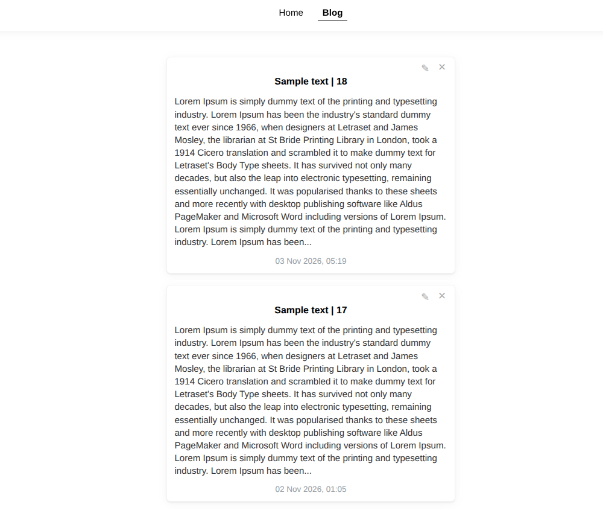

<strong>Screenshot 8: Blog Feed</strong>

  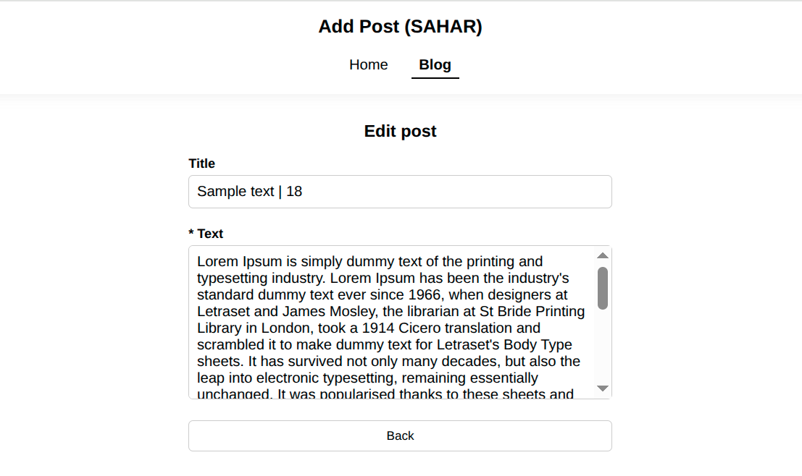

<strong>Screenshot 9: Post Editing Interface</strong>

---

#### 2.8. Hardened Cybersecurity Architecture
The prototype is engineered in strict accordance with cybersecurity best practices to eliminate the possibility of website compromise or system intrusion (mechanisms are ordered from the most critical architectural barriers to auxiliary defense layers):

#### 1. CQL Injection Immunity, TOCTOU Race Protection & Atomic Cross-Table Integrity (`src/db.rs`, `src/handlers.rs`)
* **100% CQL Injection Immunity:** All user database queries execute exclusively through pre-compiled `PreparedStatement` expressions of the ScyllaDB driver (initialized at startup in `src/db.rs` and invoked in `src/handlers.rs`). User data is transmitted separately from the query body over the binary CQL protocol.
* **Atomic Writes via `BatchType::Logged` (`create_post`):** Inserts into both denormalized tables (`posts` and `posts_by_id`) use a pre-built `Logged Batch` inside `AppState` — the ScyllaDB coordinator guarantees delivery to both tables via its `batchlog` even if the web server process crashes mid-request.
* **Dual-Table LWT (`IF EXISTS` / `IF NOT EXISTS`) Against Zombie Posts & Races:** In CQL, a standard `UPDATE` acts as an `UPSERT` and could resurrect a deleted row (or create a corrupted `bucket = NULL, created_at = NULL` row in `posts_by_id`) under concurrent deletes. Therefore, `IF EXISTS` is enforced on **both** tables for both updates (`stmt_update_post_by_id`, `stmt_update_post`) and deletes (`stmt_delete_post_by_id`, `stmt_delete_post`), while the compensating rollback in `delete_post` also executes via Paxos (`stmt_restore_post_by_id` with `IF NOT EXISTS`). This eliminates LWT/non-LWT timestamp mixing, client timestamp tampering, ghost posts, and counter double-decrements.

#### 2. Uncompromising Content Security Policy — CSP (`src/main.rs`)
At the HTTP server middleware level in `src/main.rs`, a strict `Content-Security-Policy` is enforced: `default-src 'self'; script-src 'self'; style-src 'self'; img-src 'self'; connect-src 'self'; object-src 'none'; base-uri 'none'; form-action 'self'; frame-ancestors 'none';` — completely prohibiting `'unsafe-inline'`, `'unsafe-eval'`, `<object>`/`<embed>`, `<base>` hijacking, external form targets, and framing. Because there are no inline hydration scripts in the SAHAR architecture, the server spends zero CPU generating per-request `nonce` keys, and **HTMX 4.0.0** loads indicator styles through Constructable Stylesheets (`document.adoptedStyleSheets`), complying with `style-src 'self'` natively without non-standard `<meta>` tags.

#### 3. Multi-Tier XSS, HTMX-Injection & BiDi Protection (`templates/*.html`, `src/security.rs`, `static/style.css`)
* **Compile-Time Template Auto-Escaping (`templates/*.html`):** Askama automatically escapes all user variables (`{{ post.title }}`, `{{ post.content }}`) at Rust compile time. The `|safe` filter is used exclusively for server-rendered and already-escaped sub-templates (`base.html`, `blog.html`). Multi-line text formatting is preserved safely via CSS (`white-space: pre-wrap`) without unescaped ` ` tags.
* **HTMX-Injection & BiDi Isolation (`templates/post_items.html`, `templates/post_detail.html`):** User-rendered titles and bodies carry HTMX 4's native `data-hx-ignore` attribute (blinding HTMX to any `hx-*` / `data-hx-*` attributes inside user text blocks even if rich HTML were ever enabled) and `dir="auto"` to isolate RTL/BiDi text directions.
* **Dynamic `<title>` Protection (`src/security.rs`):** `html_escape_title()` sanitizes `&`, `<`, `>`, `"`, and `'` inside dynamic `<title>` tags during partial HTMX transitions.

#### 4. Fail-Fast Config & Fail-Closed Anti-CSRF (`src/main.rs`, `src/security.rs`, `src/handlers.rs`)
* **Fail-Fast Startup Validation (`security::init_security_config()`):** Invoked in `main()` before starting `HttpServer`: warms the `OnceLock` cache, normalizes `ALLOWED_ORIGINS` to lowercase, and halts startup immediately on misconfiguration (invalid scheme or unexpected paths `/...`, queries, or `@` in `ALLOWED_ORIGINS` or `CANONICAL_BASE_URL`).
* **Fail-Closed Anti-CSRF (`validate_origin()`):** Invoked prior to every mutating handler (`POST` / `DELETE`). Any `Sec-Fetch-Site`, `Origin`, or `Referer` header containing invalid non-ASCII bytes (`0xFF`) is rejected immediately with `403 Forbidden` (no silent bypass). Enforces strict `Sec-Fetch-Site: same-origin` (blocking third-party sites and sibling subdomains), checks `Origin` with strict priority (blocking `Origin: null` from sandboxed iframes without falling back to `Referer`), and verifies `Referer` strictly along RFC 3986 authority boundaries (`/`, `?`, `#`) when `Origin` is absent.

#### 5. Single-Pass Input Sanitization & Defense against DoS, Slowloris, Floods & Double-Submits (`src/main.rs`, `src/security.rs`, `templates/*.html`)
* **Server Timeouts & Payload Limits (`src/main.rs`):** `HttpServer` enforces `client_request_timeout(5s)` and `keep_alive(30s)` against Slowloris attacks, while `web::FormConfig::default().limit(65536)` (64 KB) drops oversized spam payloads.
* **Single-Pass `sanitize_text_input()` (`src/security.rs`):** Runs in a single pass with zero intermediate `.replace()` allocations: normalizes `\r\n`, `\r`, `\u{2028}`, and `\u{2029}` to `\n`; strips null bytes (`\0`), control characters (`Log/Terminal Injection`), invisible spaces/BOM (`\u{200B}`, `\u{2060}`, `\u{FEFF}`), and all BiDi-override characters (`\u{061C}`, `\u{200E}`, `\u{200F}`, `\u{202A}..=\u{202E}`, `\u{2066}..=\u{2069}`) while **preserving** `\u{200D}` (ZWJ) and `\u{200C}` (ZWNJ) so compound emojis (`👨‍💻`, `❤️‍🔥`) never break apart; trims trailing horizontal blank characters via `is_inline_blank` (including `\u{2800}`, `\u{3164}`, `\u{FFA0}`) before `\n`, blocking blank-line floods (`"\n \n\u{2800}\n"`) while keeping `\n\n` paragraphs.
* **UTF-8 Panic Immunity & Double-Submit Protection (`src/security.rs`, `templates/*.html`):** Unicode scalar `.chars()` iteration eliminates `panic` on multi-byte boundaries and emojis, while `maxlength="150"` / `maxlength="3000"` paired with `data-hx-sync="this:drop"` and `data-hx-disable` prevent duplicate concurrent requests.

#### 6. Zero Internal Error Leakage (CWE-209) & Honest DB Outage Handling (`src/main.rs`, `src/db.rs`, `src/security.rs`, `src/handlers.rs`)
* **Extractor Error Interceptors (`src/main.rs`):** Custom `.error_handler(...)` hooks on `FormConfig`, `QueryConfig`, and `PathConfig` intercept malformed payloads, query strings, and path parameters before entering handlers: technical Rust/Serde diagnostics go strictly to `stderr`, while clients receive a generic `"Bad Request"`.
* **Template, CSRF & DB Error Isolation (`src/security.rs`, `src/handlers.rs`):** `internal_error()` and `validate_origin()` log full details strictly to server `stderr` (`eprintln!`) and return generic `"Internal Server Error"` / `"Forbidden"` responses. `PostLookup` and `get_total_posts() -> Option<i64>` cleanly separate missing records (`404`) from ScyllaDB outages (`503 Service Unavailable` with `Retry-After: 5`), while form errors return `toast_error_response` with `HX-Reswap: none`, keeping the user's input intact.

#### 7. Network Perimeter, Permissions, Cache Isolation & Security Headers (`src/main.rs`, `src/security.rs`)
* **Clickjacking:** `X-Frame-Options: DENY` and CSP `frame-ancestors 'none'`.
* **MIME-Sniffing & Charset Attacks:** `X-Content-Type-Options: nosniff` + explicit `text/html; charset=utf-8`.
* **Browser APIs & Cross-Origin Isolation:** `Permissions-Policy: geolocation=(), microphone=(), camera=(), payment=(), usb=(), interest-cohort=()`, `Cross-Origin-Opener-Policy: same-origin`, `Cross-Origin-Resource-Policy: same-origin`, `X-Permitted-Cross-Domain-Policies: none`.
* **Transport, Cache & SEO Protection:** `Strict-Transport-Security` (HSTS), `Referrer-Policy: strict-origin-when-cross-origin`, `Cache-Control: no-store, no-cache, must-revalidate`, `Vary: HX-Request, HX-Request-Type, HX-History-Restore-Request` (isolating partial HTMX fragments from full SSR pages), and `noindex, nofollow` without `canonical` on `404` and `/posts/{id}/edit`.

<strong>main.rs (security section)</strong>

~~~rust
    // Fail-Fast validation of runtime origin & canonical URL config before binding sockets
    security::init_security_config();
~~~

~~~rust
            .app_data(app_state.clone())
            // DoS, Memory Exhaustion & CWE-209 Protection:
            // Strictly limits incoming form payloads to 64 KB and suppresses raw Rust/Serde parser errors.
            .app_data(
                web::FormConfig::default()
                    .limit(65536)
                    .error_handler(|err, _req| {
                        eprintln!("⚠️ [FORM ERROR]: {err}");
                        actix_web::error::InternalError::from_response(
                            err,
                            HttpResponse::BadRequest().body("Bad Request"),
                        )
                        .into()
                    }),
            )
            .app_data(
                web::QueryConfig::default().error_handler(|err, _req| {
                    eprintln!("⚠️ [QUERY ERROR]: {err}");
                    actix_web::error::InternalError::from_response(
                        err,
                        HttpResponse::BadRequest().body("Bad Request"),
                    )
                    .into()
                }),
            )
            .app_data(
                web::PathConfig::default().error_handler(|err, _req| {
                    eprintln!("⚠️ [PATH ERROR]: {err}");
                    actix_web::error::InternalError::from_response(
                        err,
                        HttpResponse::BadRequest().body("Bad Request"),
                    )
                    .into()
                }),
            )
            // Strict HTTP Security Headers Middleware (Zero 'unsafe-inline' tolerance)
            .wrap(
                middleware::DefaultHeaders::new()
                    .add(("X-Frame-Options", "DENY"))
                    .add(("X-Content-Type-Options", "nosniff"))
                    .add((
                        "Content-Security-Policy",
                        "default-src 'self'; script-src 'self'; style-src 'self'; img-src 'self'; connect-src 'self'; object-src 'none'; base-uri 'none'; form-action 'self'; frame-ancestors 'none';",
                    ))
                    .add((
                        "Strict-Transport-Security",
                        "max-age=31536000; includeSubDomains; preload",
                    ))
                    .add(("Referrer-Policy", "strict-origin-when-cross-origin"))
                    .add((
                        "Permissions-Policy",
                        "geolocation=(), microphone=(), camera=(), payment=(), usb=(), interest-cohort=()",
                    ))
                    .add(("Cross-Origin-Opener-Policy", "same-origin"))
                    .add(("Cross-Origin-Resource-Policy", "same-origin"))
                    .add(("X-Permitted-Cross-Domain-Policies", "none")),
            )
~~~

 

<strong>security.rs</strong>

~~~rust
use crate::models::{BaseTemplate, PostDetailTemplate};
use actix_web::{error, Error, HttpRequest, HttpResponse};
use askama::Template;
use std::fmt::Display;
use std::sync::OnceLock;

static ALLOWED_ORIGINS: OnceLock<Vec<String>> = OnceLock::new();
static CANONICAL_BASE_URL: OnceLock<String> = OnceLock::new();

pub const VARY_HTMX_HEADERS: &str = "HX-Request, HX-Request-Type, HX-History-Restore-Request";

// CWE-209 & OWASP A09 Mitigation:
// Logs internal error details strictly to server stderr and returns a generic error to the client.
pub fn internal_error<E: Display>(context: &str, err: E) -> Error {
    eprintln!("❌ [{context}]: {err}");
    error::ErrorInternalServerError("Internal Server Error")
}

pub fn service_unavailable_response() -> HttpResponse {
    HttpResponse::ServiceUnavailable()
        .content_type("text/plain; charset=utf-8")
        .insert_header(("Retry-After", "5"))
        .insert_header(("Cache-Control", "no-store, no-cache, must-revalidate"))
        .body("Service Unavailable")
}

// Allowlist of trusted Origins for Cross-Site Request Forgery (CSRF) protection.
// Reads `ALLOWED_ORIGINS` (comma-separated) from env or falls back to local prototype origins.
fn allowed_origins() -> &'static [String] {
    ALLOWED_ORIGINS.get_or_init(|| {
        if let Ok(raw) = std::env::var("ALLOWED_ORIGINS") {
            let parsed: Vec<String> = raw
                .split(',')
                .map(|s| s.trim().trim_end_matches('/').to_ascii_lowercase())
                .filter(|s| !s.is_empty())
                .collect();
            if !parsed.is_empty() {
                return parsed;
            }
        }
        vec![
            "http://127.0.0.1:8080".to_string(),
            "http://localhost:8080".to_string(),
        ]
    })
}

pub fn canonical_base_url() -> &'static str {
    CANONICAL_BASE_URL.get_or_init(|| {
        std::env::var("CANONICAL_BASE_URL")
            .ok()
            .map(|s| s.trim().trim_end_matches('/').to_string())
            .filter(|s| !s.is_empty())
            .unwrap_or_else(|| "http://127.0.0.1:8080".to_string())
    })
}

fn validate_base_origin(value: &str) -> bool {
    let authority = value
        .strip_prefix("http://")
        .or_else(|| value.strip_prefix("https://"))
        .unwrap_or("");
    !authority.is_empty() && !authority.contains(['/', '?', '#', '@', ' '])
}

// Fail-Fast startup warmup & strict validation of runtime security config
pub fn init_security_config() {
    let base = canonical_base_url();
    assert!(
        validate_base_origin(base),
        "Invalid CANONICAL_BASE_URL '{base}': must be exact scheme://host[:port] with no path, query, or fragment"
    );

    for origin in allowed_origins() {
        assert!(
            validate_base_origin(origin),
            "Invalid ALLOWED_ORIGINS entry '{origin}': must be exact scheme://host[:port] with no path or query"
        );
    }
}

// Fail-Closed Anti-CSRF (Cross-Site Request Forgery) Validation:
// Invoked on all state-mutating endpoints (POST / DELETE).
// Rejects malformed non-ASCII headers immediately (fail-closed), enforces `Sec-Fetch-Site: same-origin`
// (when provided), checks `Origin` with strict priority (blocking `Origin: null` and foreign origins),
// and validates `Referer` strictly along RFC 3986 authority boundaries when `Origin` is absent.
pub fn validate_origin(req: &HttpRequest) -> Result<(), Error> {
    if let Some(raw_fetch_site) = req.headers().get("Sec-Fetch-Site") {
        let Ok(fetch_site) = raw_fetch_site.to_str() else {
            eprintln!("🛡️ [CSRF BLOCKED] Malformed non-ASCII Sec-Fetch-Site header");
            return Err(error::ErrorForbidden("Forbidden"));
        };
        if fetch_site != "same-origin" {
            eprintln!("🛡️ [CSRF BLOCKED] Invalid Sec-Fetch-Site: {fetch_site:?}");
            return Err(error::ErrorForbidden("Forbidden"));
        }
    }

    let origins = allowed_origins();

    if let Some(raw_origin) = req.headers().get("Origin") {
        let Ok(origin) = raw_origin.to_str() else {
            eprintln!("🛡️ [CSRF BLOCKED] Malformed non-ASCII Origin header");
            return Err(error::ErrorForbidden("Forbidden"));
        };
        let normalized_origin = origin.to_ascii_lowercase();
        if !origins.iter().any(|allowed| allowed == &normalized_origin) {
            eprintln!("🛡️ [CSRF BLOCKED] Untrusted Origin: {origin:?}");
            return Err(error::ErrorForbidden("Forbidden"));
        }
        return Ok(());
    }

    let Some(raw_referer) = req.headers().get("Referer") else {
        eprintln!("🛡️ [CSRF BLOCKED] Missing both Origin and Referer headers");
        return Err(error::ErrorForbidden("Forbidden"));
    };
    let Ok(referer) = raw_referer.to_str() else {
        eprintln!("🛡️ [CSRF BLOCKED] Malformed non-ASCII Referer header");
        return Err(error::ErrorForbidden("Forbidden"));
    };

    let referer_lower = referer.to_ascii_lowercase();
    let is_valid_referer = origins.iter().any(|allowed| {
        referer_lower == *allowed
            || referer_lower.strip_prefix(allowed.as_str()).is_some_and(|rest| {
                rest.starts_with('/') || rest.starts_with('?') || rest.starts_with('#')
            })
    });

    if !is_valid_referer {
        eprintln!("🛡️ [CSRF BLOCKED] Missing Origin and untrusted Referer: {referer:?}");
        return Err(error::ErrorForbidden("Forbidden"));
    }

    Ok(())
}

fn is_stripped_unicode(ch: char) -> bool {
    matches!(
        ch,
        '\0'
            | '\u{061C}' // Arabic Letter Mark
            | '\u{200B}' // Zero-Width Space (preserves \u{200C} ZWNJ and \u{200D} ZWJ for compound emojis!)
            | '\u{200E}'
            | '\u{200F}' // LRM / RLM
            | '\u{202A}'..='\u{202E}' // BiDi embedding & override
            | '\u{2060}' // Word Joiner
            | '\u{2066}'..='\u{2069}' // BiDi isolates
            | '\u{FEFF}' // BOM / Zero-Width No-Break Space
    )
}

fn is_edge_blank(ch: char) -> bool {
    ch.is_whitespace()
        || matches!(
            ch,
            '\u{2800}' | '\u{3164}' | '\u{FFA0}' | '\u{115F}' | '\u{1160}'
        )
}

fn is_inline_blank(ch: char) -> bool {
    ch != '\n' && is_edge_blank(ch)
}

// Single-Pass Input Sanitization, CRLF Normalization & Blank-Line Flood Protection:
// Strips null bytes, control chars, and dangerous BiDi/zero-width overrides while preserving ZWJ
// compound emojis, normalizes CRLF/CR/\u{2028}/\u{2029} -> LF, collapses blank-line floods
// (even with spaces/tabs/blank chars via `is_inline_blank`), and truncates safely by Unicode scalars.
pub fn sanitize_text_input(input: &str, max_chars: usize, allow_newlines: bool) -> String {
    let mut cleaned = String::with_capacity(input.len().min(max_chars * 4));
    let mut consecutive_newlines: usize = 0;
    let mut chars = input.chars().peekable();

    while let Some(ch) = chars.next() {
        if ch == '\r' || ch == '\n' || ch == '\u{2028}' || ch == '\u{2029}' {
            if ch == '\r' && chars.peek() == Some(&'\n') {
                chars.next();
            }
            if allow_newlines {
                while let Some(last) = cleaned.chars().next_back()
                    && is_inline_blank(last)
                {
                    cleaned.pop();
                }
                if !cleaned.is_empty() {
                    consecutive_newlines += 1;
                    if consecutive_newlines <= 2 {
                        cleaned.push('\n');
                    }
                }
            } else if !cleaned.is_empty() && !cleaned.ends_with(' ') {
                cleaned.push(' ');
            }
            continue;
        }

        if ch == '\t' {
            if allow_newlines {
                cleaned.push('\t');
            } else if !cleaned.is_empty() && !cleaned.ends_with(' ') {
                cleaned.push(' ');
            }
            continue;
        }

        if is_stripped_unicode(ch) || ch.is_control() {
            continue;
        }

        if !is_edge_blank(ch) {
            consecutive_newlines = 0;
        }
        cleaned.push(ch);
    }

    let trimmed = cleaned.trim_matches(is_edge_blank);
    trimmed
        .chars()
        .take(max_chars)
        .collect::<String>()
        .trim_end_matches(is_edge_blank)
        .to_string()
}

// Safe HTMX 4 Header Inspection:
// Returns true ONLY when HTMX expects a partial HTML fragment.
// On browser Back/Forward navigation, HTMX 4 sends `hx-history-restore-request: true`
// (or `hx-request-type: full`) and expects the full page containing `<main data-hx-history-elt>`.
pub fn is_htmx_partial_request(req: &HttpRequest) -> bool {
    let is_htmx =
        req.headers().contains_key("hx-request") || req.headers().contains_key("hx-request-type");
    let is_history_restore = req.headers().contains_key("hx-history-restore-request");
    let is_full_request = req
        .headers()
        .get("hx-request-type")
        .and_then(|v| v.to_str().ok())
        .is_some_and(|v| v == "full");

    is_htmx && !is_history_restore && !is_full_request
}

// Memory-Safe UTF-8 Character Truncation:
// Iterates over Unicode scalar values (`.chars()`) rather than raw byte slices,
// preventing server panics on multi-byte UTF-8 character boundaries and emojis.
pub fn truncate(s: &str, max: usize) -> String {
    let s = s.trim();
    if s.chars().count() > max {
        let mut truncated = s.chars().take(max).collect::<String>().trim_end().to_string();
        truncated.push_str("...");
        truncated
    } else {
        s.to_string()
    }
}

// Anti-XSS Escaping for Dynamic <title> Tags in HTMX Partial Responses:
// Since partial HTMX responses prepend `<title>` outside `BaseTemplate`, this function
// sanitizes HTML control characters (&, <, >, ", ') to prevent tag injection and XSS.
pub fn html_escape_title(s: &str) -> String {
    s.replace('&', "&amp;")
        .replace('<', "&lt;")
        .replace('>', "&gt;")
        .replace('"', "&quot;")
        .replace('\'', "&#x27;")
}

// Secure SSR & Partial HTML Renderer:
// Explicitly enforces `charset=utf-8` (mitigating charset-sniffing XSS), sets
// `Cache-Control: no-store, no-cache, must-revalidate`, and isolates HTMX vs full-page caches via `Vary`.
pub fn render_page(
    req: &HttpRequest,
    partial: String,
    path: &str,
    page_title: &str,
    page_description: &str,
    noindex: bool,
) -> Result<HttpResponse, Error> {
    if is_htmx_partial_request(req) {
        let safe_title = html_escape_title(page_title);
        Ok(HttpResponse::Ok()
            .content_type("text/html; charset=utf-8")
            .insert_header(("Cache-Control", "no-store, no-cache, must-revalidate"))
            .insert_header(("Vary", VARY_HTMX_HEADERS))
            .body(format!("<title>{safe_title}</title>\n{partial}")))
    } else {
        let base = BaseTemplate {
            page_title: page_title.to_string(),
            page_description: page_description.to_string(),
            content_html: partial,
            current_path: path.to_string(),
            canonical_base_url: canonical_base_url().to_string(),
            noindex,
        };
        let body = base
            .render()
            .map_err(|e| internal_error("TEMPLATE base", e))?;
        Ok(HttpResponse::Ok()
            .content_type("text/html; charset=utf-8")
            .insert_header(("Cache-Control", "no-store, no-cache, must-revalidate"))
            .insert_header(("Vary", VARY_HTMX_HEADERS))
            .body(body))
    }
}

// Safe 404 Not Found Renderer:
// Returns a genuine HTTP 404 status code without leaking internal database details or stack traces,
// and suppresses canonical/index signals so arbitrary invalid URLs are never indexed.
pub fn render_not_found(req: &HttpRequest, current_path: &str) -> Result<HttpResponse, Error> {
    let partial = PostDetailTemplate { post: None }
        .render()
        .map_err(|e| internal_error("TEMPLATE post_detail 404", e))?;
    let page_title = "Post not found — Add Post (SAHAR)";

    if is_htmx_partial_request(req) {
        let safe_title = html_escape_title(page_title);
        Ok(HttpResponse::NotFound()
            .content_type("text/html; charset=utf-8")
            .insert_header(("Cache-Control", "no-store, no-cache, must-revalidate"))
            .insert_header(("Vary", VARY_HTMX_HEADERS))
            .body(format!("<title>{safe_title}</title>\n{partial}")))
    } else {
        let base = BaseTemplate {
            page_title: page_title.to_string(),
            page_description: "The requested post was not found.".to_string(),
            content_html: partial,
            current_path: current_path.to_string(),
            canonical_base_url: canonical_base_url().to_string(),
            noindex: true,
        };
        let body = base
            .render()
            .map_err(|e| internal_error("TEMPLATE base 404", e))?;
        Ok(HttpResponse::NotFound()
            .content_type("text/html; charset=utf-8")
            .insert_header(("Cache-Control", "no-store, no-cache, must-revalidate"))
            .insert_header(("Vary", VARY_HTMX_HEADERS))
            .body(body))
    }
}
~~~

---

#### 2.9. Informative Server Logging
Upon startup, the system outputs a clear status report to the terminal indicating ScyllaDB schema readiness and web server launch:

    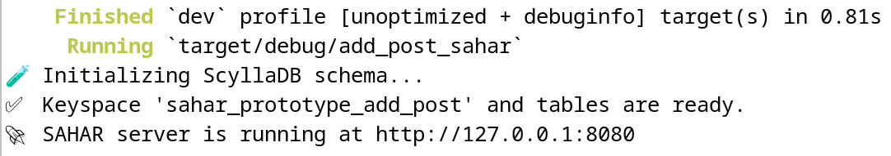

<strong>Screenshot 10: ScyllaDB readiness and server startup log</strong>

---

### 3. Installation & Setup

**Compatibility Note:** This project is verified to work on Debian 12. Development on Windows is not recommended. A Linux-based environment is required for correct operation.

**3.1. Environment Preparation (Debian 12 and similar)** 

Installing system dependencies:

~~~bash
sudo apt update && sudo apt install build-essential pkg-config libssl-dev -y
~~~

**3.2. Installing Rust**

**3.2.1. Install Rust (installs the current stable version):**

~~~bash
curl --proto '=https' --tlsv1.2 -sSf https://sh.rustup.rs | sh
~~~

**3.2.2. Configure environment variables:**

~~~bash
source $HOME/.cargo/env
~~~

**3.3. ScyllaDB Installation and Configuration**

Installation is performed directly on the Debian 12 system using the official ScyllaDB repository.

**3.3.1. Update package indexes:**

~~~bash
sudo apt-get update
~~~

**3.3.2. Install necessary system utilities:**

~~~bash
sudo apt-get install -y apt-transport-https curl gnupg
~~~

**3.3.3. Add the official ScyllaDB repository to the system:**

>📌 By default, this script automatically registers the repository for the latest stable version of ScyllaDB Open Source. To explicitly install ScyllaDB v2026.2.6 used in this prototype, run the command with the version flag:

~~~bash
curl -sSf https://get.scylladb.com/server | sudo bash -s -- --scylla-version 2026.2
~~~

**3.3.4. Interactive configuration and ScyllaDB installation:**

~~~bash
sudo scylla_setup
~~~

**3.3.5. Start the ScyllaDB server service:**

~~~bash
sudo systemctl start scylla-server
~~~

**3.3.6. Check the status of cluster nodes:**

~~~bash
nodetool status
~~~

---

### 4. Database Preparation

Thanks to the built-in `initialize_schema` function in `src/db.rs`, the **`sahar_prototype_add_post`** keyspace and all three tables (`posts`, `posts_by_id`, and `post_counts`) are **created automatically** upon the first launch of the application.

If you wish to create or inspect the Keyspace manually prior to launch, open the database console:

~~~bash
cqlsh
~~~

and execute the query:

~~~sql
CREATE KEYSPACE IF NOT EXISTS sahar_prototype_add_post
WITH REPLICATION = {'class': 'NetworkTopologyStrategy', 'replication_factor': 1};
~~~

---

### 5. Launching the project

**5.1. Cloning the project repository:**

~~~bash
git clone https://github.com/AndrewShedov/add-post--SAHAR && cd add-post--SAHAR/main
~~~

**5.2. Launch the project:**

~~~bash
cargo run
~~~

> *Optional: to verify strict code quality and zero warnings before running, use `cargo clippy -- -D warnings`.*

Once the build is complete, the application will be available at:

`http://127.0.0.1:8080`

By default, ScyllaDB is configured to work with the address `127.0.0.1:9042`. 
You can verify the connection by entering the command into the terminal:

~~~bash
cqlsh
~~~

After entering the command, the connection address should be displayed: 
<code>Connected to at 127.0.0.1:9042</code>

**5.3. Optional Environment Configuration (for production domains without recompiling):**

All settings fall back to safe local defaults automatically and can be overridden via environment variables:
* `BIND_ADDR` (default: `127.0.0.1:8080`) and `SCYLLA_URI` (default: `127.0.0.1:9042`) — read once at process startup;
* `CANONICAL_BASE_URL` (default: `http://127.0.0.1:8080`) and `ALLOWED_ORIGINS` (comma-separated, default: `http://127.0.0.1:8080,http://localhost:8080`) — cached in `std::sync::OnceLock` and Fail-Fast validated at startup via `security::init_security_config()`.

 

    

<strong>SAHAR is a transliteration of the Russian word 'САХАР', meaning 'sugar'</strong>

  

 
 

       