&nbsp;&nbsp;

# Add Post (SAHAR)

 

### ***Developed with Gemini 4 Argon ✨***

> **Research Article:**  
> [💎 CRYSTAL Developer’s Diary #3: A Comparative Study of Performance and Cybersecurity of Client-Server Interaction in the LARS and SAHAR Technology Stacks](https://shedov.top/crystal-dev-diary-3-comparative-study-lars-and-sahar/)

This application is a multi-page prototype developed as part of the search for a new high-performance and cybersecure technology stack for the [CRYSTAL v3.0](https://github.com/CrystalSystems) social network. 
Expanding upon the concept of the [basic CRUD prototype](https://github.com/AndrewShedov/enter-text--SAHAR), this application demonstrates a complete publication lifecycle with the **ScyllaDB** database: 
 1. Creating posts.
 2. Live distributed post counter.
 3. Browsing the post feed with Infinite Scroll powered by cursor-based pagination.
 4. Dedicated full post page (`/posts/{id}`).
 5. Editing posts (`/posts/{id}/edit`).
 6. Deleting posts.
 7. Toast notifications for post operations.

By utilizing **Askama** compile-time templates and **HTMX 4.0.0**, the application combines **Server-Side Rendering (SSR)** with **smooth SPA navigation without page reloads**, guaranteeing **excellent search engine indexing**, benchmark **SEO** performance (including Infinite Scroll indexing), and maximum resistance to vulnerabilities.

  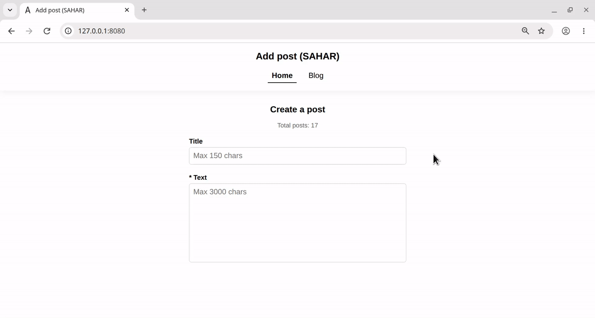

<strong>GIF 1: Creating a post, Infinite Scroll, and Back button navigation</strong>

  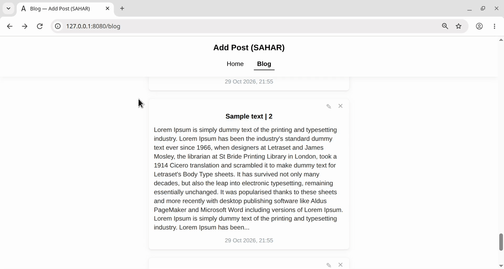

<strong>GIF 2: Editing and deleting a post</strong>

 

<strong>Full demonstration of the prototype's features</strong>

 

**Contents:** 
1. [Project structure and local PC specifications](#paragraph_1)
2. [Key Features & Architecture](#paragraph_2)
   - [2.1. Modularity](#feature_2_1)
   - [2.2. Multi-Page SPA Routing without Page Reloads (HTMX 4.0.0)](#feature_2_2)
   - [2.3. Comprehensive SEO Architecture & Zero-Overhead SSR via Askama](#feature_2_3)
   - [2.4. Cursor-Based Pagination in Infinite Scroll, Post Feed SEO Indexing, Loader Testing & Smart Scroll Restoration](#feature_2_4)
   - [2.5. ScyllaDB 3-Table Denormalized Architecture & Distributed Post Counter](#feature_2_5)
   - [2.6. Automatic Database Schema Initialization](#feature_2_6)
   - [2.7. Full CRUD Cycle & Smart Form UX](#feature_2_7)
   - [2.8. Hardened Cybersecurity Architecture](#feature_2_8)
   - [2.9. Informative Server Logging](#feature_2_9)
3. [Installation & Setup](#paragraph_3)
4. [Database Preparation](#paragraph_4)
5. [Launching the project](#paragraph_5)

---

### 1. Project structure and local PC specifications

**Composition:**  
[Full code](https://github.com/AndrewShedov/add-post--SAHAR/tree/main/main) | [Cargo.toml](https://github.com/AndrewShedov/add-post--SAHAR/blob/main/main/Cargo.toml) 

**Structure:**  
**S**cyllaDB v2026.2.6 (driver: v1.8.0). 
**A**ctix Web v4.15.0. 
**H**TMX v4.0.0. 
**A**skama v0.16. 
**R**ust v1.98.0. 

**Local PC Specifications:**  
OS: Debian 12.

---

### 2. Key Features & Architecture

#### 2.1. Modularity
The backend is divided into logically isolated modules inside the `src/` directory:
* `src/main.rs` — Entry point, HTTP server initialization, Security Headers configuration, incoming payload limits, and routing.
* `src/models.rs` — Domain data structures (`Post`, `PostForm`, query parameters) and compile-time Askama template structures `#[derive(Template)]`.
* `src/db.rs` — ScyllaDB connection, automatic schema initialization, startup counter synchronization, and pre-compiled `PreparedStatement` queries inside the `AppState` struct..
* `src/handlers.rs` — Asynchronous Actix Web route handlers for rendering pages and executing CRUD operations.
* `src/security.rs` — `Origin`/`Referer` header validation for CSRF protection, HTMX 4 request type detection, and SSR/partial rendering functions.

---

#### 2.2. Multi-Page SPA Routing without Page Reloads (HTMX 4.0.0)
The application provides smooth **Single-Page Application** navigation across multiple pages without loading heavy WebAssembly bundles or client-side JS routers:

| Method | Route | Description |
| :--- | :--- | :--- |
| `GET` | `/` | **Home page (Home):** Form for creating a new post + dynamic counter of all posts (`Total posts`). |
| `GET` | `/blog` | **Blog feed (Blog):** List of post previews (5 posts per batch) with Infinite Scroll (`?before=<timestamp>`). |
| `GET` | `/posts/{id}` | **Full post page:** Displays the complete title, publication date, full post text, and Edit/Delete buttons. |
| `GET` | `/posts/{id}/edit` | **Edit post page:** Pre-filled form with a smart `Back`, `Cancel`, and `Publish` button bar (`?from=blog` or `?from=post`). |
| `POST` | `/api/posts` | **Create post:** Validates and saves a new post in ScyllaDB, increments the counter, and returns an updated form + pop-up Toast. |
| `POST` | `/api/posts/{id}/edit` | **Update post:** Updates the post in ScyllaDB, pushes `/posts/{id}` into browser history, and returns the updated post + Toast. |
| `DELETE` | `/api/posts/{created_at}/{id}` | **Delete post:** Deletes the post from ScyllaDB, decrements the counter, and removes the card from the DOM (or redirects to `/blog` when deleted from the full post page). |

**SPA Navigation & Browser History Management:**
* In accordance with **HTMX 4.0.0**'s explicit attribute model, navigation links specify `hx-get`, `hx-target="#main-content"`, `hx-swap="innerHTML"`, and `hx-push-url="true"` directly on semantic `<a>` tags.
* The main page container is marked with the `<main id="main-content" hx-history-elt>` attribute.

On the server side, the `is_htmx_partial_request()` function distinguishes between three types of incoming requests:
1. **Initial page load or search engine crawler visit (`HX-Request` header absent):** The server returns the complete HTML document (`BaseTemplate` + page content).
2. **Standard SPA link transition (`hx-request: true`, `hx-request-type: partial`):** The server returns only the updated `<title>` tag and the inner HTML fragment for the `#main-content` container.
3. **Mouse/Browser "Back / Forward" button navigation (`hx-history-restore-request: true` or `hx-request-type: full`):** The server returns the document wrapped with `<main id="main-content" hx-history-elt>`, allowing HTMX 4 to seamlessly restore the contents of `<main>` without a full browser tab reload.

  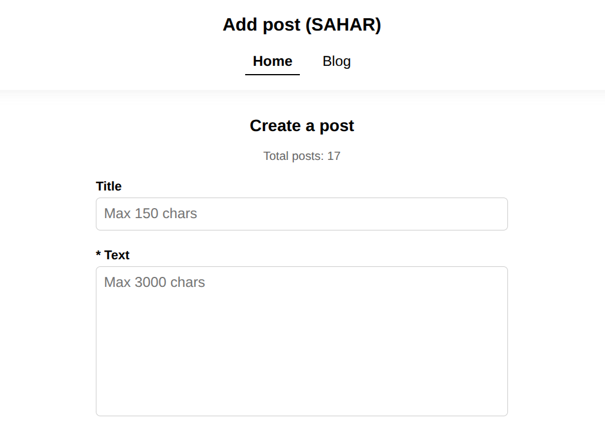

<strong>Screenshot 1: Home Page — Creating a post and publication counter</strong>

---

#### 2.3. Comprehensive SEO Architecture & Zero-Overhead SSR via Askama
Unlike classic client-side SPAs that return an empty `

`, the Askama template engine compiles HTML templates directly into native Rust machine code at build time. Every route of the prototype is engineered for **100% search engine indexing** and passes strict **W3C HTML5 validation ([validator.w3.org](https://validator.w3.org/nu/))**:

#### 1. Dynamic Meta Tags & OpenGraph (`src/handlers.rs`, `src/security.rs`, `templates/base.html`)
Every page (`/`, `/blog`, `/posts/{id}`, `/posts/{id}/edit`) generates unique `<title>`, `<meta name="description">`, `<meta property="og:title">`, and `<meta property="og:description">` tags on the server side. In **`src/handlers.rs`** (within the `index`, `blog`, `view_post`, and `edit_post_page` functions), an individual title and description are generated for the current route (or the text of the opened post), `render_page()` in **`src/security.rs`** passes them into `BaseTemplate`, and **`templates/base.html`** renders them inside the `<head>` section.

~~~html
<title>Sample text | 18 — Add Post (SAHAR)</title>
    <meta name="description" content="Lorem Ipsum is simply dummy text of the printing and typesetting industry. Lorem Ipsum has been the industry&#39;s standard dummy text ever since 1966, wh..." />
    <meta name="robots" content="index, follow" />
    <link rel="canonical" href="http://127.0.0.1:8080/posts/3fa4febf65d442cbad3d776399f0507f" />

    <!-- OpenGraph -->
    <meta property="og:type" content="website" />
    <meta property="og:title" content="Sample text | 18 — Add Post (SAHAR)" />
    <meta property="og:description" content="Lorem Ipsum is simply dummy text of the printing and typesetting industry. Lorem Ipsum has been the industry&#39;s standard dummy text ever since 1966, wh..." />
~~~

#### 2. Self-Referencing Canonical URLs
All pages contain the `<link rel="canonical" href="http://127.0.0.1:8080{{ current_path }}" />` tag. Because the `/posts/{id}` route accepts UUIDs both with and without hyphens, the canonical tag always normalizes the address to the clean 32-character hex format (`/posts/{id_hex}`), preventing duplicate pages in search results (`src/handlers.rs`, `templates/base.html`).

#### 3. Genuine HTTP `404 Not Found` Status
When requesting a non-existent or deleted post ID, the server returns a true `HTTP 404 Not Found` response status header instead of `200 OK`, protecting the site from *Soft 404* search engine penalties (`src/security.rs`, `templates/post_detail.html`).

  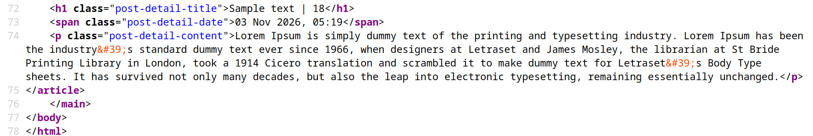

<strong>Screenshot 2: Server-Side Rendering (SSR) of the full post page — Source code</strong>

---

#### 2.4. Cursor-Based Pagination in Infinite Scroll, Post Feed SEO Indexing, Loader Testing & Smart Scroll Restoration

#### 2.4.1. Cursor-Based Pagination (Keyset / Cursor-Based Pagination: `?before=1792191698274`)
Instead of `OFFSET` pagination (`?page=2`), which slows down as the database grows and leads to duplicate or skipped posts when new entries are added, the `/blog` feed utilizes **cursor-based pagination with `O(1)` complexity**.

After every 5 `<article class="post-item">` post previews in the feed DOM tree, a loader element is automatically generated with a link to the next timestamp cursor (for example, `?before=1792581672794`):

~~~html

    <a href="/blog?before=1792581672794">Loading more posts... ⏳</a>

~~~

> **💡 What the number `1792191698274` means in `http://127.0.0.1:8080/blog?before=1792191698274`**  
> At the moment a post is created, the server records the exact Coordinated Universal Time (UTC) in milliseconds elapsed since the Unix Epoch — January 1, 1970 (`Utc::now().timestamp_millis()`, e.g., `1792191698274`), and writes it into the `created_at` column. Once a post is created, its `created_at` timestamp forms part of the primary clustering key in ScyllaDB and **never changes** (even if the post's title or text is subsequently edited).

> **💡 How the cursor works**  
> When the server fetches a batch of 5 posts (`LIMIT 5`), it takes the `created_at` timestamp of the 5th (lowest) post in the current batch and passes it as the `next_timestamp` cursor (`?before=1792191698274`). The next query executes:
>
> ~~~sql
> SELECT created_at, id, title, content FROM posts WHERE bucket = 1 AND created_at < 1792191698274 LIMIT 5
> ~~~
>
> ScyllaDB jumps directly to that millisecond in the clustering index in **`O(1)`** constant time without scanning preceding rows. Even if 10,000 new posts are added to the top of the feed, the `/blog?before=1792191698274` URL remains permanently anchored to that exact historical point and will always return the exact same 5 historical posts.

#### 2.4.2. Hybrid Infinite Scroll for Humans + 100% SEO Indexing for Search Bots
The classic problem with Infinite Scroll is that search engine crawlers (Googlebot, YandexBot, Bingbot) do not spin the mouse wheel (do not scroll down the page) and do not trigger JS scroll events, leaving older posts unindexed.
In this prototype, this issue is solved using a **hybrid hypermedia pattern** at the end of the `templates/post_items.html` template:

~~~html

    <!-- Hybrid Infinite Scroll trigger (for humans) + Crawlable SEO link (for search bots) -->
    

        <a href="/blog?before={{ next_timestamp.unwrap() }}">Loading more posts... ⏳</a>
    


~~~

1. **For users:** When the user scrolls down the feed and the `
` element enters the viewport, the `hx-trigger="revealed"` trigger automatically sends a background request with the `HX-Request` header. The server returns only the next 5 semantic `<article class="post-item">` post previews, and `hx-swap="outerHTML"` seamlessly replaces the loading indicator with the new posts.
2. **For search engine crawlers and No-JavaScript mode:** Search crawlers do not execute `revealed`, but they see the standard semantic `<a href="/blog?before=1792191698274">` link inside `
`. By following it without the `HX-Request` header, the bot receives a **complete SSR HTML page** from the Rust backend with a **self-referencing canonical tag** (`<link rel="canonical" href="http://127.0.0.1:8080/blog?before=1792191698274" />`) and the next `<a href="/blog?before=...">` link. Thus, search engines traverse the chain of cursors and index the entire publication history from the newest entries down to the very first post in the database.

#### 2.4.3. Loader Testing (`Loader Delay`) & Its SEO Impact
Because on a local server (`127.0.0.1`) the Rust + Actix Web + ScyllaDB stack serves data in a fraction of a millisecond (`~0.3 ms`), the human eye cannot perceive the loading indicators.
To visually test the initial feed loader (**`Loading posts... ⏳`**) and the infinite pagination loader (**`Loading more posts... ⏳`**), the codebase includes dedicated artificial delay blocks wrapped with **`// Loader Delay`** and **`// /Loader Delay`** markers.

By default, these blocks are commented out. To enable visual loader testing mode, simply uncomment the code between `// Loader Delay` and `// /Loader Delay` in the following 3 files:

1. **`src/main.rs`** — delay duration constant in milliseconds (e.g., `800` ms):

~~~rust
// Loader Delay
// pub const LOADER_DELAY_MS: u64 = 800;
// /Loader Delay
~~~

2. **`src/handlers.rs`** (at the beginning of `pub async fn blog`) — artificial server response pause when querying the feed:

~~~rust
// Loader Delay
// if crate::LOADER_DELAY_MS > 0 {
//     tokio::time::sleep(std::time::Duration::from_millis(crate::LOADER_DELAY_MS)).await;
// }
// /Loader Delay
~~~

3. **`static/app.js`** (at the end of the file) — client-side display of the initial `Loading posts... ⏳` loader when navigating to the `/blog` tab and when refreshing the page with `F5`:

~~~javascript
// Loader Delay
// document.addEventListener('htmx:before:request', (e) => {
//     const target =
//         (e.detail && e.detail.ctx && e.detail.ctx.target) ||
//         (e.detail && e.detail.target) ||
//         e.target;
//     const sourceElt =
//         (e.detail && e.detail.ctx && e.detail.ctx.sourceElement) || e.target;
//
//     if (
//         target &&
//         target.id === 'main-content' &&
//         sourceElt &&
//         sourceElt.getAttribute('href') === '/blog' &&
//         !shouldRestoreBlogScroll
//     ) {
//         target.innerHTML =
//             '

Loading posts... ⏳

';
//     }
// });
//
// window.addEventListener('beforeunload', () => {
//     if (window.location.pathname.startsWith('/blog')) {
//         const mainContent = document.getElementById('main-content');
//         if (mainContent) {
//             mainContent.innerHTML =
//                 '

Loading posts... ⏳

';
//         }
//     }
// });
// /Loader Delay
~~~

> **💡 Degrees of Loader Impact on SEO:**
> 1. **Default Baseline Configuration (only the `Loading more posts... ⏳` pagination loader is active, `Loader Delay` blocks are commented out) — 0% Negative Impact on SEO:**
>    The first 5 posts are rendered on the server (SSR) inside semantic `<article class="post-item">` tags and delivered to the search crawler instantaneously without any delay. The `
Loading more posts... ⏳
` block below the 5th post contains a semantic `<a href="/blog?before=...">` link: the search crawler treats it as a standard pagination link, follows it, and just as instantaneously indexes the next batches of posts. Server response speed (**TTFB**) and content rendering (**LCP**) metrics remain at benchmark levels.
> 2. **Enabling `Loader Delay` Mode and the Initial Post Loader (`Loading posts... ⏳`) — Negative Impact on Core Web Vitals Speed Metrics:**
>    Although enabling these blocks preserves SSR post delivery in the page source code (`Ctrl + U`), the artificial `LOADER_DELAY_MS` pause on the server directly increases waiting time for the first byte (**TTFB — Time to First Byte**) and delays final content rendering (**LCP — Largest Contentful Paint**), while the client-side interception showing `Loading posts... ⏳` temporarily replaces content during navigation. Because search algorithms factor server response speed and Core Web Vitals metrics into rankings, the `Loader Delay` blocks are intended **exclusively for local testing and UI demonstration**, and must remain commented out in normal operation and production.

#### 2.4.4. Smart Scroll Position Restoration & Ephemeral Feed Cache (Zero Memory Leak)
In `static/app.js`, default browser scroll jumps are disabled (`history.scrollRestoration = 'manual'`) and replaced with deterministic scroll position management.

**When navigating from the feed into a post (`/blog` -> `/posts/{id}` or `/posts/{id}/edit`):**
1. The current vertical scroll coordinate is saved in RAM (`savedBlogScrollY = window.scrollY`).
2. If the user has scrolled past the initial 5 posts via Infinite Scroll (`loadedPostsCount > 5`), a DOM snapshot of the `#feed-list` container is temporarily stored in RAM (`savedBlogFeedHtml`, with a `< 2 MB` safety limit). If `<= 5` posts are on screen, `savedBlogFeedHtml` remains `null` (`0 bytes`), since the server already returns the first 5 posts.
3. The opened full post page automatically scrolls to the very top (`window.scrollTo(0, 0)`) so the post is always read from its title.

**When returning back to the feed (`← Back to Blog`, `Back` button, or mouse "Back" side button):**
1. If additional batches of posts were loaded via Infinite Scroll, they are instantaneously restored from `savedBlogFeedHtml` into `#feed-list` and re-initialized via `htmx.process(feedList)`.
2. The window immediately returns to the exact scroll pixel (`window.scrollTo(0, savedBlogScrollY)`) from which the user entered the post.
3. **Instant Memory Cleanup (Zero Memory Leak):** In the exact same millisecond after restoring the feed, the `savedBlogFeedHtml` variable is forcibly reset to `null` (`savedBlogFeedHtml = null`), freeing RAM down to `0 bytes`. When creating, editing, or deleting a post, the snapshot is also automatically reset to `null`, guaranteeing that fresh data from ScyllaDB is displayed.

**Visual Inspection:**
To ensure complete transparency of how this mechanism operates, informative cache lifecycle logging is built into `static/app.js`. By opening the browser Developer Console (`F12`), you can observe in real time: saving the Y coordinate, recording the memory size allocated for the DOM snapshot (in characters/bytes), exact position restoration, and, most importantly, immediate variable nullification (garbage collection) upon cleanup. 
Below are the results of testing navigation in a blog feed consisting of 17 posts:

  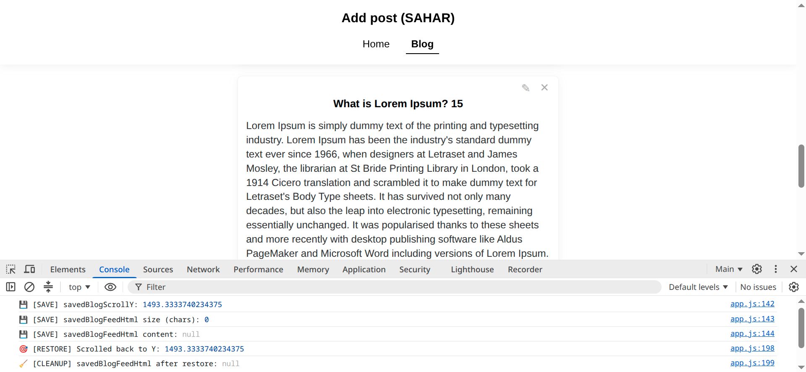

<strong>Screenshot 3: Navigating to the 15th post (upper part of the feed, ≤ 5 posts) and returning to the blog. Since Infinite Scroll has not been triggered yet, no DOM snapshot is created (0 bytes, null); only the scroll offset is saved and successfully restored upon return.</strong>

  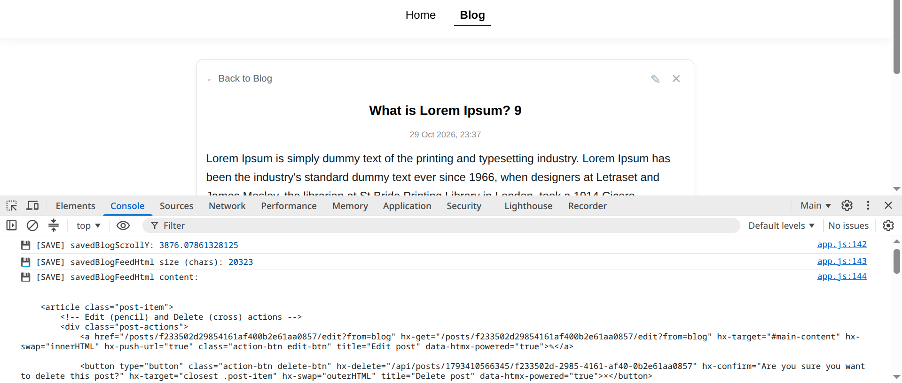

<strong>Screenshot 4: Navigating to the 9th post (deep scroll). The algorithm saves the coordinate (Y: 3738) and records the DOM snapshot size of the loaded feed (28,352 characters), preventing loss of loaded data.</strong>

  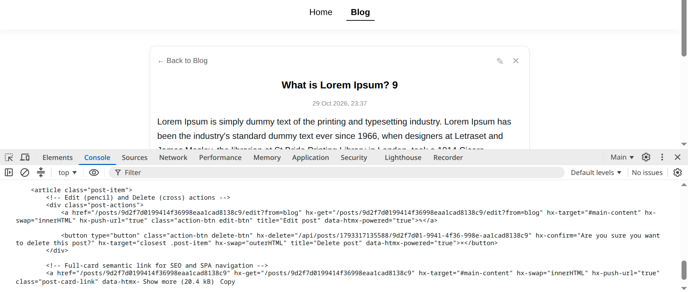

<strong>Screenshot 5: Inspecting the <code>savedBlogFeedHtml</code> variable. The console shows the semantic contents of the cache and its actual footprint in memory (28.4 kB).</strong>

  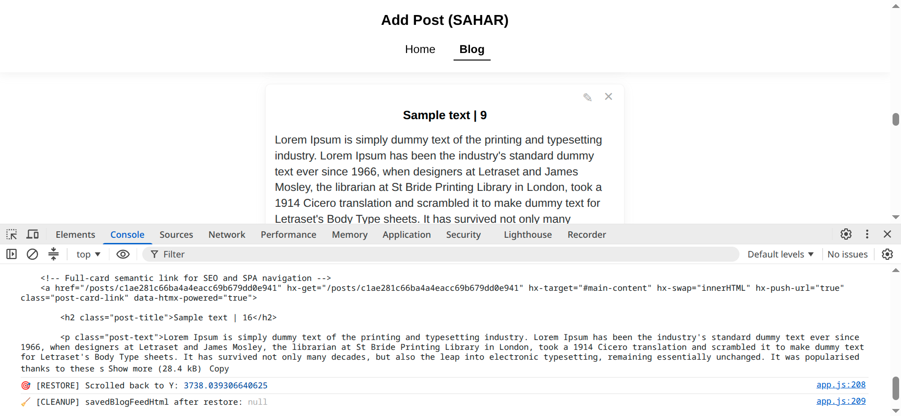

<strong>Screenshot 6: Returning back to the feed. Instantaneous pixel-accurate scroll restoration and forced nullification of the ephemeral cache (<code>🧹 [CLEANUP] savedBlogFeedHtml after restore: null</code>), completely freeing memory (Zero Memory Leak).</strong>

---

#### 2.5. ScyllaDB 3-Table Denormalized Architecture & Distributed Post Counter
To achieve **constant `O(1)` read and write speed** across all routes without using slow `ALLOW FILTERING` queries, a denormalized 3-table schema is implemented in the `sahar_prototype_add_post` keyspace:

1. **`post_counts`** — Stores the distributed `counter` (`scylla::value::Counter`) for instant display of the total number of posts (`Total posts`) on the Home page (`/`). Automatically synchronizes with the actual row count upon server startup:

~~~sql
cqlsh:sahar_prototype_add_post> DESCRIBE TABLE post_counts;

CREATE TABLE sahar_prototype_add_post.post_counts (
    bucket int,
    total counter,
    PRIMARY KEY (bucket)
) WITH bloom_filter_fp_chance = 0.01
    AND caching = {'keys': 'ALL', 'rows_per_partition': 'ALL'}
    AND comment = ''
    AND compaction = {'class': 'IncrementalCompactionStrategy'}
    AND compression = {'sstable_compression': 'LZ4WithDictsCompressor'}
    AND crc_check_chance = 1
    AND default_time_to_live = 0
    AND gc_grace_seconds = 864000
    AND max_index_interval = 2048
    AND memtable_flush_period_in_ms = 0
    AND min_index_interval = 128
    AND speculative_retry = '99.0PERCENTILE'
    AND tombstone_gc = {'mode': 'repair', 'propagation_delay_in_seconds': '3600'};
~~~

2. **`posts`** — Stores the publication feed ordered by time at the clustering key level (`PRIMARY KEY (bucket, created_at, id) WITH CLUSTERING ORDER BY (created_at DESC, id ASC)`), providing `O(1)` feed retrieval for `/blog`:

~~~sql
cqlsh:sahar_prototype_add_post> DESCRIBE TABLE posts;

CREATE TABLE sahar_prototype_add_post.posts (
    bucket int,
    created_at timestamp,
    id uuid,
    content text,
    title text,
    PRIMARY KEY (bucket, created_at, id)
) WITH CLUSTERING ORDER BY (created_at DESC, id ASC)
    AND bloom_filter_fp_chance = 0.01
    AND caching = {'keys': 'ALL', 'rows_per_partition': 'ALL'}
    AND comment = ''
    AND compaction = {'class': 'IncrementalCompactionStrategy'}
    AND compression = {'sstable_compression': 'LZ4WithDictsCompressor'}
    AND crc_check_chance = 1
    AND default_time_to_live = 0
    AND gc_grace_seconds = 864000
    AND max_index_interval = 2048
    AND memtable_flush_period_in_ms = 0
    AND min_index_interval = 128
    AND speculative_retry = '99.0PERCENTILE'
    AND tombstone_gc = {'mode': 'repair', 'propagation_delay_in_seconds': '3600'};
~~~

3. **`posts_by_id`** — Stores posts with `id uuid PRIMARY KEY`, providing instant `O(1)` post lookup when opening the full post page (`/posts/{id}`) and the edit page (`/posts/{id}/edit`):

~~~sql
cqlsh:sahar_prototype_add_post> DESCRIBE TABLE posts_by_id;

CREATE TABLE sahar_prototype_add_post.posts_by_id (
    id uuid,
    bucket int,
    content text,
    created_at timestamp,
    title text,
    PRIMARY KEY (id)
) WITH bloom_filter_fp_chance = 0.01
    AND caching = {'keys': 'ALL', 'rows_per_partition': 'ALL'}
    AND comment = ''
    AND compaction = {'class': 'IncrementalCompactionStrategy'}
    AND compression = {'sstable_compression': 'LZ4WithDictsCompressor'}
    AND crc_check_chance = 1
    AND default_time_to_live = 0
    AND gc_grace_seconds = 864000
    AND max_index_interval = 2048
    AND memtable_flush_period_in_ms = 0
    AND min_index_interval = 128
    AND speculative_retry = '99.0PERCENTILE'
    AND tombstone_gc = {'mode': 'repair', 'propagation_delay_in_seconds': '3600'};
~~~

> **💡 Production Scaling Note (`bucket` Partitioning & Seastar Row Cache):**
> * **Time-Bucketing (`bucket int`):** The `posts` table schema is pre-designed with `bucket int` as the Partition Key. In this prototype, a fixed value of `bucket = 1` is used for simplicity. In a high-load production cluster, `bucket` is dynamically populated with a time-window integer (for example, `YYYYMM` or `YYYYMMDD`), which automatically splits the global feed into compact partitions (< 100 MB) and distributes the load evenly across all cluster nodes and CPU cores (shards) without changing the CQL table schema.
> * **Row-Granularity LRU Cache (`rows_per_partition: 'ALL'`):** Unlike legacy Apache Cassandra, the Seastar engine in ScyllaDB completely bypasses the Linux Page Cache and implements **row-granularity cache population and row-granularity LRU eviction (Row-Granularity Cache)**. The `caching = {'keys': 'ALL', 'rows_per_partition': 'ALL'}` setting does not load the entire partition into memory at once — it retains only the "hottest" recently queried feed rows in RAM, automatically evicting older historical records to `LZ4`-compressed SSTable files on disk.

---

#### 2.6. Automatic Database Schema Initialization
For out-of-the-box prototype reproducibility (Zero-Config Reproducibility), the `src/db.rs` module automatically creates the `sahar_prototype_add_post` keyspace and required tables upon application startup before switching the active session:

~~~rust
    // 1. Establish connection to the local ScyllaDB node
    let session = SessionBuilder::new()
        .known_node("127.0.0.1:9042")
        .build()
        .await
        .expect("Failed to connect to ScyllaDB");

    // 2. Automatically create the keyspace and tables if they do not exist yet.
    // NOTE (Best Practice & Cybersecurity):
    // Auto-initialization is enabled here for zero-config prototype reproducibility.
    // In a production environment, DDL schema migrations (CREATE/ALTER/DROP) must be
    // executed separately via a dedicated migration tool, and the web server must
    // connect using a restricted DB role (SELECT/MODIFY permissions only — Principle of Least Privilege).
    initialize_schema(&session).await;

    // 3. Switch the active session to the newly created (or existing) keyspace
    session
        .use_keyspace("sahar_prototype_add_post", false)
        .await
        .expect("Failed to select keyspace");
~~~

---

#### 2.7. Full CRUD Cycle & Smart Form UX
* **Create Post (`/`):** Supports an optional `Title` (up to 150 characters) and a required `* Text` field (up to 3,000 characters). The `Add` button is hidden by default and appears only when text is entered into the required `* Text` field. After submission, the form is automatically cleared, the `Total posts` counter is incremented by one, and a Toast notification pops up in the corner of the screen via the `hx-swap-oob` attribute (`templates/toast.html`).
* **Flexible Title & Text Length Configuration in Previews and Full Posts:**
  * **Post Preview Size in the Feed (`/blog`):** In the ScyllaDB database, a post is always stored in full; however, for compact display of `<article class="post-item">` cards in the `/blog` feed, the length of the displayed title and text is configured in **`src/handlers.rs`** (inside the `render_blog_feed_html` function) using `truncate()` from **`src/security.rs`**:

~~~rust
title: truncate(&title, 100),   // Maximum 100 characters for the title in the feed preview
content: truncate(&content, 700), // Maximum 700 characters for the text in the feed preview
~~~

  If the title or text exceeds the specified values, it is cleanly truncated in the feed preview with an ellipsis (`...`), while navigating to the full post page (`/posts/{id}`) or edit page (`/posts/{id}/edit`) displays the content in full.
  * **Maximum Full Post Size:** Configured synchronously across three layers — in the **`templates/home.html`** and **`templates/post_edit.html`** HTML templates (`maxlength="150"` and `maxlength="3000"`), on the server in **`src/handlers.rs`** within the `create_post` and `update_post` functions (`.chars().take(150)` and `.chars().take(3000)`), and via the form payload limit in **`src/main.rs`** (`web::FormConfig::default().limit(65536)`).
* **Edit Post (`/posts/{id}/edit`) & Zero-State Reactive Reset:**
  Accessible by clicking the pencil icon (`✎`) on both the preview card in the feed (`/blog`) and inside the full post (`/posts/{id}`). Tracking form modifications and rolling back changes requires no client-side state managers, state hooks, or in-memory JSON caching—instead, a native **DOM Dataset pattern** is used (`templates/post_edit.html` + `static/app.js`):
  * During server-side rendering of **`templates/post_edit.html`**, Askama stamps the reference database values from ScyllaDB directly into native HTML5 `data-original` attributes on the form inputs:

~~~html
<input type="text" id="edit-title" name="title" value="{{ post.title }}" data-original="{{ post.title }}" ... />
<textarea id="edit-content" name="content" data-original="{{ post.content }}" ...>{{ post.content }}</textarea>
~~~

  * The interface features a context-aware **`Back, Cancel, Publish`** button bar:
    * **`Back`** is always visible and returns the user to the exact page from which they entered the edit view (back to the `/blog` feed or to the full post `/posts/{id}`).
    * **`Cancel`** and **`Publish`** are hidden by default and appear dynamically only when the current `.value` differs from the reference string in `.dataset.original` (evaluated in `static/app.js` with zero DOM re-renders).
    * Clicking **`Cancel`** invokes `resetEditFormToOriginal()`, which instantaneously restores the original title and post text directly from `dataset.original` without making an extra network request to the server or database, and automatically hides the `Cancel` and `Publish` buttons:

~~~javascript
function resetEditFormToOriginal() {
    const editTitle = document.getElementById('edit-title');
    const editContent = document.getElementById('edit-content');
    if (!editTitle || !editContent) return;

    editTitle.value = editTitle.dataset.original || '';
    editContent.value = editContent.dataset.original || '';
    updateEditButtons();
}
~~~
* **Delete Post (`×`):** Deletes the post simultaneously from both tables (`posts` and `posts_by_id`), decrements the counter in `post_counts` (with protection against going into negative values in `src/handlers.rs`), and either removes the card from the list (in `/blog`) or redirects the user back to `/blog` with a deletion toast notification (if triggered from the full post page `/posts/{id}`).

  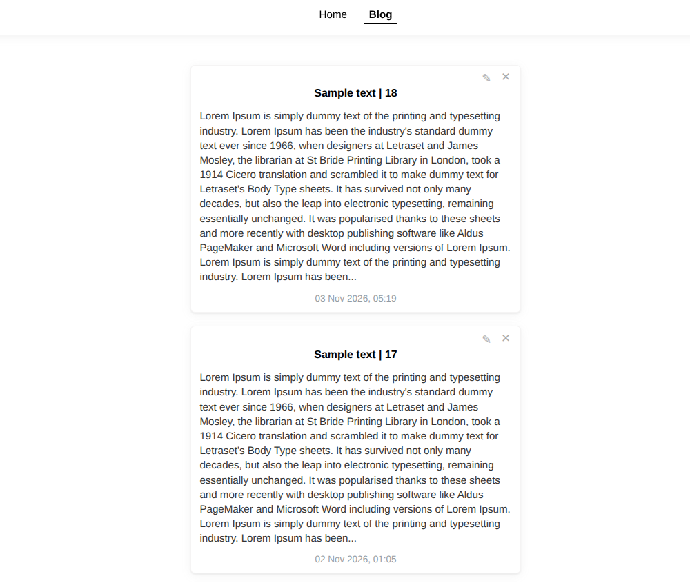

<strong>Screenshot 7: Blog Feed</strong>

  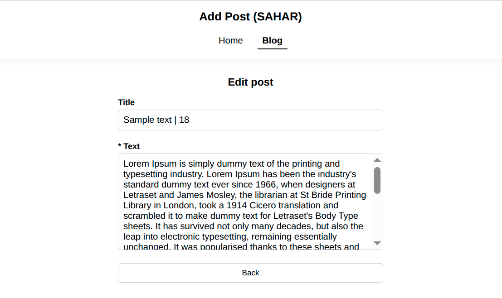

<strong>Screenshot 8: Post Editing Interface</strong>

---

#### 2.8. Hardened Cybersecurity Architecture
The prototype is engineered in strict accordance with cybersecurity best practices to eliminate the possibility of website compromise or system intrusion (mechanisms are ordered from the most critical architectural barriers to auxiliary defense layers):

#### 1. Database Driver-Level CQL Injection Protection (`src/db.rs`, `src/handlers.rs`)
100% of user database queries are executed exclusively through pre-compiled `PreparedStatement` expressions of the ScyllaDB driver (initialized at startup in `src/db.rs` and invoked in `src/handlers.rs`). User data is transmitted separately from the query body over the binary CQL protocol, architecturally eliminating any possibility of CQL injection.

#### 2. Uncompromising Content Security Policy — CSP (`src/main.rs`, `templates/base.html`)
At the HTTP server middleware level in `src/main.rs`, the `Content-Security-Policy: default-src 'self'; script-src 'self'; style-src 'self'; img-src 'self';` header is strictly enforced, completely prohibiting `'unsafe-inline'` and `'unsafe-eval'`. Because there are no inline hydration scripts in the SAHAR architecture, the server does not need to spend CPU resources generating one-time `nonce` keys. To comply with the strict `style-src 'self'` rule, dynamic inline indicator style injection in HTMX 4 is disabled in `templates/base.html` via `<meta name="htmx-config" content='{"includeIndicatorCSS": false}'>`.

#### 3. Two-Tier XSS Protection at Compile Time and in Partial Responses (`templates/*.html`, `src/security.rs`, `static/style.css`)
* **In templates (`templates/home.html`, `templates/post_items.html`, `templates/post_detail.html`, `templates/post_edit.html`, `templates/toast.html`):** The Askama template engine automatically escapes all user variables (`{{ post.title }}`, `{{ post.content }}`) at Rust compile time. Multi-line text formatting is preserved safely via CSS (`white-space: pre-wrap` in `static/style.css`) without using unescaped HTML tags — ` `.
* **In partial HTMX responses (`src/security.rs`):** The `html_escape_title()` function forcibly sanitizes special characters (`&`, `<`, `>`) inside the dynamically generated `<title>` tag, eliminating the possibility of HTML tag injection during SPA transitions.

#### 4. Cross-Site Request Forgery Protection — Anti-CSRF (`src/security.rs`, `src/handlers.rs`)
The `validate_origin()` function in `src/security.rs` is called prior to executing every state-mutating handler (`create_post`, `update_post`, `delete_post` in `src/handlers.rs`). The server strictly verifies the `Origin` and `Referer` headers against the `ALLOWED_ORIGINS` allowlist of trusted origins and instantaneously blocks (`HTTP 403 Forbidden`) any attempts to create, edit, or delete posts from third-party websites.

#### 5. Defense-in-Depth DoS & Buffer Overflow Protection (`src/main.rs`, `src/handlers.rs`, `templates/home.html`, `templates/post_edit.html`)
Triple filtering of incoming data volume is implemented:
* **At the HTTP server level (`src/main.rs`):** The `web::FormConfig::default().limit(65536)` (64 KB) form size limit is sized with headroom to accept 150 title characters and 3,000 text characters in multi-byte UTF-8 encoding (`application/x-www-form-urlencoded`), while reliably cutting off attempts to send megabyte spam payloads.
* **At the request handler level (`src/handlers.rs`):** Enforced string length truncation via `.chars().take(150)` and `.chars().take(3000)` prior to database insertion, along with strict typed identifier validation via `Uuid::parse_str`.
* **At the browser level (`templates/home.html`, `templates/post_edit.html`):** Client-side `maxlength="150"` and `maxlength="3000"` constraints.

#### 6. Server Panic Protection (DoS via Panic) on UTF-8 Character Boundaries (`src/security.rs`, `src/handlers.rs`)
The `truncate()` text truncation function in `src/security.rs` and form processing in `src/handlers.rs` operate on Unicode scalar value iterators (`.chars()`) rather than raw byte slices, completely eliminating server thread crashes (`panic`) when truncating multi-byte UTF-8 characters and emojis.

#### 7. Network Perimeter Protection, Anti-Sniffing & HTTP Security Headers (`src/main.rs`, `src/security.rs`)
* **Clickjacking & UI Redressing Protection (`src/main.rs`):** The `X-Frame-Options: DENY` header prohibits embedding the site inside third-party `<iframe>` and `<frame>` elements.
* **MIME-Sniffing & Charset Substitution Protection (`src/main.rs`, `src/security.rs`):** The `X-Content-Type-Options: nosniff` header combined with explicit `text/html; charset=utf-8` declaration in `render_page()` blocks MIME-type guessing and charset-switching attacks.
* **Transport Layer, Cache & Error Masking Protection (`src/main.rs`, `src/security.rs`):** `Strict-Transport-Security` (HSTS), `Referrer-Policy: strict-origin-when-cross-origin`, dynamic response cache prohibition via `Cache-Control: no-store, no-cache, must-revalidate`, and safe `404 Not Found` page rendering (`render_not_found()`) without exposing internal database structures or system stack traces.

<strong>main.rs (security section)</strong>

~~~rust
            .app_data(app_state.clone())
            // DoS & Memory Exhaustion Protection:
            // Strictly limits incoming form payloads to 64 KB (65,536 bytes).
            // Accommodates a 150-char title + 3,000-char content in multi-byte UTF-8 percent-encoding
            // while rejecting oversized megabyte payload floods.
            .app_data(web::FormConfig::default().limit(65536))
            // Strict HTTP Security Headers Middleware (Zero 'unsafe-inline' tolerance)
            .wrap(
                middleware::DefaultHeaders::new()
                    // Clickjacking Protection: forbids embedding the site inside external <iframe> / <frame> elements
                    .add(("X-Frame-Options", "DENY"))
                    // MIME-Sniffing Protection: prevents browsers from guessing MIME types outside the declared Content-Type
                    .add(("X-Content-Type-Options", "nosniff"))
                    .add((
                        "Content-Security-Policy",
                        // Strict Content Security Policy (XSS & Data Injection Mitigation):
                        // Disables all inline scripts and styles ('unsafe-inline' and 'unsafe-eval' are completely prohibited).
                        // Restricts scripts, stylesheets, and images strictly to the application's own Origin ('self').
                        "default-src 'self'; script-src 'self'; style-src 'self'; img-src 'self';",
                    ))
                    .add((
                        "Strict-Transport-Security",
                        // HSTS Protection: enforces HTTPS connections for 1 year, including subdomains
                        "max-age=31536000; includeSubDomains; preload",
                    ))
                    // Referrer Privacy Protection when navigating to external origins
                    .add(("Referrer-Policy", "strict-origin-when-cross-origin")),
            )
~~~

 

<strong>security.rs</strong>

~~~rust
use crate::models::{BaseTemplate, PostDetailTemplate};
use actix_web::{error, Error, HttpRequest, HttpResponse};
use askama::Template;

// Allowlist of trusted Origins for Cross-Site Request Forgery (CSRF) protection
const ALLOWED_ORIGINS: [&str; 2] = ["http://127.0.0.1:8080", "http://localhost:8080"];

// Anti-CSRF (Cross-Site Request Forgery) Validation:
// Invoked on all state-mutating endpoints (POST / DELETE).
// Verifies the `Origin` and `Referer` headers against `ALLOWED_ORIGINS` and blocks (HTTP 403 Forbidden)
// any unauthorized cross-origin mutation requests initiated from third-party websites.
pub fn validate_origin(req: &HttpRequest) -> Result<(), Error> {
    let origin = req.headers().get("Origin").and_then(|v| v.to_str().ok());
    let referer = req.headers().get("Referer").and_then(|v| v.to_str().ok());

    let is_valid_origin = origin.is_some_and(|o| ALLOWED_ORIGINS.contains(&o));
    let is_valid_referer =
        referer.is_some_and(|r| ALLOWED_ORIGINS.iter().any(|allowed| r.starts_with(allowed)));

    if !is_valid_origin && !is_valid_referer {
        return Err(error::ErrorForbidden("Security Alert: CSRF detected"));
    }
    Ok(())
}

// Safe HTMX 4 Header Inspection:
// Returns true ONLY when HTMX expects a partial HTML fragment.
// On browser Back/Forward navigation, HTMX 4 sends `hx-history-restore-request: true`
// (or `hx-request-type: full`) and expects the full page containing `<main hx-history-elt>`.
pub fn is_htmx_partial_request(req: &HttpRequest) -> bool {
    let is_htmx =
        req.headers().contains_key("hx-request") || req.headers().contains_key("hx-request-type");
    let is_history_restore = req.headers().contains_key("hx-history-restore-request");
    let is_full_request = req
        .headers()
        .get("hx-request-type")
        .and_then(|v| v.to_str().ok())
        .is_some_and(|v| v == "full");

    is_htmx && !is_history_restore && !is_full_request
}

// Memory-Safe UTF-8 Character Truncation:
// Iterates over Unicode scalar values (`.chars()`) rather than raw byte slices,
// preventing server panics on multi-byte UTF-8 character boundaries and emojis.
pub fn truncate(s: &str, max: usize) -> String {
    let s = s.trim();
    if s.chars().count() > max {
        let mut truncated = s.chars().take(max).collect::<String>().trim_end().to_string();
        truncated.push_str("...");
        truncated
    } else {
        s.to_string()
    }
}

// Anti-XSS Escaping for Dynamic <title> Tags in HTMX Partial Responses:
// Since partial HTMX responses prepend `<title>` outside `BaseTemplate`, this function
// sanitizes HTML control characters (&, <, >) to prevent tag injection and XSS.
pub fn html_escape_title(s: &str) -> String {
    s.replace('&', "&amp;")
        .replace('<', "&lt;")
        .replace('>', "&gt;")
}

// Secure SSR & Partial HTML Renderer:
// Explicitly enforces `charset=utf-8` (mitigating charset-sniffing XSS) and sets
// `Cache-Control: no-store, no-cache, must-revalidate` to prevent stale sensitive state caching.
pub fn render_page(
    req: &HttpRequest,
    partial: String,
    path: &str,
    page_title: &str,
    page_description: &str,
) -> Result<HttpResponse, Error> {
    if is_htmx_partial_request(req) {
        let safe_title = html_escape_title(page_title);
        Ok(HttpResponse::Ok()
            .content_type("text/html; charset=utf-8")
            .insert_header(("Cache-Control", "no-store, no-cache, must-revalidate"))
            .body(format!("<title>{safe_title}</title>\n{partial}")))
    } else {
        let base = BaseTemplate {
            page_title: page_title.to_string(),
            page_description: page_description.to_string(),
            content_html: partial,
            current_path: path.to_string(),
        };
        let body = base.render().map_err(error::ErrorInternalServerError)?;
        Ok(HttpResponse::Ok()
            .content_type("text/html; charset=utf-8")
            .insert_header(("Cache-Control", "no-store, no-cache, must-revalidate"))
            .body(body))
    }
}

// Safe 404 Not Found Renderer:
// Returns a genuine HTTP 404 status code without leaking internal database details or stack traces.
pub fn render_not_found(req: &HttpRequest, current_path: &str) -> Result<HttpResponse, Error> {
    let partial = PostDetailTemplate { post: None }
        .render()
        .map_err(error::ErrorInternalServerError)?;
    let page_title = "Post not found — Add Post (SAHAR)";

    if is_htmx_partial_request(req) {
        Ok(HttpResponse::NotFound()
            .content_type("text/html; charset=utf-8")
            .insert_header(("Cache-Control", "no-store, no-cache, must-revalidate"))
            .body(format!("<title>{page_title}</title>\n{partial}")))
    } else {
        let base = BaseTemplate {
            page_title: page_title.to_string(),
            page_description: "The requested post was not found.".to_string(),
            content_html: partial,
            current_path: current_path.to_string(),
        };
        let body = base.render().map_err(error::ErrorInternalServerError)?;
        Ok(HttpResponse::NotFound()
            .content_type("text/html; charset=utf-8")
            .insert_header(("Cache-Control", "no-store, no-cache, must-revalidate"))
            .body(body))
    }
}
~~~

---

#### 2.9. Informative Server Logging
Upon startup, the system outputs a clear status report to the terminal indicating ScyllaDB schema readiness and web server launch:

    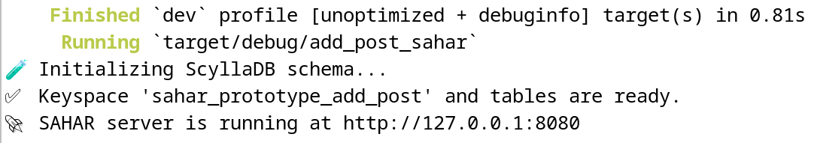

<strong>Screenshot 9: ScyllaDB readiness and server startup log</strong>

---

### 3. Installation & Setup

**Compatibility Note:** This project is verified to work on Debian 12. Development on Windows is not recommended. A Linux-based environment is required for correct operation.

**3.1. Environment Preparation (Debian 12 and similar)** 

Installing system dependencies:

~~~bash
sudo apt update && sudo apt install build-essential pkg-config libssl-dev -y
~~~

**3.2. Installing Rust**

**3.2.1. Install Rust (installs the current stable version):**

~~~bash
curl --proto '=https' --tlsv1.2 -sSf https://sh.rustup.rs | sh
~~~

**3.2.2. Configure environment variables:**

~~~bash
source $HOME/.cargo/env
~~~

**3.3. ScyllaDB Installation and Configuration**

Installation is performed directly on the Debian 12 system using the official ScyllaDB repository.

**3.3.1. Update package indexes:**

~~~bash
sudo apt-get update
~~~

**3.3.2. Install necessary system utilities:**

~~~bash
sudo apt-get install -y apt-transport-https curl gnupg
~~~

**3.3.3. Add the official ScyllaDB repository to the system:**

>📌 By default, this script automatically registers the repository for the latest stable version of ScyllaDB Open Source. To explicitly install ScyllaDB v2026.2.6 used in this prototype, run the command with the version flag:

~~~bash
curl -sSf https://get.scylladb.com/server | sudo bash -s -- --scylla-version 2026.2
~~~

**3.3.4. Interactive configuration and ScyllaDB installation:**

~~~bash
sudo scylla_setup
~~~

**3.3.5. Start the ScyllaDB server service:**

~~~bash
sudo systemctl start scylla-server
~~~

**3.3.6. Check the status of cluster nodes:**

~~~bash
nodetool status
~~~

---

### 4. Database Preparation

Thanks to the built-in `initialize_schema` function in `src/db.rs`, the **`sahar_prototype_add_post`** keyspace and all three tables (`posts`, `posts_by_id`, and `post_counts`) are **created automatically** upon the first launch of the application.

If you wish to create or inspect the Keyspace manually prior to launch, open the database console:

~~~bash
cqlsh
~~~

and execute the query:

~~~sql
CREATE KEYSPACE IF NOT EXISTS sahar_prototype_add_post
WITH REPLICATION = {'class': 'NetworkTopologyStrategy', 'replication_factor': 1};
~~~

---

### 5. Launching the project

**5.1. Cloning the project repository:**

~~~bash
git clone https://github.com/AndrewShedov/add-post--SAHAR && cd add-post--SAHAR/main
~~~

**5.2. Launch the project:**

~~~bash
cargo run
~~~

Once the build is complete, the application will be available at:

`http://127.0.0.1:8080`

By default, ScyllaDB is configured to work with the address `127.0.0.1:9042`. 
You can verify the connection by entering the command into the terminal:

~~~bash
cqlsh
~~~

After entering the command, the connection address should be displayed: 
<code>Connected to at 127.0.0.1:9042</code>
 
 

    

<strong>SAHAR is a transliteration of the Russian word 'САХАР', meaning 'sugar'</strong>

  

 
 

       