&nbsp;&nbsp;

# Add Post (SAHAR)

 

### ***Распределение вклада моделей ИИ ✨***
* **Gemini 4 Argon** — основа и кибербезопасность (60%) **| Релиз v1.0.0 (на момент начала разработки, модели ниже ещё не вышли) |**
* **Gemini 4 Hydrogen** — кибербезопасность и целостность данных (22%) **| v1.1.0 |**
* **Gemini 4 Carbon** — кибербезопасность (10%) **| v1.1.0 |**
* **Claude Fable 5.2** — кибербезопасность (8%) **| v1.1.0 |**

🤖&nbsp;&nbsp;[Полная кодовая база для ИИ (Repomix XML)](https://raw.githubusercontent.com/AndrewShedov/add-post--SAHAR/refs/heads/main/FULL_CODEBASE.repomix.xml) 

> 📋 [Подробное описание вклада моделей](https://github.com/AndrewShedov/add-post--SAHAR/blob/main/AI_CONTRIBUTION_RU.md) 
> 📋 [Новое в релизе v1.1.0](https://github.com/AndrewShedov/add-post--SAHAR/blob/main/RELEASE_v1.1.0_RU.md)

> **Исследовательская статья:**  
> [💎 Дневник разработчика CRYSTAL #3: Сравнительное исследование производительности и кибербезопасности клиент-серверного взаимодействия в технологических стеках LARS и SAHAR](https://shedov.top/ru/dnevnik-razrabotchika-crystal-3-sravnitelnoe-issledovanie-lars-i-sahar/)

Данное приложение представляет собой многостраничный прототип, разработанный в рамках поиска нового высокопроизводительного и кибербезопасного технологического стека для социальной сети [CRYSTAL v3.0](https://github.com/CrystalSystems). 
Развивая концепцию [базового CRUD-прототипа](https://github.com/AndrewShedov/enter-text--SAHAR), это приложение демонстрирует полноценный цикл работы с публикациями в базе данных **ScyllaDB**: 
 1. Создание постов.
 2. Динамический счетчик постов.
 3. Просмотр ленты постов с бесконечной прокруткой на основе курсорной пагинации.
 4. Отдельная страница полного поста (`/posts/{id}`).
 5. Редактирование постов (`/posts/{id}/edit`).
 6. Удаление постов.
 7. Toast уведомления при операциях с постами.

Благодаря компилируемым шаблонам **Askama** и **HTMX 4.0.0**, приложение сочетает **серверный рендеринг (SSR)** с **плавной SPA-навигацией без перезагрузки страницы**, **индексацию поисковыми системами** (включая индексацию бесконечного скролла), полную валидность **W3C HTML5** и максимальную устойчивость к уязвимостям.

  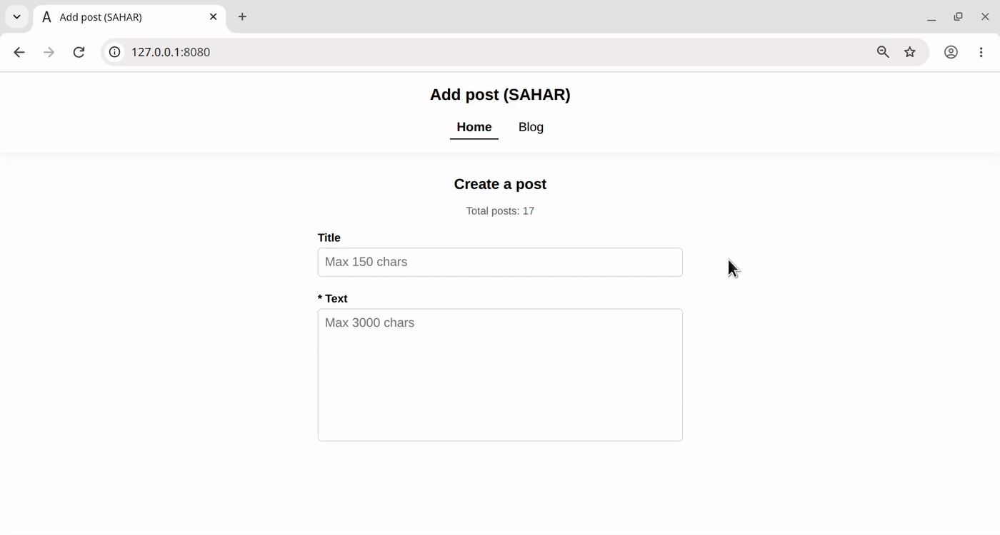

<strong>GIF 1: Создание поста, бесконечный скролл и работа кнопки назад</strong>

  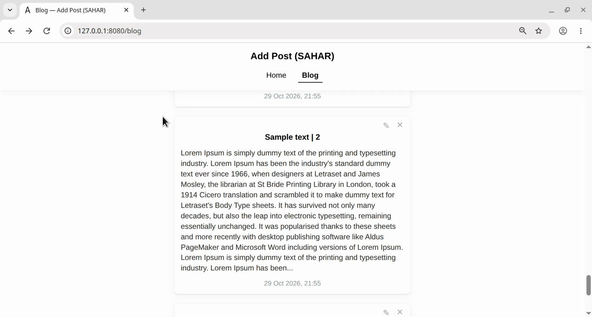

<strong>GIF 2: Редактирование и удаление поста</strong>

 

<a href="https://vkvideo.ru/video-161152224_456239088" target="_blank">
  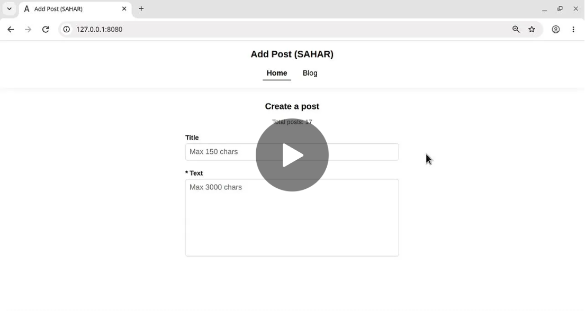
</a>

<strong>Полная демонстрация возможностей прототипа</strong>

 

**Содержание:** 
1. [Структура проекта и характеристики локального ПК](#paragraph_1)
2. [Ключевые возможности и архитектура](#paragraph_2)
   - [2.1. Модульность](#feature_2_1)
   - [2.2. Многостраничный SPA-роутинг без перезагрузки страницы (HTMX 4.0.0)](#feature_2_2)
   - [2.3. Комплексная SEO-архитектура и SSR без накладных расходов через Askama](#feature_2_3)
   - [2.4. Курсорная пагинация в Infinite Scroll, SEO-индексация ленты постов, тестирование лоадеров и умное сохранение скролла](#feature_2_4)
   - [2.5. Денормализованная архитектура из 3 таблиц ScyllaDB и распределённый счётчик постов](#feature_2_5)
   - [2.6. Автоматическая инициализация схемы БД](#feature_2_6)
   - [2.7. Полный цикл CRUD и умный UX форм](#feature_2_7)
   - [2.8. Усиленная архитектура кибербезопасности](#feature_2_8)
   - [2.9. Информативное логирование сервера](#feature_2_9)
3. [Установка и настройка](#paragraph_3)
4. [Подготовка базы данных](#paragraph_4)
5. [Запуск проекта](#paragraph_5)

---

### 1. Структура проекта и характеристики локального ПК

**Строение:**  
[Full code](https://github.com/AndrewShedov/add-post--SAHAR/tree/main/main) | [Cargo.toml](https://github.com/AndrewShedov/add-post--SAHAR/blob/main/main/Cargo.toml) 

**Структура:**  
**S**cyllaDB v2026.2.6 (driver: v1.8.0). 
**A**ctix Web v4.15.0. 
**H**TMX v4.0.0. 
**A**skama v0.16. 
**R**ust v1.98.0. 

**Характеристики локального ПК:**  
OS: Debian 12.

---

### 2. Ключевые возможности и архитектура

#### 2.1. Модульность
Серверная часть разделена на логически изолированные модули в директории `src/`:
* `src/main.rs` — Точка входа, Fail-Fast валидация конфигурации (`security::init_security_config()`), инициализация HTTP-сервера, настройка защитных заголовков (Security Headers), таймаутов, лимитов входящих данных, перехватчиков ошибок экстракторов (CWE-209) и маршрутизации.
* `src/models.rs` — Структуры данных предметной области (`Post`, `PostForm`, параметры запросов) и структуры компилируемых шаблонов Askama `#[derive(Template)]` (включая флаг индексации `noindex`).
* `src/db.rs` — Подключение к ScyllaDB (настраиваемое через `SCYLLA_URI`), автоматическая инициализация схемы, постраничная синхронизация счётчика при старте (`query_single_page`), состояние выборки `PostLookup` (`Found` / `NotFound` / `Unavailable`), хелпер `is_lwt_applied()`, а также подготовка `BatchType::Logged` и `PreparedStatement` внутри структуры `AppState`.
* `src/handlers.rs` — Асинхронные обработчики маршрутов Actix Web для отображения страниц и выполнения атомарных и согласованных операций CRUD (с сохранением текста форм через `HX-Reswap: none` при ошибках).
* `src/security.rs` — Fail-Fast проверка конфигурации (`init_security_config`), Fail-Closed валидация `Sec-Fetch-Site`/`Origin`/`Referer` для Anti-CSRF, однопроходная санитизация ввода (`sanitize_text_input`), изоляция внутренних ошибок по CWE-209 (`internal_error`), определение типа запроса HTMX 4 и функции SSR/частичного рендеринга.

---

#### 2.2. Многостраничный SPA-роутинг без перезагрузки страницы (HTMX 4.0.0)
Приложение обеспечивает плавную навигацию в стиле **Single-Page Application** между несколькими страницами без загрузки тяжёлых WebAssembly-бандлов и клиентских JS-роутеров:

| Метод | Маршрут | Описание |
| :--- | :--- | :--- |
| `GET` | `/` | **Главная страница (Home):** Форма создания нового поста + динамический счётчик всех постов (`Total posts`). |
| `GET` | `/blog` | **Лента блога (Blog):** Список превью постов (по 5 постов за порцию) с бесконечной прокруткой (`?before=<timestamp>`). |
| `GET` | `/posts/{id}` | **Страница полного поста:** Отображает полный заголовок, дату публикации, полный текст поста и кнопки Редактирования/Удаления. |
| `GET` | `/posts/{id}/edit` | **Страница редактирования:** Предзаполненная форма с умной панелью кнопок `Back`, `Cancel` и `Publish` (`?from=blog` или `?from=post`), закрытая от индексации (`noindex, nofollow`). |
| `POST` | `/api/posts` | **Создание поста:** Санитизирует, валидирует и атомарно (`Logged Batch`) сохраняет новый пост в ScyllaDB, увеличивает счётчик и возвращает обновлённую форму + всплывающий Toast. |
| `POST` | `/api/posts/{id}/edit` | **Обновление поста:** Обновляет пост в обеих таблицах ScyllaDB через LWT (`IF EXISTS`), записывает `/posts/{id}` в историю браузера и возвращает обновлённый пост + Toast. |
| `DELETE` | `/api/posts/{id}` | **Удаление поста:** Читает эталонные ключи из ScyllaDB (`posts_by_id`), атомарно удаляет запись в обеих таблицах через LWT (`IF EXISTS`), уменьшает счётчик и удаляет карточку из DOM (или перенаправляет в `/blog` при удалении со страницы полного поста). |

**SPA-навигация и работа с историей браузера:**
* В соответствии с явной моделью гипермедийных атрибутов **HTMX 4.0.0** и строгим стандартом **HTML5**, навигационные ссылки используют нативный префикс `data-hx-*`: `data-hx-get`, `data-hx-target="#main-content"`, `data-hx-swap="innerHTML"` и `data-hx-push-url="true"` непосредственно на семантических тегах `<a>`.
* Главный контейнер страницы размечен атрибутом `<main id="main-content" data-hx-history-elt>`.

На стороне сервера функция `is_htmx_partial_request()` различает три типа входящих запросов:
1. **Первичная загрузка страницы или заход поискового робота (заголовок `HX-Request` отсутствует):** Сервер отдаёт полный HTML-документ (`BaseTemplate` + контент страницы).
2. **Обычный SPA-переход по ссылке (`hx-request: true`, `hx-request-type: partial`):** Сервер возвращает только обновлённый тег `<title>` и внутренний HTML-фрагмент для контейнера `#main-content`.
3. **Навигация кнопками мыши/браузера «Назад / Вперёд» (`hx-history-restore-request: true` или `hx-request-type: full`):** Сервер отдаёт документ с обёрткой `<main id="main-content" data-hx-history-elt>`, позволяя HTMX 4 бесшовно восстановить содержимое `<main>` без полной перезагрузки вкладки браузера.

  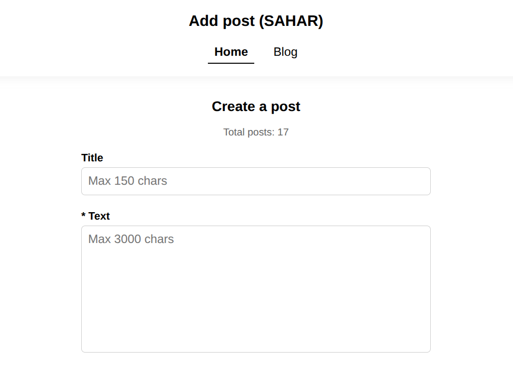

<strong>Скрин 1: Главная страница — Создание поста и счётчик публикаций</strong>

---

#### 2.3. Комплексная SEO-архитектура и SSR без накладных расходов через Askama
В отличие от классических клиентских SPA, отдающих пустой `

`, шаблонизатор Askama компилирует HTML-шаблоны напрямую в нативный машинный код Rust на этапе сборки проекта. Благодаря использованию нативного HTML5-префикса `data-hx-*` и отказу от избыточных закрывающих слэшей на void-элементах, каждый маршрут прототипа спроектирован для **индексации поисковыми системами** и проходит строгую валидацию **W3C HTML5 ([validator.w3.org](https://validator.w3.org/nu/))** без ошибок, предупреждений или `Info`-замечаний.

  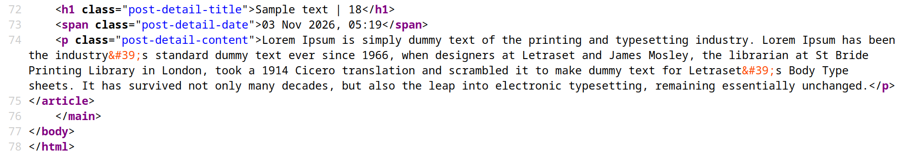

<strong>Скрин 2: Серверный рендеринг (SSR) страницы полного поста — Исходный код</strong>

  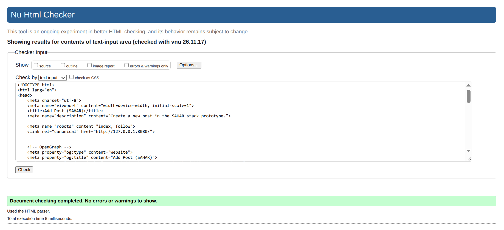

<strong>Скрин 3: Проверка исходного кода в W3C Nu Html Checker (https://validator.w3.org/nu) — 0 ошибок, 0 предупреждений</strong>

#### 1. Динамические метатеги и OpenGraph (`src/handlers.rs`, `src/security.rs`, `templates/base.html`)
Каждая страница (`/`, `/blog`, `/posts/{id}`, `/posts/{id}/edit`) на стороне сервера формирует уникальные теги `<title>`, `<meta name="description">`, `<meta property="og:title">` и `<meta property="og:description">`. В файле **`src/handlers.rs`** (в функциях `index`, `blog`, `view_post`, `edit_post_page`) генерируются индивидуальный заголовок и описание для текущего маршрута (или текста открытого поста), функция `render_page()` в **`src/security.rs`** передаёт их в структуру `BaseTemplate`, а шаблон **`templates/base.html`** рендерит их внутри секции `<head>`.

~~~html
<title>Sample text | 18 — Add Post (SAHAR)</title>
    <meta name="description" content="Lorem Ipsum is simply dummy text of the printing and typesetting industry. Lorem Ipsum has been the industry&#39;s standard dummy text ever since 1966, wh...">
    <meta name="robots" content="index, follow">
    <link rel="canonical" href="http://127.0.0.1:8080/posts/3fa4febf65d442cbad3d776399f0507f">

    <!-- OpenGraph -->
    <meta property="og:type" content="website">
    <meta property="og:title" content="Sample text | 18 — Add Post (SAHAR)">
    <meta property="og:description" content="Lorem Ipsum is simply dummy text of the printing and typesetting industry. Lorem Ipsum has been the industry&#39;s standard dummy text ever since 1966, wh...">
~~~

#### 2. Самоссылающиеся канонические ссылки (Self-Referencing Canonical URLs)
Все индексируемые страницы содержат тег `<link rel="canonical" href="{{ canonical_base_url }}{{ current_path }}">` (по умолчанию `http://127.0.0.1:8080`, настраивается через `CANONICAL_BASE_URL`). Так как маршрут `/posts/{id}` понимает UUID как с дефисами, так и без дефисов, канонический тег всегда нормализует адрес к чистому 32-символьному hex-формату (`/posts/{id_hex}`), исключая появление дублей в поисковой выдаче (`src/handlers.rs`, `src/security.rs`, `templates/base.html`).

#### 3. Честные HTTP-статусы `404 Not Found` / `503 Service Unavailable` и управление `noindex`
При обращении к несуществующему или удалённому ID поста сервер возвращает настоящий заголовок ответа `HTTP 404 Not Found` вместо `200 OK` (защищая сайт от *Soft 404*). Кроме того, как для страниц `404`, так и для служебной формы редактирования (`/posts/{id}/edit`) флаг `noindex: true` в `BaseTemplate` выводит `<meta name="robots" content="noindex, nofollow">` и полностью подавляет вывод `<link rel="canonical">`, исключая конфликтующие сигналы для поисковых роботов и индексацию технических страниц (`src/security.rs`, `templates/base.html`, `templates/post_detail.html`). При временной недоступности ScyllaDB маршруты честно отдают `HTTP 503 Service Unavailable` с заголовком `Retry-After: 5`, чтобы краулер не удалил посты из индекса при сбое БД.

---

#### 2.4. Курсорная пагинация в Infinite Scroll, SEO-индексация ленты постов, тестирование лоадеров и умное сохранение скролла

#### 2.4.1. Курсорная пагинация (Keyset / Cursor-Based Pagination: `?before=1792191698274`)
Вместо пагинации через `OFFSET` (`?page=2`), которая замедляется по мере роста базы данных и приводит к дублированию или пропуску постов при добавлении новых записей, в ленте `/blog` применяется **курсорная пагинация со сложностью `O(1)`**.

После каждых 5 превью постов `<article class="post-item">` в DOM-дереве ленты автоматически формируется элемент подгрузки со ссылкой на следующий временной курсор (например, `?before=1792581672794`):

~~~html

    <a href="/blog?before=1792581672794">Loading more posts... ⏳</a>

~~~

> **💡 Что означает число `1792191698274` в адресе `http://127.0.0.1:8080/blog?before=1792191698274`**  
> В момент создания поста сервер фиксирует точное всемирное время (UTC) в миллисекундах, прошедших с начала эпохи Unix — 1 января 1970 года (`Utc::now().timestamp_millis()`, например `1792191698274`), и записывает его в колонку `created_at`. После создания поста его метка `created_at` является частью первичного кластерного ключа в ScyllaDB и **никогда не изменяется** (даже если заголовок или текст поста впоследствии были отредактированы).

> **💡 Как работает курсор**  
> Когда сервер выбирает порцию из 5 постов (`LIMIT 5`), он берёт метку `created_at` у 5-го (самого нижнего) поста в текущей выборке и передаёт её как курсор `next_timestamp` (`?before=1792191698274`). Следующий запрос выполняет:
>
> ~~~sql
> SELECT created_at, id, title, content FROM posts WHERE bucket = 1 AND created_at < 1792191698274 LIMIT 5
> ~~~
>
> ScyllaDB мгновенно переходит к этой миллисекунде в кластерном индексе за константное время **`O(1)`** без сканирования предыдущих строк. Даже если сверху в ленту добавят 10 000 новых постов, адрес `/blog?before=1792191698274` навсегда останется привязанным к этой точной исторической точке и всегда вернёт те же самые 5 исторических постов.

#### 2.4.2. Гибридный Infinite Scroll для людей + 100% SEO-индексация для поисковых роботов
Классическая проблема бесконечного скролла заключается в том, что поисковые роботы (Googlebot, YandexBot, Bingbot) не крутят колесо мыши (не скроллят страницу вниз) и не вызывают JS-события прокрутки, из-за чего старые посты остаются неиндексированными.
В данном прототипе эта проблема решена с помощью **гибридного гипермедийного паттерна** в конце шаблона `templates/post_items.html` (с безопасным сопоставлением `if let Some(ts)` без `.unwrap()`):

~~~html

    <!-- Hybrid Infinite Scroll trigger (for humans) + Crawlable SEO link (for search bots) -->
    

        <a href="/blog?before={{ ts }}">Loading more posts... ⏳</a>
    


~~~

1. **Для пользователей:** Когда пользователь прокручивает ленту вниз и элемент `
` появляется в области видимости экрана, триггер `data-hx-trigger="revealed"` автоматически отправляет фоновый запрос с заголовком `HX-Request`. Сервер возвращает только следующие 5 семантических превью постов `<article class="post-item">`, а `data-hx-swap="outerHTML"` бесшовно заменяет индикатор загрузки новыми постами.
2. **Для поисковых роботов и режима без JavaScript:** Поисковые краулеры не выполняют `revealed`, но видят внутри `
` стандартную семантическую ссылку `<a href="/blog?before=1792191698274">`. Переходя по ней без заголовка `HX-Request`, робот получает от Rust-бэкенда **полноценную SSR HTML-страницу** с **самоссылающимся каноническим тегом** (`<link rel="canonical" href="http://127.0.0.1:8080/blog?before=1792191698274">`) и следующей ссылкой `<a href="/blog?before=...">`. Таким образом поисковые системы проходят по цепочке курсоров и индексируют всю историю публикаций от самых свежих до самого первого поста в базе данных.

#### 2.4.3. Тестирование лоадеров загрузки (`Loader Delay`) и их влияние на SEO
Поскольку на локальном сервере (`127.0.0.1`) связка Rust + Actix Web + ScyllaDB отдаёт данные за доли миллисекунды (`~0.3 мс`), человеческий глаз не успевает заметить отображение лоадеров.
Для визуального тестирования работы первоначального лоадера ленты (**`Loading posts... ⏳`**) и лоадера бесконечной подзагрузки постов (**`Loading more posts... ⏳`**) в коде предусмотрены специальные блоки искусственной задержки, обрамлённые метками **`// Loader Delay`** и **`// /Loader Delay`**.

По умолчанию эти блоки закомментированы. Чтобы включить режим визуального тестирования лоадеров, достаточно раскомментировать код между метками `// Loader Delay` и `// /Loader Delay` в следующих 3 файлах:

1. **`src/main.rs`** — константа времени задержки в миллисекундах (например, `800` мс):

~~~rust
// Loader Delay
// pub const LOADER_DELAY_MS: u64 = 800;
// /Loader Delay
~~~

2. **`src/handlers.rs`** (в начале функции `pub async fn blog`) — искусственная пауза ответа сервера при запросе ленты:

~~~rust
// Loader Delay
// if crate::LOADER_DELAY_MS > 0 {
//     tokio::time::sleep(std::time::Duration::from_millis(crate::LOADER_DELAY_MS)).await;
// }
// /Loader Delay
~~~

3. **`static/app.js`** (в конце файла) — клиентский показ лоадера первой загрузки `Loading posts... ⏳` при переходе во вкладку `/blog` и при обновлении страницы клавишей `F5`:

~~~javascript
// Loader Delay
// document.addEventListener('htmx:before:request', (e) => {
//     const target =
//         (e.detail && e.detail.ctx && e.detail.ctx.target) ||
//         (e.detail && e.detail.target) ||
//         e.target;
//     const sourceElt =
//         (e.detail && e.detail.ctx && e.detail.ctx.sourceElement) || e.target;
//
//     if (
//         target &&
//         target.id === 'main-content' &&
//         sourceElt &&
//         sourceElt.getAttribute('href') === '/blog' &&
//         !shouldRestoreBlogScroll
//     ) {
//         target.innerHTML =
//             '

Loading posts... ⏳

';
//     }
// });
//
// window.addEventListener('beforeunload', () => {
//     if (window.location.pathname.startsWith('/blog')) {
//         const mainContent = document.getElementById('main-content');
//         if (mainContent) {
//             mainContent.innerHTML =
//                 '

Loading posts... ⏳

';
//         }
//     }
// });
// /Loader Delay
~~~

> **💡 Степени влияния лоадеров на SEO:**
> 1. **Базовая конфигурация по умолчанию (активен только лоадер подзагрузки постов `Loading more posts... ⏳`, блоки `Loader Delay` закомментированы) — 0% негативного влияния на SEO:**
>    Первые 5 постов рендерятся на сервере (SSR) в семантических тегах `<article class="post-item">` и отдаются поисковому роботу мгновенно без каких-либо задержек. Сам блок `
Loading more posts... ⏳
` внизу 5-го поста содержит семантическую ссылку `<a href="/blog?before=...">`: поисковый робот воспринимает её как стандартную ссылку пагинации, переходит по ней и так же мгновенно индексирует следующие порции постов. Показатели скорости ответа сервера (**TTFB**) и отрисовки контента (**LCP**) остаются эталонными.
> 2. **Включение режима `Loader Delay` и лоадера первой загрузки постов (`Loading posts... ⏳`) — Негативное влияние на метрики скорости Core Web Vitals:**
>    Хотя включение этих блоков сохраняет SSR-отдачу постов в исходном коде страницы (`Ctrl + U`), искусственная задержка `LOADER_DELAY_MS` на сервере напрямую увеличивает время ожидания первого байта (**TTFB — Time to First Byte**) и задерживает финальную отрисовку контента (**LCP — Largest Contentful Paint**), а клиентский перехват с показом `Loading posts... ⏳` временно замещает контент во время навигации. Поскольку поисковые алгоритмы учитывают скорость ответа сервера и метрики Core Web Vitals при ранжировании, блоки `Loader Delay` предназначены **исключительно для локального тестирования и демонстрации UI**, а в основном режиме и продакшене должны оставаться закомментированными.

#### 2.4.4. Умное восстановление позиции скролла и эфемерный кэш ленты (Zero Memory Leak)
В `static/app.js` стандартные скачки прокрутки браузера отключены (`history.scrollRestoration = 'manual'`) и заменены точным управлением позицией скролла.

**При переходе из ленты в пост (`/blog` -> `/posts/{id}` или `/posts/{id}/edit`):**
1. Текущая вертикальная координата прокрутки сохраняется в оперативной памяти (`savedBlogScrollY = window.scrollY`).
2. Если пользователь прокрутил ленту дальше первых 5 постов через Infinite Scroll (`loadedPostsCount > 5`), в оперативной памяти временно сохраняется DOM-снимок контейнера `#feed-list` (`savedBlogFeedHtml`, с защитным лимитом `< 2 МБ`). Если же на экране `<= 5` постов, `savedBlogFeedHtml` остаётся равным `null` (`0 байт`), так как сервер и так возвращает первые 5 постов.
3. Открытая страница полного поста автоматически прокручивается в самое начало (`window.scrollTo(0, 0)`), чтобы пост всегда читался с заголовка.

**При возврате назад в ленту (`← Back to Blog`, кнопка `Back` или боковая кнопка мыши «Назад»):**
1. Если через Infinite Scroll были подгружены дополнительные партии постов, они мгновенно восстанавливаются из `savedBlogFeedHtml` в `#feed-list` и переинициализируются вызовом `htmx.process(feedList)`.
2. Окно мгновенно возвращается на точный пиксель прокрутки (`window.scrollTo(0, savedBlogScrollY)`), с которого пользователь перешёл в пост.
3. **Мгновенная очистка памяти и сброс при мутациях:** В ту же миллисекунду после восстановления ленты переменная `savedBlogFeedHtml` принудительно обнуляется (`savedBlogFeedHtml = null`), освобождая оперативную память до `0 байт`. При создании, редактировании или подтверждённом удалении поста (`submit` на формах и `htmx:before:request` после подтверждения `data-hx-confirm`) одновременно сбрасываются и снимок `savedBlogFeedHtml = null`, и флаг с координатой (`shouldRestoreBlogScroll = false; savedBlogScrollY = 0;`), что гарантирует отображение свежих данных из ScyllaDB с начала ленты без ложных скачков скролла.

**Визуальный контроль:**
Для обеспечения полной прозрачности и информативности работы этого механизма в прототипе в `static/app.js` оставлено логирование жизненного цикла кэша и координат скролла. Открыв консоль разработчика в браузере (F12), можно в реальном времени наблюдать за процессами сохранения координаты Y, фиксации размера выделенной памяти под DOM-снимок (в символах/байтах), точного восстановления позиции и мгновенного обнуления переменной (`savedBlogFeedHtml = null`). 
Ниже приведены результаты тестирования навигации в ленте блога, состоящей из 17 постов:

> **💡 Примечание:**
> В данном прототипе все вызовы `console.log(...)` (включая вывод содержимого `savedBlogFeedHtml`) сохранены намеренно для наглядной отладки и визуальной демонстрации в консоли браузера.

  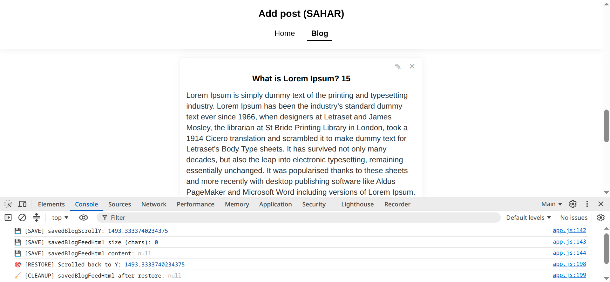

<strong>Скрин 4: Переход на 15-й пост (верхняя часть ленты, ≤ 5 постов) и возврат в блог. Поскольку подгрузка Infinite Scroll ещё не задействована, снимок DOM не создаётся (0 байт, null), сохраняется только скролл, который успешно восстанавливается при возврате.</strong>

  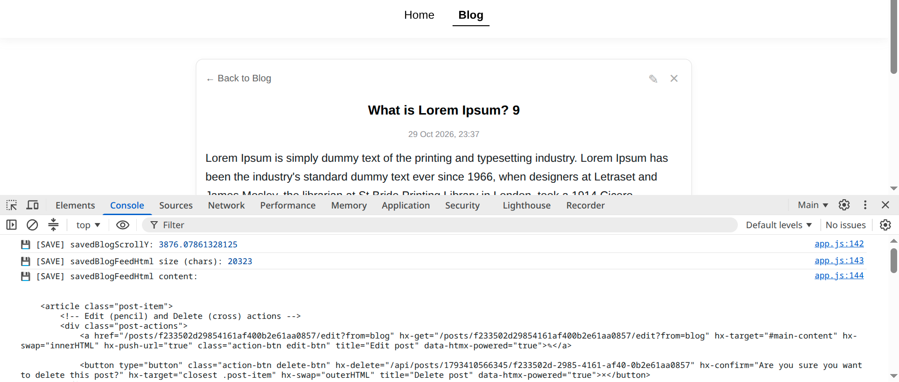

<strong>Скрин 5: Переход на 9-й пост (глубокая прокрутка). Алгоритм сохраняет координату (Y: 3738) и фиксирует размер DOM-снимка подгруженной ленты (28352 символа), предотвращая потерю загруженных данных.</strong>

  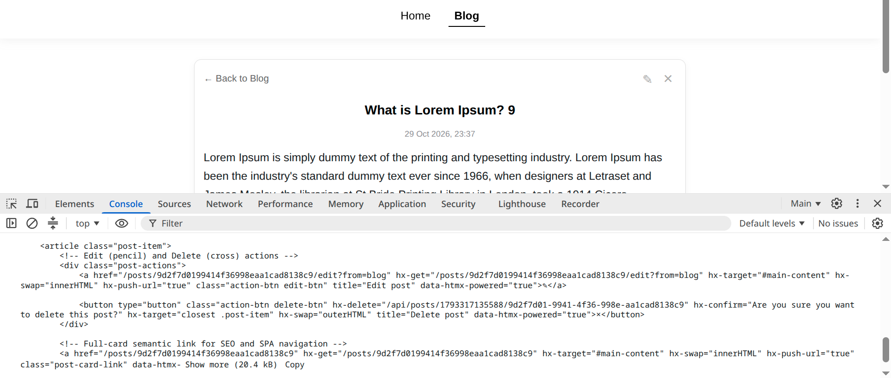

<strong>Скрин 6: Инспекция переменной <code>savedBlogFeedHtml</code>. В консоли видно семантическое содержимое кэша и его фактический вес в памяти браузера (28.4 kB).</strong> <em>(Это скриншот версии v1.0.0: начиная с v1.1.0, к HTMX-атрибутам добавлен префикс <code>data-</code>, а маршрут удаления обновлён до <code>/api/posts/{id}</code>.)</em>

  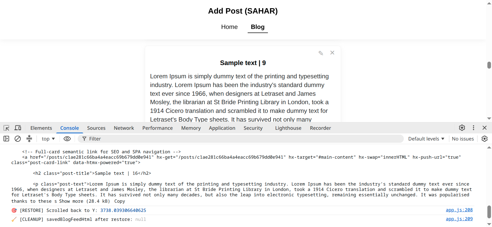

<strong>Скрин 7: Возврат назад в ленту. Мгновенное восстановление скролла с пиксельной точностью и принудительное обнуление эфемерного кэша (<code>🧹 [CLEANUP] savedBlogFeedHtml after restore: null</code>), полностью освобождающее память.</strong> <em>(Это скриншот версии v1.0.0: начиная с v1.1.0, к HTMX-атрибутам добавлен префикс <code>data-</code>.)</em>

---

#### 2.5. Денормализованная архитектура из 3 таблиц ScyllaDB и распределённый счётчик постов
Для достижения **константной скорости чтения и записи `O(1)`** на всех маршрутах без использования медленных запросов `ALLOW FILTERING`, в пространстве ключей `sahar_prototype_add_post` реализована денормализованная схема из 3 таблиц:

1. **`post_counts`** — Хранит распределённый счётчик `counter` (`scylla::value::Counter`) для мгновенного вывода общего числа постов (`Total posts`) на главной странице (`/`). При запуске сервера автоматически синхронизируется с фактическим числом записей через постраничный проход `query_single_page` (`page_size = 500`):

~~~sql
cqlsh:sahar_prototype_add_post> DESCRIBE TABLE post_counts;

CREATE TABLE sahar_prototype_add_post.post_counts (
    bucket int,
    total counter,
    PRIMARY KEY (bucket)
) WITH bloom_filter_fp_chance = 0.01
    AND caching = {'keys': 'ALL', 'rows_per_partition': 'ALL'}
    AND comment = ''
    AND compaction = {'class': 'IncrementalCompactionStrategy'}
    AND compression = {'sstable_compression': 'LZ4WithDictsCompressor'}
    AND crc_check_chance = 1
    AND default_time_to_live = 0
    AND gc_grace_seconds = 864000
    AND max_index_interval = 2048
    AND memtable_flush_period_in_ms = 0
    AND min_index_interval = 128
    AND speculative_retry = '99.0PERCENTILE'
    AND tombstone_gc = {'mode': 'repair', 'propagation_delay_in_seconds': '3600'};
~~~

2. **`posts`** — Хранит ленту публикаций, упорядоченную по времени на уровне кластерного ключа (`PRIMARY KEY (bucket, created_at, id) WITH CLUSTERING ORDER BY (created_at DESC, id ASC)`), обеспечивая выборку ленты `/blog` за `O(1)`:

~~~sql
cqlsh:sahar_prototype_add_post> DESCRIBE TABLE posts;

CREATE TABLE sahar_prototype_add_post.posts (
    bucket int,
    created_at timestamp,
    id uuid,
    content text,
    title text,
    PRIMARY KEY (bucket, created_at, id)
) WITH CLUSTERING ORDER BY (created_at DESC, id ASC)
    AND bloom_filter_fp_chance = 0.01
    AND caching = {'keys': 'ALL', 'rows_per_partition': 'ALL'}
    AND comment = ''
    AND compaction = {'class': 'IncrementalCompactionStrategy'}
    AND compression = {'sstable_compression': 'LZ4WithDictsCompressor'}
    AND crc_check_chance = 1
    AND default_time_to_live = 0
    AND gc_grace_seconds = 864000
    AND max_index_interval = 2048
    AND memtable_flush_period_in_ms = 0
    AND min_index_interval = 128
    AND speculative_retry = '99.0PERCENTILE'
    AND tombstone_gc = {'mode': 'repair', 'propagation_delay_in_seconds': '3600'};
~~~

3. **`posts_by_id`** — Хранит посты с первичным ключом `id uuid PRIMARY KEY`, обеспечивая мгновенный поиск поста за `O(1)` при открытии страницы полного поста (`/posts/{id}`), страницы редактирования (`/posts/{id}/edit`) и при получении эталонных ключей `bucket` / `created_at` для атомарного обновления и удаления через LWT (`IF EXISTS`):

~~~sql
cqlsh:sahar_prototype_add_post> DESCRIBE TABLE posts_by_id;

CREATE TABLE sahar_prototype_add_post.posts_by_id (
    id uuid,
    bucket int,
    content text,
    created_at timestamp,
    title text,
    PRIMARY KEY (id)
) WITH bloom_filter_fp_chance = 0.01
    AND caching = {'keys': 'ALL', 'rows_per_partition': 'ALL'}
    AND comment = ''
    AND compaction = {'class': 'IncrementalCompactionStrategy'}
    AND compression = {'sstable_compression': 'LZ4WithDictsCompressor'}
    AND crc_check_chance = 1
    AND default_time_to_live = 0
    AND gc_grace_seconds = 864000
    AND max_index_interval = 2048
    AND memtable_flush_period_in_ms = 0
    AND min_index_interval = 128
    AND speculative_retry = '99.0PERCENTILE'
    AND tombstone_gc = {'mode': 'repair', 'propagation_delay_in_seconds': '3600'};
~~~

> **💡 О масштабировании в продакшене (Партиционирование через `bucket` и построчный кэш Seastar):**
> * **Временное бакетирование (`bucket int`):** Схема таблицы `posts` заранее спроектирована с ключом партиционирования `bucket int`. В данном прототипе для простоты используется фиксированное значение `bucket = 1`. В высоконагруженном продакшен-кластере в поле `bucket` динамически передаётся число временного окна (например, `ГГГГММ` или `ГГГГММДД`), что автоматически делит глобальную ленту на компактные партиции (< 100 МБ) и равномерно распределяет нагрузку по всем узлам кластера и ядрам процессора (шардам) без изменения CQL-схемы таблиц.
> * **Построчный LRU-кэш (`rows_per_partition: 'ALL'`):** В отличие от старой Apache Cassandra, движок Seastar в ScyllaDB полностью обходит Linux Page Cache и реализует **построчное заполнение и построчное LRU-вытеснение кэша (Row-Granularity Cache)**. Настройка `caching = {'keys': 'ALL', 'rows_per_partition': 'ALL'}` не загружает всю партицию целиком в память — она удерживает в оперативной памяти (RAM) только самые «горячие» недавно запрошенные строки ленты, автоматически вытесняя старые исторические записи в сжатые по алгоритму `LZ4` файлы SSTables на диске.

---

#### 2.6. Автоматическая инициализация схемы БД
Для удобства запуска прототипа «из коробки» (Zero-Config Reproducibility), модуль `src/db.rs` автоматически создаёт пространство ключей `sahar_prototype_add_post` и необходимые таблицы при старте приложения перед переключением активной сессии:

~~~rust
    // 1. Устанавливаем соединение с локальным узлом ScyllaDB
    let scylla_uri =
        std::env::var("SCYLLA_URI").unwrap_or_else(|_| "127.0.0.1:9042".to_string());
    let session = SessionBuilder::new()
        .known_node(scylla_uri)
        .connection_timeout(Duration::from_secs(5))
        .build()
        .await
        .expect("Failed to connect to ScyllaDB");

    // 2. Автоматически создаём keyspace и таблицы, если они ещё не существуют.
    // ПРИМЕЧАНИЕ (Best Practice и Кибербезопасность):
    // Автоинициализация включена здесь для удобства воспроизводимости прототипа без ручной настройки.
    // В продакшен-окружении миграции схемы (CREATE/ALTER/DROP) должны выполняться отдельно
    // через специализированный инструмент миграций, а веб-сервер должен подключаться
    // под ограниченной ролью БД (только права SELECT/MODIFY — Принцип наименьших привилегий).
    initialize_schema(&session).await;

    // 3. Переключаем активную сессию на созданный (или существующий) keyspace
    session
        .use_keyspace("sahar_prototype_add_post", false)
        .await
        .expect("Failed to select keyspace");
~~~

---

#### 2.7. Полный цикл CRUD и умный UX форм
* **Создание поста (`/`):** Поддерживает необязательный заголовок `Title` (до 150 символов) и обязательное поле `* Text` (до 3000 символов). Кнопка `Add` скрыта по умолчанию и появляется только тогда, когда в обязательное поле `* Text` введён текст. Параллельные дубликаты отправки отсекаются на уровне ядра HTMX 4 через `data-hx-sync="this:drop"` и `data-hx-disable="find button[type='submit']"`. Запись в `posts` и `posts_by_id` выполняется атомарно через нативный `BatchType::Logged` ScyllaDB. После успешной отправки форма автоматически очищается, счётчик `Total posts` увеличивается на единицу, и с помощью атрибута `data-hx-swap-oob` (`templates/toast.html`) в углу экрана всплывает Toast-уведомление. При ошибке валидации (`400`) или сбое БД (`503`) сервер возвращает заголовок `HX-Reswap: none` и красный тост — набранный в форме текст сохраняется.
* **Гибкая настройка длины заголовка и текста в превью и полном посте:**
  * **Размер превью поста в ленте (`/blog`):** В базе данных ScyllaDB пост всегда хранится целиком, но для компактного отображения карточек `<article class="post-item">` в ленте `/blog` длина выводимого заголовка и текста регулируется в файле **`src/handlers.rs`** (внутри функции `render_blog_feed_html`) с помощью `truncate()` из **`src/security.rs`**:

~~~rust
title: truncate(&title, 100),   // Максимум 100 символов для заголовка в превью ленты
content: truncate(&content, 730), // Максимум 730 символов для текста в превью ленты
~~~

  Если заголовок или текст превышают указанные значения, в превью ленты они обрезаются с добавлением многоточия (`...`), а при переходе на страницу полного поста (`/posts/{id}`) или редактирования (`/posts/{id}/edit`) отображаются полностью.
  * **Максимальный размер полного поста:** Задаётся синхронно на трёх уровнях — в HTML-шаблонах **`templates/home.html`** и **`templates/post_edit.html`** (`maxlength="150"` и `maxlength="3000"`), на сервере в **`src/handlers.rs`** + **`src/security.rs`** (`sanitize_text_input` с лимитами в `150` и `3000` скалярных значений Unicode), а также лимитом полезной нагрузки формы в **`src/main.rs`** (`web::FormConfig::default().limit(65536)`).
* **Редактирование поста (`/posts/{id}/edit`) и реактивный сброс состояния:**
  Доступно по клику на иконку карандаша (`✎`) как на карточке превью в ленте (`/blog`), так и внутри полного поста (`/posts/{id}`). Для отслеживания изменений формы и отката к исходным данным не используются клиентские стейт-менеджеры, хуки состояния или кэширование JSON-объектов в памяти, вместо этого применён нативный **DOM Dataset паттерн** (`templates/post_edit.html` + `static/app.js`):
  * При серверном рендеринге шаблона **`templates/post_edit.html`** Askama записывает эталонные значения из ScyllaDB в нативные HTML5-атрибуты `data-original` непосредственно на самих полях ввода:

~~~html
<input type="text" id="edit-title" name="title" value="{{ post.title }}" data-original="{{ post.title }}" ...>
<textarea id="edit-content" name="content" data-original="{{ post.content }}" ...>{{ post.content }}</textarea>
~~~

  * Интерфейс оснащён контекстным рядом кнопок **`Back, Cancel, Publish`**:
    * **`Back`** всегда видна и возвращает пользователя ровно на ту страницу, с которой он перешёл к редактированию (в ленту `/blog` или в полный пост `/posts/{id}`).
    * **`Cancel`** и **`Publish`** по умолчанию скрыты и появляются динамически только тогда, когда текущее значение `.value` отличается от эталона в `.dataset.original` (проверка выполняется в `static/app.js` без перерисовки DOM).
    * При нажатии на **`Cancel`** функция `resetEditFormToOriginal()` мгновенно восстанавливает исходный заголовок и текст поста напрямую из `dataset.original` без повторного запроса к серверу и базе данных, после чего кнопки `Cancel` и `Publish` автоматически скрываются:

~~~javascript
function resetEditFormToOriginal() {
    const editTitle = document.getElementById('edit-title');
    const editContent = document.getElementById('edit-content');
    if (!editTitle || !editContent) return;

    editTitle.value = editTitle.dataset.original || '';
    editContent.value = editContent.dataset.original || '';
    updateEditButtons();
}
~~~
  * При сохранении изменения записываются через LWT (`IF EXISTS`) в обе таблицы (`posts_by_id` и `posts`), а при ошибке `400`/`404`/`503` текст в форме остаётся целым за счёт `HX-Reswap: none`.
* **Удаление поста (`×`):** Берёт эталонные `bucket` и `created_at` напрямую из ScyllaDB (`posts_by_id`), атомарно фиксирует удаление с помощью ScyllaDB Lightweight Transactions (`IF EXISTS`) в обеих таблицах (с компенсирующим LWT-откатом `IF NOT EXISTS` при сетевом сбое), безопасно уменьшает счётчик `post_counts` (без ухода в минус) и удаляет карточку в `/blog` только при подтверждённом статусе `2xx`/`404` в `htmx:finally:request` (`data-hx-swap="none"`) либо перенаправляет в `/blog` с уведомлением (при удалении со страницы `/posts/{id}`).

  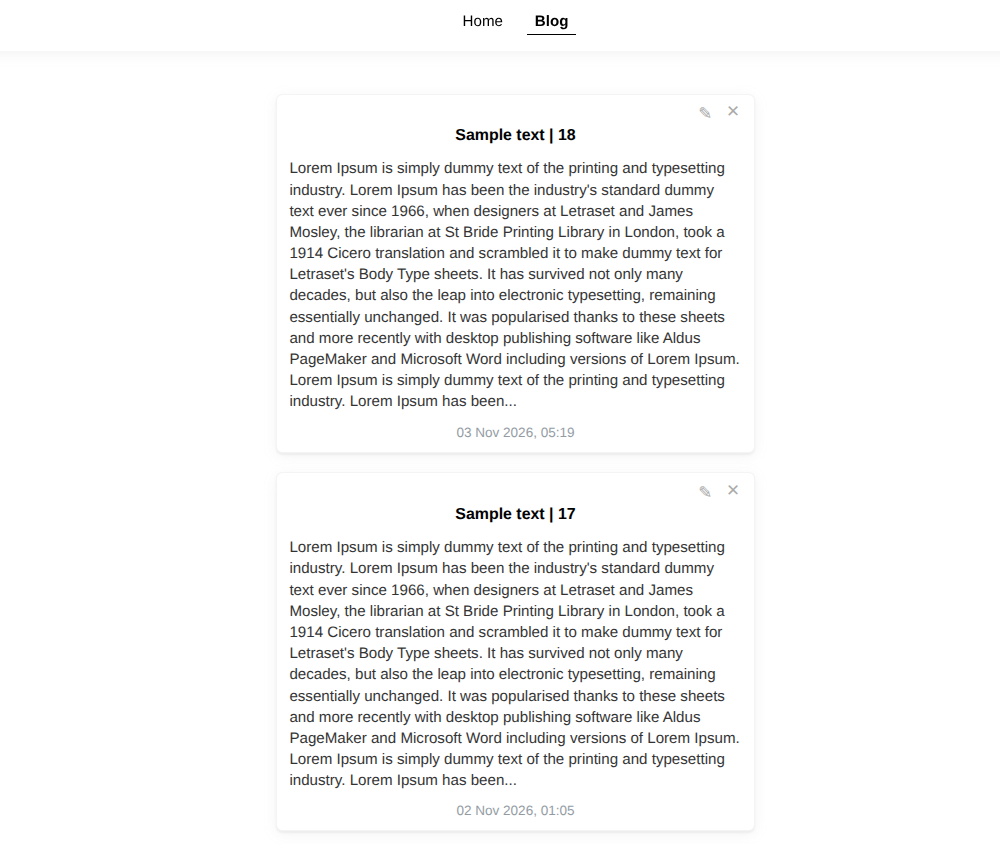

<strong>Скрин 8: Лента блога</strong>

  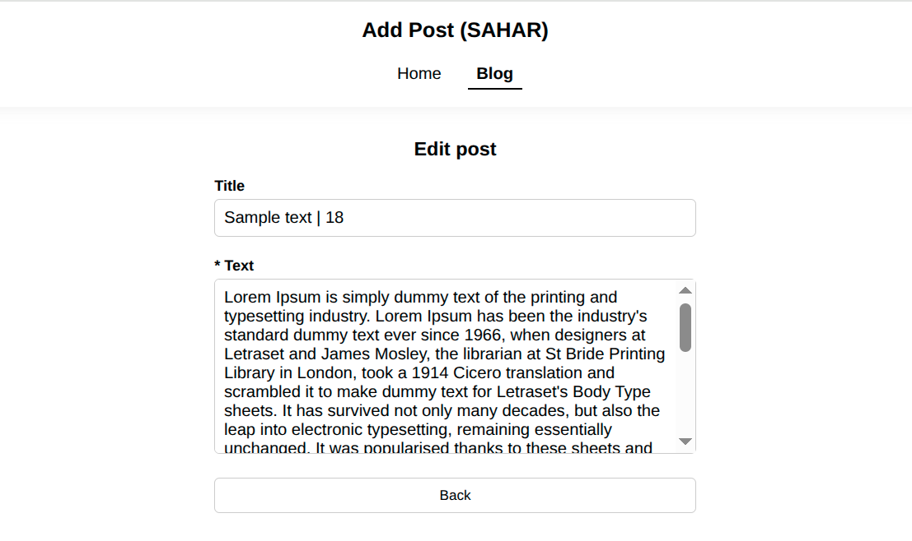

<strong>Скрин 9: Интерфейс редактирования поста</strong>

---

#### 2.8. Усиленная архитектура кибербезопасности
Прототип спроектирован в строгом соответствии с лучшими практиками кибербезопасности для исключения возможности взлома сайта или проникновения в систему (механизмы расположены в порядке от наиболее критических архитектурных барьеров к вспомогательным уровням защиты):

#### 1. Защита от CQL-инъекций, TOCTOU-гонок и атомарная целостность таблиц (`src/db.rs`, `src/handlers.rs`)
* **100% иммунитет к CQL-инъекциям:** Все пользовательские запросы к БД выполняются исключительно через предкомпилированные выражения `PreparedStatement` драйвера ScyllaDB (инициализируются при старте в `src/db.rs` и вызываются в `src/handlers.rs`). Данные передаются отдельно от тела команды по бинарному протоколу CQL.
* **Атомарная запись через `BatchType::Logged` (`create_post`):** Вставка в обе денормализованные таблицы (`posts` и `posts_by_id`) упакована в предсобранный `Logged Batch` в `AppState` — координатор ScyllaDB через `batchlog` гарантирует доставку обеих записей даже при внезапной остановке процесса веб-сервера.
* **Двойной LWT (`IF EXISTS` / `IF NOT EXISTS`) против «зомби-постов» и гонок:** В CQL обычный `UPDATE` работает как `UPSERT` и при параллельном удалении способен пересоздать удалённую строку (или создать битую строку с `bucket = NULL, created_at = NULL`). Поэтому `IF EXISTS` применён в **обеих** таблицах как для обновления (`stmt_update_post_by_id`, `stmt_update_post`), так и для удаления (`stmt_delete_post_by_id`, `stmt_delete_post`), а компенсирующий откат в `delete_post` также использует Paxos-запрос (`stmt_restore_post_by_id` с `IF NOT EXISTS`). Тем самым исключены смешивание LWT/non-LWT меток, подмена таймстемпов из URL, «посты-призраки» и двойной декремент счётчика.

#### 2. Бескомпромиссная политика Content Security Policy — CSP (`src/main.rs`)
На уровне middleware HTTP-сервера в `src/main.rs` принудительно задан строгий заголовок `Content-Security-Policy: default-src 'self'; script-src 'self'; style-src 'self'; img-src 'self'; connect-src 'self'; object-src 'none'; base-uri 'none'; form-action 'self'; frame-ancestors 'none';` — с полным запретом `'unsafe-inline'`, `'unsafe-eval'`, `<object>`/`<embed>`, перехвата `<base>`, отправки форм на сторонние домены и встраивания во фреймы. Поскольку в архитектуре SAHAR отсутствуют инлайновые скрипты гидратации, серверу не требуется тратить ресурсы процессора на генерацию одноразовых `nonce`-ключей, а движок **HTMX 4.0.0** подключает встроенные стили индикаторов через Constructable Stylesheets (`document.adoptedStyleSheets`), не нарушая строгий `style-src 'self'` даже без нестандартных `<meta>`-тегов.

#### 3. Многоуровневая защита от XSS, HTMX-инъекций и BiDi-подмены (`templates/*.html`, `src/security.rs`, `static/style.css`)
* **Компиляционное автоэкранирование в шаблонах (`templates/*.html`):** Шаблонизатор Askama автоматически экранирует все пользовательские переменные (`{{ post.title }}`, `{{ post.content }}`) ещё на этапе компиляции Rust-кода. Фильтр `|safe` применяется строго для уже экранированных и отрендеренных сервером подшаблонов (`base.html`, `blog.html`). Многострочное форматирование текста безопасно сохраняется средствами CSS (`white-space: pre-wrap`) без неэкранированных тегов ` `.
* **Изоляция HTMX-инъекций и BiDi (`templates/post_items.html`, `templates/post_detail.html`):** На элементах с пользовательскими заголовками и текстом заданы нативный для HTMX 4 атрибут `data-hx-ignore` (делающий движок HTMX полностью невосприимчивым к любым атрибутам `hx-*` / `data-hx-*` внутри пользовательского контента даже при возможном расширении разметки в будущем) и `dir="auto"` для изоляции RTL/BiDi-направления текста.
* **Защита динамического `<title>` (`src/security.rs`):** Функция `html_escape_title()` принудительно экранирует спецсимволы `&`, `<`, `>`, `"` и `'` внутри формируемого тега `<title>` при частичных HTMX-переходах.

#### 4. Fail-Fast конфигурация и Fail-Closed Anti-CSRF (`src/main.rs`, `src/security.rs`, `src/handlers.rs`)
* **Fail-Fast валидация на старте (`security::init_security_config()`):** Вызывается в `main()` до запуска `HttpServer`: прогревает кэш `OnceLock`, нормализует `ALLOWED_ORIGINS` к нижнему регистру и останавливает запуск при любой ошибке конфигурации (неверная схема, наличие пути `/...`, query или `@` в `ALLOWED_ORIGINS` или `CANONICAL_BASE_URL`).
* **Fail-Closed Anti-CSRF (`validate_origin()`):** Вызывается перед каждым мутирующим обработчиком (`POST` / `DELETE`). Любой заголовок `Sec-Fetch-Site`, `Origin` или `Referer` с невалидными не-ASCII байтами (`0xFF`) немедленно отклоняется с `403 Forbidden` (без тихого пропуска). Проверяется строгое совпадение `Sec-Fetch-Site: same-origin` (отсекая сторонние сайты и соседние поддомены), заголовок `Origin` проверяется в безусловном приоритете (блокируя `Origin: null` из `iframe sandbox` без отката на `Referer`), а при отсутствии `Origin` проверяется `Referer` строго по границе authority по RFC 3986 (`/`, `?`, `#`).

#### 5. Однопроходная санитизация ввода, защита от DoS, Slowloris, флуда и дабл-клика (`src/main.rs`, `src/security.rs`, `templates/*.html`)
* **Таймауты сервера и лимит тела запроса (`src/main.rs`):** `HttpServer` ограничивает `client_request_timeout` до 5 секунд и `keep_alive` до 30 секунд (защита от Slowloris), а `web::FormConfig::default().limit(65536)` (64 КБ) отсекает мегабайтные спам-пакеты.
* **Однопроходный `sanitize_text_input()` (`src/security.rs`):** Работает без лишних промежуточных `.replace()`-аллокаций: нормализует `\r\n`, `\r`, `\u{2028}` и `\u{2029}` в `\n`; вырезает нулевые байты (`\0`), управляющие символы (`Log/Terminal Injection`), невидимые пробелы/BOM (`\u{200B}`, `\u{2060}`, `\u{FEFF}`) и все BiDi-override символы (`\u{061C}`, `\u{200E}`, `\u{200F}`, `\u{202A}..=\u{202E}`, `\u{2066}..=\u{2069}`), **сохраняя** `\u{200D}` (ZWJ) и `\u{200C}` (ZWNJ), чтобы составные эмодзи (`👨‍💻`, `❤️‍🔥`) не распадались; зачищает хвостовые горизонтальные пустые символы через `is_inline_blank` (включая `\u{2800}`, `\u{3164}`, `\u{FFA0}`) перед `\n`, блокируя флуд вида `"\n \n\u{2800}\n"`, но сохраняя абзацы `\n\n`.
* **Иммунитет к паникам UTF-8 и дабл-клику (`src/security.rs`, `templates/*.html`):** Безопасная обрезка по скалярам Unicode `.chars()` исключает `panic` на границах эмодзи и кириллицы, а клиентские `maxlength="150"` / `maxlength="3000"` в связке с `data-hx-sync="this:drop"` и `data-hx-disable` предотвращают гонки повторной отправки.

#### 6. Нулевая утечка внутренних ошибок (CWE-209) и честная обработка сбоев БД (`src/main.rs`, `src/db.rs`, `src/security.rs`, `src/handlers.rs`)
* **Перехватчики экстракторов (`src/main.rs`):** Кастомные `.error_handler(...)` на `FormConfig`, `QueryConfig` и `PathConfig` перехватывают некорректные формы, query-строки и параметры пути до входа в обработчики: технические подробности Rust/Serde пишутся строго в `stderr`, клиент получает обезличенное `"Bad Request"`.
* **Изоляция ошибок шаблонов, CSRF и БД (`src/security.rs`, `src/handlers.rs`):** Функции `internal_error()` и `validate_origin()` логируют детали строго в `stderr` сервера (`eprintln!`), отдавая клиенту безликие `"Internal Server Error"` / `"Forbidden"`. Состояния `PostLookup` и `get_total_posts() -> Option<i64>` честно разделяют отсутствие записи (`404`) и сбой ScyllaDB (`503 Service Unavailable` с `Retry-After: 5`), а ошибки форм отдаются через `toast_error_response` с `HX-Reswap: none`, сохраняя введённый пользователем текст.

#### 7. Защита сетевого периметра, разрешений, изоляция кэша и HTTP-заголовки безопасности (`src/main.rs`, `src/security.rs`)
* **Clickjacking:** `X-Frame-Options: DENY` и директива CSP `frame-ancestors 'none'`.
* **MIME-sniffing и кодировка:** `X-Content-Type-Options: nosniff` + явный `text/html; charset=utf-8`.
* **Изоляция браузерных API и Cross-Origin политик:** `Permissions-Policy: geolocation=(), microphone=(), camera=(), payment=(), usb=(), interest-cohort=()`, `Cross-Origin-Opener-Policy: same-origin`, `Cross-Origin-Resource-Policy: same-origin`, `X-Permitted-Cross-Domain-Policies: none`.
* **Транспорт, кэш и SEO-защита:** `Strict-Transport-Security` (HSTS), `Referrer-Policy: strict-origin-when-cross-origin`, `Cache-Control: no-store, no-cache, must-revalidate`, заголовок `Vary: HX-Request, HX-Request-Type, HX-History-Restore-Request` (изоляция частичных HTMX-фрагментов от полных SSR-страниц) и `noindex, nofollow` без `canonical` на `404` и `/posts/{id}/edit`.

<strong>main.rs (security часть)</strong>

~~~rust
    // Fail-Fast проверка runtime-конфигурации Origin и Canonical URL до привязки сокетов
    security::init_security_config();
~~~

~~~rust
            .app_data(app_state.clone())
            // Защита от DoS-атак, переполнения памяти и утечки внутренних ошибок (CWE-209):
            // Жёстко ограничиваем размер входящей формы до 64 КБ и глушим сырые ошибки парсера Rust/Serde.
            .app_data(
                web::FormConfig::default()
                    .limit(65536)
                    .error_handler(|err, _req| {
                        eprintln!("⚠️ [FORM ERROR]: {err}");
                        actix_web::error::InternalError::from_response(
                            err,
                            HttpResponse::BadRequest().body("Bad Request"),
                        )
                        .into()
                    }),
            )
            .app_data(
                web::QueryConfig::default().error_handler(|err, _req| {
                    eprintln!("⚠️ [QUERY ERROR]: {err}");
                    actix_web::error::InternalError::from_response(
                        err,
                        HttpResponse::BadRequest().body("Bad Request"),
                    )
                    .into()
                }),
            )
            .app_data(
                web::PathConfig::default().error_handler(|err, _req| {
                    eprintln!("⚠️ [PATH ERROR]: {err}");
                    actix_web::error::InternalError::from_response(
                        err,
                        HttpResponse::BadRequest().body("Bad Request"),
                    )
                    .into()
                }),
            )
            // Строгие HTTP-заголовки кибербезопасности (нулевая терпимость к 'unsafe-inline')
            .wrap(
                middleware::DefaultHeaders::new()
                    // Защита от Clickjacking: запрещает встраивание сайта в сторонние <iframe> / <frame>
                    .add(("X-Frame-Options", "DENY"))
                    // Защита от MIME-sniffing: запрещает браузеру угадывать тип файла в обход Content-Type
                    .add(("X-Content-Type-Options", "nosniff"))
                    .add((
                        "Content-Security-Policy",
                        // Строгая политика CSP (защита от XSS, <base>-инъекций, сторонних форм, плагинов и фреймов)
                        "default-src 'self'; script-src 'self'; style-src 'self'; img-src 'self'; connect-src 'self'; object-src 'none'; base-uri 'none'; form-action 'self'; frame-ancestors 'none';",
                    ))
                    .add((
                        "Strict-Transport-Security",
                        // Защита HSTS (принудительное использование HTTPS в течение 1 года, включая поддомены)
                        "max-age=31536000; includeSubDomains; preload",
                    ))
                    // Защита приватности URL при переходах на внешние ресурсы
                    .add(("Referrer-Policy", "strict-origin-when-cross-origin"))
                    // Блокировка доступа к чувствительным API браузера
                    .add((
                        "Permissions-Policy",
                        "geolocation=(), microphone=(), camera=(), payment=(), usb=(), interest-cohort=()",
                    ))
                    .add(("Cross-Origin-Opener-Policy", "same-origin"))
                    .add(("Cross-Origin-Resource-Policy", "same-origin"))
                    .add(("X-Permitted-Cross-Domain-Policies", "none")),
            )
~~~

 

<strong>security.rs</strong>

~~~rust
use crate::models::{BaseTemplate, PostDetailTemplate};
use actix_web::{error, Error, HttpRequest, HttpResponse};
use askama::Template;
use std::fmt::Display;
use std::sync::OnceLock;

static ALLOWED_ORIGINS: OnceLock<Vec<String>> = OnceLock::new();
static CANONICAL_BASE_URL: OnceLock<String> = OnceLock::new();

pub const VARY_HTMX_HEADERS: &str = "HX-Request, HX-Request-Type, HX-History-Restore-Request";

// Защита по CWE-209 и OWASP A09:
// Подробности внутренней ошибки пишутся строго в stderr сервера, клиенту отдаётся обезличенный ответ.
pub fn internal_error<E: Display>(context: &str, err: E) -> Error {
    eprintln!("❌ [{context}]: {err}");
    error::ErrorInternalServerError("Internal Server Error")
}

pub fn service_unavailable_response() -> HttpResponse {
    HttpResponse::ServiceUnavailable()
        .content_type("text/plain; charset=utf-8")
        .insert_header(("Retry-After", "5"))
        .insert_header(("Cache-Control", "no-store, no-cache, must-revalidate"))
        .body("Service Unavailable")
}

// Белый список доверенных источников (Origin) для защиты от межсайтовой подделки запросов (CSRF).
// Читает ALLOWED_ORIGINS (через запятую) из окружения или использует локальные адреса прототипа.
fn allowed_origins() -> &'static [String] {
    ALLOWED_ORIGINS.get_or_init(|| {
        if let Ok(raw) = std::env::var("ALLOWED_ORIGINS") {
            let parsed: Vec<String> = raw
                .split(',')
                .map(|s| s.trim().trim_end_matches('/').to_ascii_lowercase())
                .filter(|s| !s.is_empty())
                .collect();
            if !parsed.is_empty() {
                return parsed;
            }
        }
        vec![
            "http://127.0.0.1:8080".to_string(),
            "http://localhost:8080".to_string(),
        ]
    })
}

pub fn canonical_base_url() -> &'static str {
    CANONICAL_BASE_URL.get_or_init(|| {
        std::env::var("CANONICAL_BASE_URL")
            .ok()
            .map(|s| s.trim().trim_end_matches('/').to_string())
            .filter(|s| !s.is_empty())
            .unwrap_or_else(|| "http://127.0.0.1:8080".to_string())
    })
}

fn validate_base_origin(value: &str) -> bool {
    let authority = value
        .strip_prefix("http://")
        .or_else(|| value.strip_prefix("https://"))
        .unwrap_or("");
    !authority.is_empty() && !authority.contains(['/', '?', '#', '@', ' '])
}

// Fail-Fast прогрев и строгая валидация runtime-конфигурации безопасности при старте
pub fn init_security_config() {
    let base = canonical_base_url();
    assert!(
        validate_base_origin(base),
        "Invalid CANONICAL_BASE_URL '{base}': must be exact scheme://host[:port] with no path, query, or fragment"
    );

    for origin in allowed_origins() {
        assert!(
            validate_base_origin(origin),
            "Invalid ALLOWED_ORIGINS entry '{origin}': must be exact scheme://host[:port] with no path or query"
        );
    }
}

// Fail-Closed защита от CSRF (Cross-Site Request Forgery):
// Вызывается на всех мутирующих маршрутах (POST / DELETE).
// Сразу отбрасывает невалидные не-ASCII заголовки, требует `Sec-Fetch-Site: same-origin`
// (если передан браузером), проверяет `Origin` в строгом приоритете (блокируя `Origin: null` и чужие домены),
// а при отсутствии `Origin` проверяет `Referer` строго по границе authority (RFC 3986).
pub fn validate_origin(req: &HttpRequest) -> Result<(), Error> {
    if let Some(raw_fetch_site) = req.headers().get("Sec-Fetch-Site") {
        let Ok(fetch_site) = raw_fetch_site.to_str() else {
            eprintln!("🛡️ [CSRF BLOCKED] Malformed non-ASCII Sec-Fetch-Site header");
            return Err(error::ErrorForbidden("Forbidden"));
        };
        if fetch_site != "same-origin" {
            eprintln!("🛡️ [CSRF BLOCKED] Invalid Sec-Fetch-Site: {fetch_site:?}");
            return Err(error::ErrorForbidden("Forbidden"));
        }
    }

    let origins = allowed_origins();

    if let Some(raw_origin) = req.headers().get("Origin") {
        let Ok(origin) = raw_origin.to_str() else {
            eprintln!("🛡️ [CSRF BLOCKED] Malformed non-ASCII Origin header");
            return Err(error::ErrorForbidden("Forbidden"));
        };
        let normalized_origin = origin.to_ascii_lowercase();
        if !origins.iter().any(|allowed| allowed == &normalized_origin) {
            eprintln!("🛡️ [CSRF BLOCKED] Untrusted Origin: {origin:?}");
            return Err(error::ErrorForbidden("Forbidden"));
        }
        return Ok(());
    }

    let Some(raw_referer) = req.headers().get("Referer") else {
        eprintln!("🛡️ [CSRF BLOCKED] Missing both Origin and Referer headers");
        return Err(error::ErrorForbidden("Forbidden"));
    };
    let Ok(referer) = raw_referer.to_str() else {
        eprintln!("🛡️ [CSRF BLOCKED] Malformed non-ASCII Referer header");
        return Err(error::ErrorForbidden("Forbidden"));
    };

    let referer_lower = referer.to_ascii_lowercase();
    let is_valid_referer = origins.iter().any(|allowed| {
        referer_lower == *allowed
            || referer_lower.strip_prefix(allowed.as_str()).is_some_and(|rest| {
                rest.starts_with('/') || rest.starts_with('?') || rest.starts_with('#')
            })
    });

    if !is_valid_referer {
        eprintln!("🛡️ [CSRF BLOCKED] Missing Origin and untrusted Referer: {referer:?}");
        return Err(error::ErrorForbidden("Forbidden"));
    }

    Ok(())
}

fn is_stripped_unicode(ch: char) -> bool {
    matches!(
        ch,
        '\0'
            | '\u{061C}' // Arabic Letter Mark
            | '\u{200B}' // Zero-Width Space (не трогаем \u{200C}/\u{200D}, чтобы не ломать составные эмодзи)
            | '\u{200E}'
            | '\u{200F}' // LRM / RLM
            | '\u{202A}'..='\u{202E}' // Внедрение и принудительное переопределение BiDi
            | '\u{2060}' // Word Joiner
            | '\u{2066}'..='\u{2069}' // BiDi-изоляция
            | '\u{FEFF}' // BOM / Zero-Width No-Break Space
    )
}

fn is_edge_blank(ch: char) -> bool {
    ch.is_whitespace()
        || matches!(
            ch,
            '\u{2800}' | '\u{3164}' | '\u{FFA0}' | '\u{115F}' | '\u{1160}'
        )
}

fn is_inline_blank(ch: char) -> bool {
    ch != '\n' && is_edge_blank(ch)
}

// Однопроходная санитизация ввода, нормализация CRLF и защита от флуда пустыми строками:
// Вырезает нулевые байты, управляющие символы и BiDi-подмену при сохранении ZWJ-эмодзи,
// нормализует CRLF/CR/\u{2028}/\u{2029} -> LF, сжимает цепочки пустых строк (даже с пробелами/Брайлем)
// и безопасно обрезает строку по скалярным значениям Unicode.
pub fn sanitize_text_input(input: &str, max_chars: usize, allow_newlines: bool) -> String {
    let mut cleaned = String::with_capacity(input.len().min(max_chars * 4));
    let mut consecutive_newlines: usize = 0;
    let mut chars = input.chars().peekable();

    while let Some(ch) = chars.next() {
        if ch == '\r' || ch == '\n' || ch == '\u{2028}' || ch == '\u{2029}' {
            if ch == '\r' && chars.peek() == Some(&'\n') {
                chars.next();
            }
            if allow_newlines {
                while let Some(last) = cleaned.chars().next_back()
                    && is_inline_blank(last)
                {
                    cleaned.pop();
                }
                if !cleaned.is_empty() {
                    consecutive_newlines += 1;
                    if consecutive_newlines <= 2 {
                        cleaned.push('\n');
                    }
                }
            } else if !cleaned.is_empty() && !cleaned.ends_with(' ') {
                cleaned.push(' ');
            }
            continue;
        }

        if ch == '\t' {
            if allow_newlines {
                cleaned.push('\t');
            } else if !cleaned.is_empty() && !cleaned.ends_with(' ') {
                cleaned.push(' ');
            }
            continue;
        }

        if is_stripped_unicode(ch) || ch.is_control() {
            continue;
        }

        if !is_edge_blank(ch) {
            consecutive_newlines = 0;
        }
        cleaned.push(ch);
    }

    let trimmed = cleaned.trim_matches(is_edge_blank);
    trimmed
        .chars()
        .take(max_chars)
        .collect::<String>()
        .trim_end_matches(is_edge_blank)
        .to_string()
}

// Безопасная инспекция заголовков HTMX 4:
// Возвращает true ТОЛЬКО тогда, когда HTMX ожидает частичный HTML-фрагмент (partial).
// При навигации кнопками мыши/браузера «Назад/Вперёд» HTMX 4 отправляет заголовок
// `hx-history-restore-request: true` (или `hx-request-type: full`) и ожидает полную страницу с `<main data-hx-history-elt>`.
pub fn is_htmx_partial_request(req: &HttpRequest) -> bool {
    let is_htmx =
        req.headers().contains_key("hx-request") || req.headers().contains_key("hx-request-type");
    let is_history_restore = req.headers().contains_key("hx-history-restore-request");
    let is_full_request = req
        .headers()
        .get("hx-request-type")
        .and_then(|v| v.to_str().ok())
        .is_some_and(|v| v == "full");

    is_htmx && !is_history_restore && !is_full_request
}

// Безопасная обрезка строк по символам Unicode (UTF-8):
// Использует итератор `.chars()` вместо байтовых срезов, что исключает панику сервера (panic)
// на границах многобайтовых символов (кириллицы или эмодзи).
pub fn truncate(s: &str, max: usize) -> String {
    let s = s.trim();
    if s.chars().count() > max {
        let mut truncated = s.chars().take(max).collect::<String>().trim_end().to_string();
        truncated.push_str("...");
        truncated
    } else {
        s.to_string()
    }
}

// Защита от XSS в динамическом теге <title> при частичных HTMX-переходах:
// Поскольку тег <title> формируется вручную при частичном ответе (вне шаблона BaseTemplate),
// функция принудительно экранирует опасные HTML-спецсимволы (&, <, >, ", '), исключая инъекцию тегов.
pub fn html_escape_title(s: &str) -> String {
    s.replace('&', "&amp;")
        .replace('<', "&lt;")
        .replace('>', "&gt;")
        .replace('"', "&quot;")
        .replace('\'', "&#x27;")
}

// Безопасный рендеринг страниц (SSR и частичные HTMX-ответы):
// Явно задаёт кодировку `charset=utf-8` (защита от атак подмены кодировки UTF-7),
// заголовок `Cache-Control: no-store, no-cache, must-revalidate` и `Vary` для изоляции кэша.
pub fn render_page(
    req: &HttpRequest,
    partial: String,
    path: &str,
    page_title: &str,
    page_description: &str,
    noindex: bool,
) -> Result<HttpResponse, Error> {
    if is_htmx_partial_request(req) {
        let safe_title = html_escape_title(page_title);
        Ok(HttpResponse::Ok()
            .content_type("text/html; charset=utf-8")
            .insert_header(("Cache-Control", "no-store, no-cache, must-revalidate"))
            .insert_header(("Vary", VARY_HTMX_HEADERS))
            .body(format!("<title>{safe_title}</title>\n{partial}")))
    } else {
        let base = BaseTemplate {
            page_title: page_title.to_string(),
            page_description: page_description.to_string(),
            content_html: partial,
            current_path: path.to_string(),
            canonical_base_url: canonical_base_url().to_string(),
            noindex,
        };
        let body = base
            .render()
            .map_err(|e| internal_error("TEMPLATE base", e))?;
        Ok(HttpResponse::Ok()
            .content_type("text/html; charset=utf-8")
            .insert_header(("Cache-Control", "no-store, no-cache, must-revalidate"))
            .insert_header(("Vary", VARY_HTMX_HEADERS))
            .body(body))
    }
}

// Безопасная обработка несуществующих ресурсов (HTTP 404 Not Found):
// Возвращает честный статус 404 без раскрытия внутренней структуры БД и без тегов индексации/canonical.
pub fn render_not_found(req: &HttpRequest, current_path: &str) -> Result<HttpResponse, Error> {
    let partial = PostDetailTemplate { post: None }
        .render()
        .map_err(|e| internal_error("TEMPLATE post_detail 404", e))?;
    let page_title = "Post not found — Add Post (SAHAR)";

    if is_htmx_partial_request(req) {
        let safe_title = html_escape_title(page_title);
        Ok(HttpResponse::NotFound()
            .content_type("text/html; charset=utf-8")
            .insert_header(("Cache-Control", "no-store, no-cache, must-revalidate"))
            .insert_header(("Vary", VARY_HTMX_HEADERS))
            .body(format!("<title>{safe_title}</title>\n{partial}")))
    } else {
        let base = BaseTemplate {
            page_title: page_title.to_string(),
            page_description: "The requested post was not found.".to_string(),
            content_html: partial,
            current_path: current_path.to_string(),
            canonical_base_url: canonical_base_url().to_string(),
            noindex: true,
        };
        let body = base
            .render()
            .map_err(|e| internal_error("TEMPLATE base 404", e))?;
        Ok(HttpResponse::NotFound()
            .content_type("text/html; charset=utf-8")
            .insert_header(("Cache-Control", "no-store, no-cache, must-revalidate"))
            .insert_header(("Vary", VARY_HTMX_HEADERS))
            .body(body))
    }
}
~~~

---

#### 2.9. Информативное логирование сервера
При запуске система выводит в терминал наглядный отчёт о готовности схемы ScyllaDB и запуске веб-сервера:

    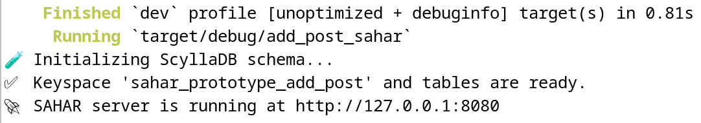

<strong>Скрин 10: Лог готовности ScyllaDB и запуска сервера</strong>

---

### 3. Установка и настройка

**Примечание о совместимости:** Данный проект протестирован на ОС Debian 12. Разработка на Windows не рекомендуется — для корректной работы требуется Linux-окружение.

**3.1. Подготовка окружения (Debian 12 и аналогичные дистрибутивы)** 

Установка системных зависимостей:

~~~bash
sudo apt update && sudo apt install build-essential pkg-config libssl-dev -y
~~~

**3.2. Установка Rust**

**3.2.1. Установите Rust (устанавливает текущую стабильную версию):**

~~~bash
curl --proto '=https' --tlsv1.2 -sSf https://sh.rustup.rs | sh
~~~

**3.2.2. Настройте переменные окружения:**

~~~bash
source $HOME/.cargo/env
~~~

**3.3. Установка и настройка ScyllaDB**

Установка выполняется непосредственно в систему Debian 12 с использованием официального репозитория ScyllaDB.

**3.3.1. Обновите индексы пакетов:**

~~~bash
sudo apt-get update
~~~

**3.3.2. Установите необходимые системные утилиты:**

~~~bash
sudo apt-get install -y apt-transport-https curl gnupg
~~~

**3.3.3. Добавьте официальный репозиторий ScyllaDB в систему:**

>📌 По умолчанию данный скрипт автоматически регистрирует репозиторий последней стабильной версии ScyllaDB Open Source. Чтобы явно установить версию ScyllaDB v2026.2.6, используемую в прототипе, выполните команду с флагом версии:

~~~bash
curl -sSf https://get.scylladb.com/server | sudo bash -s -- --scylla-version 2026.2
~~~

**3.3.4. Интерактивная настройка и установка ScyllaDB:**

~~~bash
sudo scylla_setup
~~~

**3.3.5. Запустите службу сервера ScyllaDB:**

~~~bash
sudo systemctl start scylla-server
~~~

**3.3.6. Проверьте статус узлов кластера:**

~~~bash
nodetool status
~~~

---

### 4. Подготовка базы данных

Благодаря встроенной функции `initialize_schema` в `src/db.rs`, пространство ключей **`sahar_prototype_add_post`** и все три таблицы (`posts`, `posts_by_id` и `post_counts`) **создаются автоматически** при первом запуске приложения.

Если вы хотите создать или проверить Keyspace вручную перед запуском, откройте консоль базы данных:

~~~bash
cqlsh
~~~

и выполните запрос:

~~~sql
CREATE KEYSPACE IF NOT EXISTS sahar_prototype_add_post
WITH REPLICATION = {'class': 'NetworkTopologyStrategy', 'replication_factor': 1};
~~~

---

### 5. Запуск проекта

**5.1. Клонирование репозитория проекта:**

~~~bash
git clone https://github.com/AndrewShedov/add-post--SAHAR && cd add-post--SAHAR/main
~~~

**5.2. Запуск проекта:**

~~~bash
cargo run
~~~

> *Опционально: для проверки строгого качества кода без единого предупреждения перед запуском можно выполнить `cargo clippy -- -D warnings`.*

После завершения сборки приложение будет доступно по адресу:

`http://127.0.0.1:8080`

По умолчанию ScyllaDB настроена на работу по адресу `127.0.0.1:9042`. 
Проверить подключение можно, введя в терминале команду:

~~~bash
cqlsh
~~~

После ввода команды должен отобразиться адрес подключения: 
<code>Connected to at 127.0.0.1:9042</code>

**5.3. Опциональная конфигурация через переменные окружения (для боевого домена без перекомпиляции):**

Все настройки автоматически используют безопасные локальные значения по умолчанию и при необходимости переопределяются переменными окружения:
* `BIND_ADDR` (по умолчанию: `127.0.0.1:8080`) и `SCYLLA_URI` (по умолчанию: `127.0.0.1:9042`) — считываются один раз при запуске процесса;
* `CANONICAL_BASE_URL` (по умолчанию: `http://127.0.0.1:8080`) и `ALLOWED_ORIGINS` (через запятую, по умолчанию: `http://127.0.0.1:8080,http://localhost:8080`) — кэшируются в `std::sync::OnceLock` и проходят Fail-Fast валидацию при старте через `security::init_security_config()`.

 

    

  

 
 

       