&nbsp;&nbsp;

# Add Post (SAHAR)

 

### ***Разработано с Gemini 4 Argon ✨***

> **Исследовательская статья:**  
> [💎 Дневник разработчика CRYSTAL #3: Сравнительное исследование производительности и кибербезопасности клиент-серверного взаимодействия в технологических стеках LARS и SAHAR](https://shedov.top/ru/dnevnik-razrabotchika-crystal-3-sravnitelnoe-issledovanie-lars-i-sahar/)

Данное приложение представляет собой многостраничный прототип, разработанный в рамках поиска нового высокопроизводительного и кибербезопасного технологического стека для социальной сети [CRYSTAL v3.0](https://github.com/CrystalSystems). 
Развивая концепцию [базового CRUD-прототипа](https://github.com/AndrewShedov/enter-text--SAHAR), это приложение демонстрирует полноценный цикл работы с публикациями в базе данных **ScyllaDB**: 
 1. Создание постов.
 2. Динамический счетчик постов.
 3. Просмотр ленты постов с бесконечной прокруткой на основе курсорной пагинации.
 4. Отдельная страница полного поста (`/posts/{id}`).
 5. Редактирование постов (`/posts/{id}/edit`).
 6. Удаление постов.
 7. Toast уведомления при операциях с постами.

Благодаря компилируемым шаблонам **Askama** и **HTMX 4.0.0**, приложение сочетает **серверный рендеринг (SSR)** с **плавной SPA-навигацией без перезагрузки страницы**, гарантируя **отличную индексацию поисковыми системами**, эталонные показатели **SEO** (включая индексацию бесконечного скролла) и максимальную устойчивость к уязвимостям.

  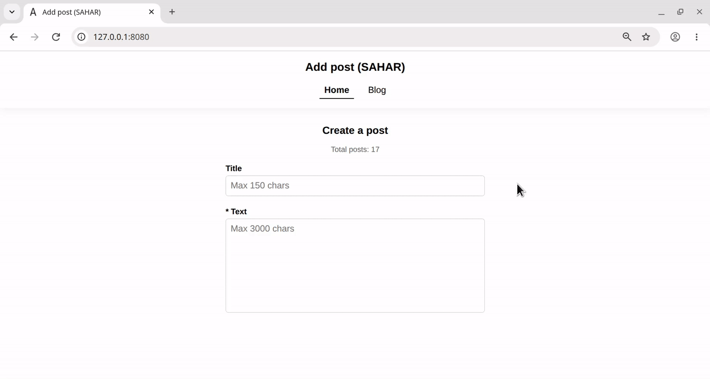

<strong>GIF 1: Создание поста, бесконечный скролл и работа кнопки назад</strong>

  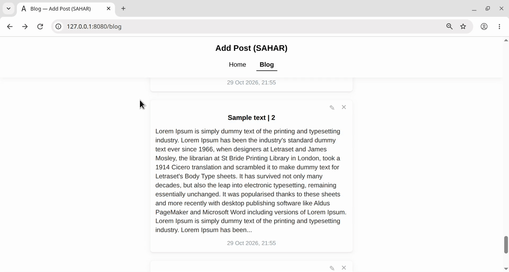

<strong>GIF 2: Редактирование и удаление поста</strong>

 

<a href="https://vk.ru/shedovtop?z=video-161152224_456239088%2F-161152224_4%2Fpl_-161152224_4" target="_blank">
  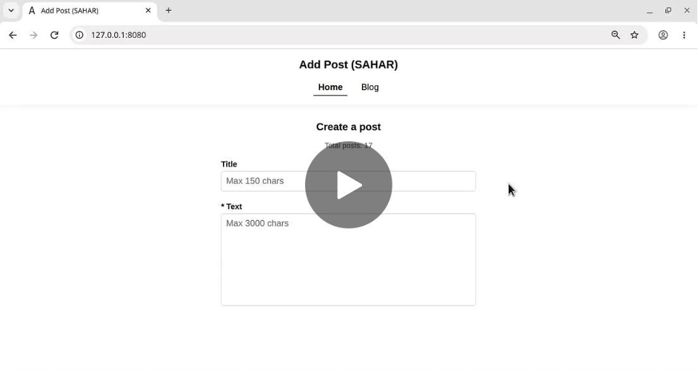
</a>

<strong>Полная демонстрация возможностей прототипа</strong>

 

**Содержание:** 
1. [Структура проекта и характеристики локального ПК](#paragraph_1)
2. [Ключевые возможности и архитектура](#paragraph_2)
   - [2.1. Модульность](#feature_2_1)
   - [2.2. Многостраничный SPA-роутинг без перезагрузки страницы (HTMX 4.0.0)](#feature_2_2)
   - [2.3. Комплексная SEO-архитектура и SSR без накладных расходов через Askama](#feature_2_3)
   - [2.4. Курсорная пагинация в Infinite Scroll, SEO-индексация ленты постов, тестирование лоадеров и умное сохранение скролла](#feature_2_4)
   - [2.5. Денормализованная архитектура из 3 таблиц ScyllaDB и распределённый счётчик постов](#feature_2_5)
   - [2.6. Автоматическая инициализация схемы БД](#feature_2_6)
   - [2.7. Полный цикл CRUD и умный UX форм](#feature_2_7)
   - [2.8. Усиленная архитектура кибербезопасности](#feature_2_8)
   - [2.9. Информативное логирование сервера](#feature_2_9)
3. [Установка и настройка](#paragraph_3)
4. [Подготовка базы данных](#paragraph_4)
5. [Запуск проекта](#paragraph_5)

---

### 1. Структура проекта и характеристики локального ПК

**Строение:**  
[Full code](https://github.com/AndrewShedov/add-post--SAHAR/tree/main/main) | [Cargo.toml](https://github.com/AndrewShedov/add-post--SAHAR/blob/main/main/Cargo.toml) 

**Структура:**  
**S**cyllaDB v2026.2.6 (driver: v1.8.0). 
**A**ctix Web v4.15.0. 
**H**TMX v4.0.0. 
**A**skama v0.16. 
**R**ust v1.98.0. 

**Характеристики локального ПК:**  
OS: Debian 12.

---

### 2. Ключевые возможности и архитектура

#### 2.1. Модульность
Серверная часть разделена на логически изолированные модули в директории `src/`:
* `src/main.rs` — Точка входа, инициализация HTTP-сервера, настройка защитных заголовков (Security Headers), лимитов входящих данных и маршрутизации.
* `src/models.rs` — Структуры данных предметной области (`Post`, `PostForm`, параметры запросов) и структуры компилируемых шаблонов Askama `#[derive(Template)]`.
* `src/db.rs` — Подключение к ScyllaDB, автоматическая инициализация схемы, синхронизация счётчика при старте и подготовка скомпилированных запросов `PreparedStatement` внутри структуры `AppState`.
* `src/handlers.rs` — Асинхронные обработчики маршрутов Actix Web для отображения страниц и выполнения операций CRUD.
* `src/security.rs` — Проверка заголовков `Origin`/`Referer` для защиты от CSRF-атак, определение типа запроса HTMX 4 и функции SSR/частичного рендеринга.

---

#### 2.2. Многостраничный SPA-роутинг без перезагрузки страницы (HTMX 4.0.0)
Приложение обеспечивает плавную навигацию в стиле **Single-Page Application** между несколькими страницами без загрузки тяжёлых WebAssembly-бандлов и клиентских JS-роутеров:

| Метод | Маршрут | Описание |
| :--- | :--- | :--- |
| `GET` | `/` | **Главная страница (Home):** Форма создания нового поста + динамический счётчик всех постов (`Total posts`). |
| `GET` | `/blog` | **Лента блога (Blog):** Список превью постов (по 5 постов за порцию) с бесконечной прокруткой (`?before=<timestamp>`). |
| `GET` | `/posts/{id}` | **Страница полного поста:** Отображает полный заголовок, дату публикации, полный текст поста и кнопки Редактирования/Удаления. |
| `GET` | `/posts/{id}/edit` | **Страница редактирования:** Предзаполненная форма с умной панелью кнопок `Back`, `Cancel` и `Publish` (`?from=blog` или `?from=post`). |
| `POST` | `/api/posts` | **Создание поста:** Валидирует и сохраняет новый пост в ScyllaDB, увеличивает счётчик и возвращает обновлённую форму + всплывающий Toast. |
| `POST` | `/api/posts/{id}/edit` | **Обновление поста:** Обновляет пост в ScyllaDB, записывает `/posts/{id}` в историю браузера и возвращает обновлённый пост + Toast. |
| `DELETE` | `/api/posts/{created_at}/{id}` | **Удаление поста:** Удаляет пост из ScyllaDB, уменьшает счётчик и удаляет карточку из DOM (или перенаправляет в `/blog` при удалении со страницы полного поста). |

**SPA-навигация и работа с историей браузера:**
* В соответствии с явной моделью атрибутов **HTMX 4.0.0**, навигационные ссылки содержат атрибуты `hx-get`, `hx-target="#main-content"`, `hx-swap="innerHTML"` и `hx-push-url="true"` непосредственно на семантических тегах `<a>`.
* Главный контейнер страницы размечен атрибутом `<main id="main-content" hx-history-elt>`.

На стороне сервера функция `is_htmx_partial_request()` различает три типа входящих запросов:
1. **Первичная загрузка страницы или заход поискового робота (заголовок `HX-Request` отсутствует):** Сервер отдаёт полный HTML-документ (`BaseTemplate` + контент страницы).
2. **Обычный SPA-переход по ссылке (`hx-request: true`, `hx-request-type: partial`):** Сервер возвращает только обновлённый тег `<title>` и внутренний HTML-фрагмент для контейнера `#main-content`.
3. **Навигация кнопками мыши/браузера «Назад / Вперёд» (`hx-history-restore-request: true` или `hx-request-type: full`):** Сервер отдаёт документ с обёрткой `<main id="main-content" hx-history-elt>`, позволяя HTMX 4 бесшовно восстановить содержимое `<main>` без полной перезагрузки вкладки браузера.

  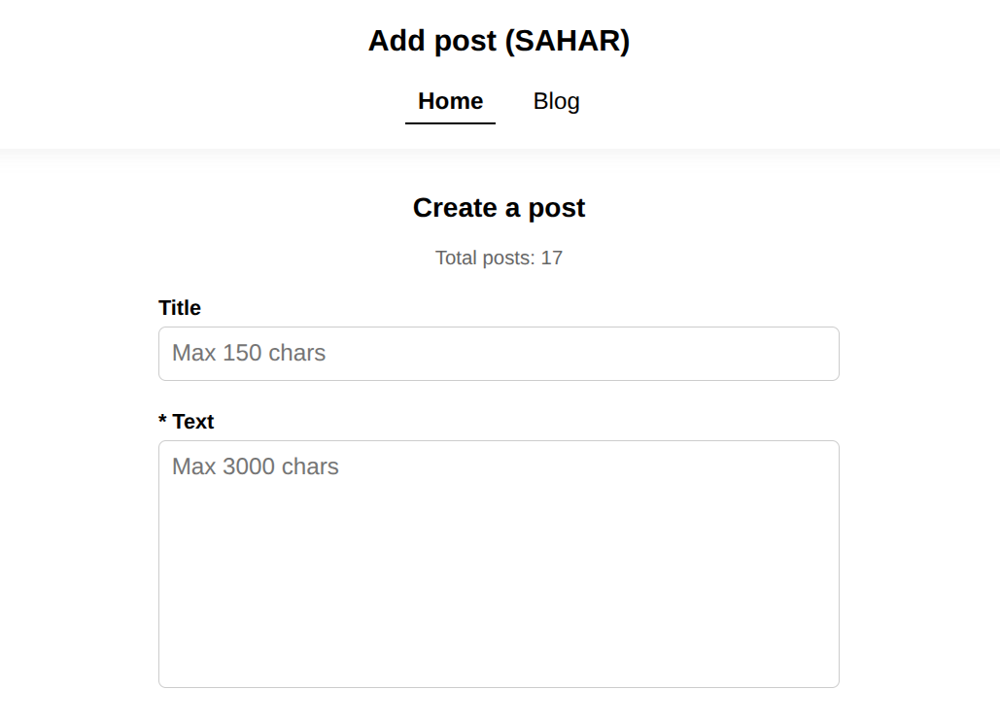

<strong>Скрин 1: Главная страница — Создание поста и счётчик публикаций</strong>

---

#### 2.3. Комплексная SEO-архитектура и SSR без накладных расходов через Askama
В отличие от классических клиентских SPA, отдающих пустой `

`, шаблонизатор Askama компилирует HTML-шаблоны напрямую в нативный машинный код Rust на этапе сборки проекта. Каждый маршрут прототипа спроектирован для **100% индексации поисковыми системами** и проходит строгую валидацию **W3C HTML5 ([validator.w3.org](https://validator.w3.org/nu/))**:

#### 1. Динамические метатеги и OpenGraph (`src/handlers.rs`, `src/security.rs`, `templates/base.html`)
Каждая страница (`/`, `/blog`, `/posts/{id}`, `/posts/{id}/edit`) на стороне сервера формирует уникальные теги `<title>`, `<meta name="description">`, `<meta property="og:title">` и `<meta property="og:description">`. В файле **`src/handlers.rs`** (в функциях `index`, `blog`, `view_post`, `edit_post_page`) генерируются индивидуальный заголовок и описание для текущего маршрута (или текста открытого поста), функция `render_page()` в **`src/security.rs`** передаёт их в структуру `BaseTemplate`, а шаблон **`templates/base.html`** рендерит их внутри секции `<head>`.

~~~html
<title>Sample text | 18 — Add Post (SAHAR)</title>
    <meta name="description" content="Lorem Ipsum is simply dummy text of the printing and typesetting industry. Lorem Ipsum has been the industry&#39;s standard dummy text ever since 1966, wh..." />
    <meta name="robots" content="index, follow" />
    <link rel="canonical" href="http://127.0.0.1:8080/posts/3fa4febf65d442cbad3d776399f0507f" />

    <!-- OpenGraph -->
    <meta property="og:type" content="website" />
    <meta property="og:title" content="Sample text | 18 — Add Post (SAHAR)" />
    <meta property="og:description" content="Lorem Ipsum is simply dummy text of the printing and typesetting industry. Lorem Ipsum has been the industry&#39;s standard dummy text ever since 1966, wh..." />
~~~

#### 2. Самоссылающиеся канонические ссылки (Self-Referencing Canonical URLs)
Все страницы содержат тег `<link rel="canonical" href="http://127.0.0.1:8080{{ current_path }}" />`. Так как маршрут `/posts/{id}` понимает UUID как с дефисами, так и без дефисов, канонический тег всегда нормализует адрес к чистому 32-символьному hex-формату (`/posts/{id_hex}`), исключая появление дублей в поисковой выдаче (src/handlers.rs, templates/base.html).

#### 3. Честный HTTP-статус `404 Not Found`
При обращении к несуществующему или удалённому ID поста сервер возвращает настоящий заголовок ответа `HTTP 404 Not Found` вместо `200 OK`, что защищает сайт от пессимизации за *Soft 404* (src/security.rs, templates/post_detail.html).

  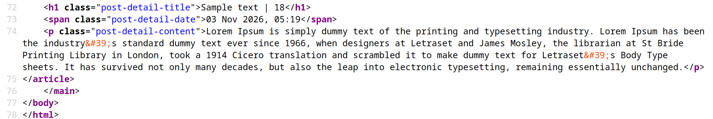

<strong>Скрин 2: Серверный рендеринг (SSR) страницы полного поста — Исходный код</strong>

---

#### 2.4. Курсорная пагинация в Infinite Scroll, SEO-индексация ленты постов, тестирование лоадеров и умное сохранение скролла

#### 2.4.1. Курсорная пагинация (Keyset / Cursor-Based Pagination: `?before=1792191698274`)
Вместо пагинации через `OFFSET` (`?page=2`), которая замедляется по мере роста базы данных и приводит к дублированию или пропуску постов при добавлении новых записей, в ленте `/blog` применяется **курсорная пагинация со сложностью `O(1)`**.

После каждых 5 превью постов `<article class="post-item">` в DOM-дереве ленты автоматически формируется элемент подгрузки со ссылкой на следующий временной курсор (например, `?before=1792581672794`):

~~~html

    <a href="/blog?before=1792581672794">Loading more posts... ⏳</a>

~~~

> **💡 Что означает число `1792191698274` в адресе `http://127.0.0.1:8080/blog?before=1792191698274`**  
> В момент создания поста сервер фиксирует точное всемирное время (UTC) в миллисекундах, прошедших с начала эпохи Unix — 1 января 1970 года (`Utc::now().timestamp_millis()`, например `1792191698274`), и записывает его в колонку `created_at`. После создания поста его метка `created_at` является частью первичного кластерного ключа в ScyllaDB и **никогда не изменяется** (даже если заголовок или текст поста впоследствии были отредактированы).

> **💡 Как работает курсор**  
> Когда сервер выбирает порцию из 5 постов (`LIMIT 5`), он берёт метку `created_at` у 5-го (самого нижнего) поста в текущей выборке и передаёт её как курсор `next_timestamp` (`?before=1792191698274`). Следующий запрос выполняет:
>
> ~~~sql
> SELECT created_at, id, title, content FROM posts WHERE bucket = 1 AND created_at < 1792191698274 LIMIT 5
> ~~~
>
> ScyllaDB мгновенно переходит к этой миллисекунде в кластерном индексе за константное время **`O(1)`** без сканирования предыдущих строк. Даже если сверху в ленту добавят 10 000 новых постов, адрес `/blog?before=1792191698274` навсегда останется привязанным к этой точной исторической точке и всегда вернёт те же самые 5 исторических постов.

#### 2.4.2. Гибридный Infinite Scroll для людей + 100% SEO-индексация для поисковых роботов
Классическая проблема бесконечного скролла заключается в том, что поисковые роботы (Googlebot, YandexBot, Bingbot) не крутят колесо мыши (не скроллят страницу вниз) и не вызывают JS-события прокрутки, из-за чего старые посты остаются неиндексированными.
В данном прототипе эта проблема решена с помощью **гибридного гипермедийного паттерна** в конце шаблона `templates/post_items.html`:

~~~html

    <!-- Hybrid Infinite Scroll trigger (for humans) + Crawlable SEO link (for search bots) -->
    

        <a href="/blog?before={{ next_timestamp.unwrap() }}">Loading more posts... ⏳</a>
    


~~~

1. **Для пользователей:** Когда пользователь прокручивает ленту вниз и элемент `
` появляется в области видимости экрана, триггер `hx-trigger="revealed"` автоматически отправляет фоновый запрос с заголовком `HX-Request`. Сервер возвращает только следующие 5 семантических превью постов `<article class="post-item">`, а `hx-swap="outerHTML"` бесшовно заменяет индикатор загрузки новыми постами.
2. **Для поисковых роботов и режима без JavaScript:** Поисковые краулеры не выполняют `revealed`, но видят внутри `
` стандартную семантическую ссылку `<a href="/blog?before=1792191698274">`. Переходя по ней без заголовка `HX-Request`, робот получает от Rust-бэкенда **полноценную SSR HTML-страницу** с **самоссылающимся каноническим тегом** (`<link rel="canonical" href="http://127.0.0.1:8080/blog?before=1792191698274" />`) и следующей ссылкой `<a href="/blog?before=...">`. Таким образом поисковые системы проходят по цепочке курсоров и индексируют всю историю публикаций от самых свежих до самого первого поста в базе данных.

#### 2.4.3. Тестирование лоадеров загрузки (`Loader Delay`) и их влияние на SEO
Поскольку на локальном сервере (`127.0.0.1`) связка Rust + Actix Web + ScyllaDB отдаёт данные за доли миллисекунды (`~0.3 мс`), человеческий глаз не успевает заметить отображение лоадеров.
Для визуального тестирования работы первоначального лоадера ленты (**`Loading posts... ⏳`**) и лоадера бесконечной подзагрузки постов (**`Loading more posts... ⏳`**) в коде предусмотрены специальные блоки искусственной задержки, обрамлённые метками **`// Loader Delay`** и **`// /Loader Delay`**.

По умолчанию эти блоки закомментированы. Чтобы включить режим визуального тестирования лоадеров, достаточно раскомментировать код между метками `// Loader Delay` и `// /Loader Delay` в следующих 3 файлах:

1. **`src/main.rs`** — константа времени задержки в миллисекундах (например, `800` мс):

~~~rust
// Loader Delay
// pub const LOADER_DELAY_MS: u64 = 800;
// /Loader Delay
~~~

2. **`src/handlers.rs`** (в начале функции `pub async fn blog`) — искусственная пауза ответа сервера при запросе ленты:

~~~rust
// Loader Delay
// if crate::LOADER_DELAY_MS > 0 {
//     tokio::time::sleep(std::time::Duration::from_millis(crate::LOADER_DELAY_MS)).await;
// }
// /Loader Delay
~~~

3. **`static/app.js`** (в конце файла) — клиентский показ лоадера первой загрузки `Loading posts... ⏳` при переходе во вкладку `/blog` и при обновлении страницы клавишей `F5`:

~~~javascript
// Loader Delay
// document.addEventListener('htmx:before:request', (e) => {
//     const target =
//         (e.detail && e.detail.ctx && e.detail.ctx.target) ||
//         (e.detail && e.detail.target) ||
//         e.target;
//     const sourceElt =
//         (e.detail && e.detail.ctx && e.detail.ctx.sourceElement) || e.target;
//
//     if (
//         target &&
//         target.id === 'main-content' &&
//         sourceElt &&
//         sourceElt.getAttribute('href') === '/blog' &&
//         !shouldRestoreBlogScroll
//     ) {
//         target.innerHTML =
//             '

Loading posts... ⏳

';
//     }
// });
//
// window.addEventListener('beforeunload', () => {
//     if (window.location.pathname.startsWith('/blog')) {
//         const mainContent = document.getElementById('main-content');
//         if (mainContent) {
//             mainContent.innerHTML =
//                 '

Loading posts... ⏳

';
//         }
//     }
// });
// /Loader Delay
~~~

> **💡 Степени влияния лоадеров на SEO:**
> 1. **Базовая конфигурация по умолчанию (активен только лоадер подзагрузки постов `Loading more posts... ⏳`, блоки `Loader Delay` закомментированы) — 0% негативного влияния на SEO:**
>    Первые 5 постов рендерятся на сервере (SSR) в семантических тегах `<article class="post-item">` и отдаются поисковому роботу мгновенно без каких-либо задержек. Сам блок `
Loading more posts... ⏳
` внизу 5-го поста содержит семантическую ссылку `<a href="/blog?before=...">`: поисковый робот воспринимает её как стандартную ссылку пагинации, переходит по ней и так же мгновенно индексирует следующие порции постов. Показатели скорости ответа сервера (**TTFB**) и отрисовки контента (**LCP**) остаются эталонными.
> 2. **Включение режима `Loader Delay` и лоадера первой загрузки постов (`Loading posts... ⏳`) — Негативное влияние на метрики скорости Core Web Vitals:**
>    Хотя включение этих блоков сохраняет SSR-отдачу постов в исходном коде страницы (`Ctrl + U`), искусственная задержка `LOADER_DELAY_MS` на сервере напрямую увеличивает время ожидания первого байта (**TTFB — Time to First Byte**) и задерживает финальную отрисовку контента (**LCP — Largest Contentful Paint**), а клиентский перехват с показом `Loading posts... ⏳` временно замещает контент во время навигации. Поскольку поисковые алгоритмы учитывают скорость ответа сервера и метрики Core Web Vitals при ранжировании, блоки `Loader Delay` предназначены **исключительно для локального тестирования и демонстрации UI**, а в основном режиме и продакшене должны оставаться закомментированными.

#### 2.4.4. Умное восстановление позиции скролла и эфемерный кэш ленты (Zero Memory Leak)
В `static/app.js` стандартные скачки прокрутки браузера отключены (`history.scrollRestoration = 'manual'`) и заменены точным управлением позицией скролла.

**При переходе из ленты в пост (`/blog` -> `/posts/{id}` или `/posts/{id}/edit`):**
1. Текущая вертикальная координата прокрутки сохраняется в оперативной памяти (`savedBlogScrollY = window.scrollY`).
2. Если пользователь прокрутил ленту дальше первых 5 постов через Infinite Scroll (`loadedPostsCount > 5`), в оперативной памяти временно сохраняется DOM-снимок контейнера `#feed-list` (`savedBlogFeedHtml`, с защитным лимитом `< 2 МБ`). Если же на экране `<= 5` постов, `savedBlogFeedHtml` остаётся равным `null` (`0 байт`), так как сервер и так возвращает первые 5 постов.
3. Открытая страница полного поста автоматически прокручивается в самое начало (`window.scrollTo(0, 0)`), чтобы пост всегда читался с заголовка.

**При возврате назад в ленту (`← Back to Blog`, кнопка `Back` или боковая кнопка мыши «Назад»):**
1. Если через Infinite Scroll были подгружены дополнительные партии постов, они мгновенно восстанавливаются из `savedBlogFeedHtml` в `#feed-list` и переинициализируются вызовом `htmx.process(feedList)`.
2. Окно мгновенно возвращается на точный пиксель прокрутки (`window.scrollTo(0, savedBlogScrollY)`), с которого пользователь перешёл в пост.
3. **Мгновенная очистка памяти (Zero Memory Leak):** В ту же миллисекунду после восстановления ленты переменная `savedBlogFeedHtml` принудительно обнуляется (`savedBlogFeedHtml = null`), освобождая оперативную память до `0 байт`. При создании, редактировании или удалении поста снимок также автоматически сбрасывается в `null`, гарантируя отображение свежих данных из ScyllaDB.

**Визуальный контроль:**
Для обеспечения полной прозрачности работы этого механизма, в `static/app.js` встроено информативное логирование жизненного цикла кэша. Открыв консоль разработчика в браузере (F12), можно в реальном времени наблюдать за процессами: сохранения координаты Y, фиксации размера выделенной памяти под DOM-снимок (в символах/байтах), точного восстановления позиции и, самое главное, мгновенного обнуления переменной (сборки мусора) при очистке.  
Ниже приведены результаты тестирования навигации в ленте блога, состоящей из 17 постов":

  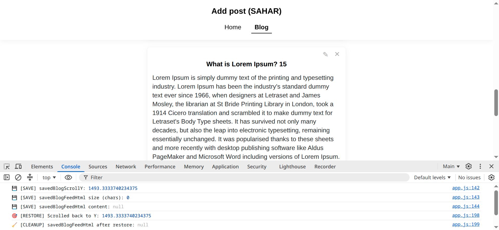

<strong>Скрин 3: Переход на 15-й пост (верхняя часть ленты, ≤ 5 постов) и возврат в блог. Поскольку подгрузка Infinite Scroll ещё не задействована, снимок DOM не создаётся (0 байт, null), сохраняется только скролл, который успешно восстанавливается при возврате.</strong>

  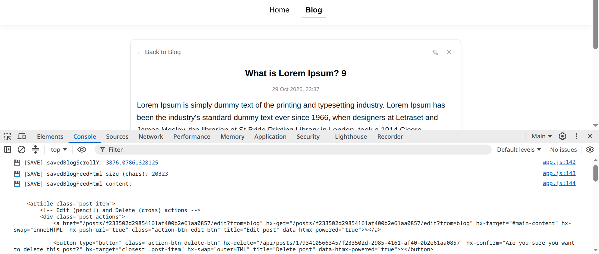

<strong>Скрин 4: Переход на 9-й пост (глубокая прокрутка). Алгоритм сохраняет координату (Y: 3738) и фиксирует размер DOM-снимка подгруженной ленты (28352 символа), предотвращая потерю загруженных данных.</strong>

  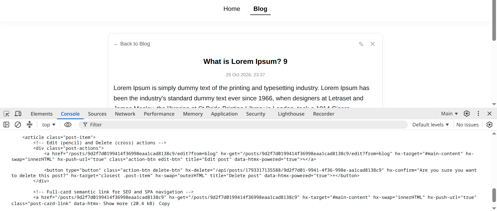

<strong>Скрин 5: Инспекция переменной <code>savedBlogFeedHtml</code>. В консоли видно семантическое содержимое кэша и его фактический вес в памяти браузера (28.4 kB).</strong>

  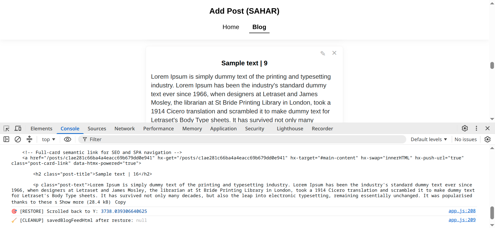

<strong>Скрин 6: Возврат назад в ленту. Мгновенное восстановление скролла с пиксельной точностью и принудительное обнуление эфемерного кэша (<code>🧹 [CLEANUP] savedBlogFeedHtml after restore: null</code>), полностью освобождающее память (Zero Memory Leak).</strong>

---

#### 2.5. Денормализованная архитектура из 3 таблиц ScyllaDB и распределённый счётчик постов
Для достижения **константной скорости чтения и записи `O(1)`** на всех маршрутах без использования медленных запросов `ALLOW FILTERING`, в пространстве ключей `sahar_prototype_add_post` реализована денормализованная схема из 3 таблиц:

1. **`post_counts`** — Хранит распределённый счётчик `counter` (`scylla::value::Counter`) для мгновенного вывода общего числа постов (`Total posts`) на главной странице (`/`). При запуске сервера автоматически синхронизируется с фактическим числом записей:

~~~sql
cqlsh:sahar_prototype_add_post> DESCRIBE TABLE post_counts;

CREATE TABLE sahar_prototype_add_post.post_counts (
    bucket int,
    total counter,
    PRIMARY KEY (bucket)
) WITH bloom_filter_fp_chance = 0.01
    AND caching = {'keys': 'ALL', 'rows_per_partition': 'ALL'}
    AND comment = ''
    AND compaction = {'class': 'IncrementalCompactionStrategy'}
    AND compression = {'sstable_compression': 'LZ4WithDictsCompressor'}
    AND crc_check_chance = 1
    AND default_time_to_live = 0
    AND gc_grace_seconds = 864000
    AND max_index_interval = 2048
    AND memtable_flush_period_in_ms = 0
    AND min_index_interval = 128
    AND speculative_retry = '99.0PERCENTILE'
    AND tombstone_gc = {'mode': 'repair', 'propagation_delay_in_seconds': '3600'};
~~~

2. **`posts`** — Хранит ленту публикаций, упорядоченную по времени на уровне кластерного ключа (`PRIMARY KEY (bucket, created_at, id) WITH CLUSTERING ORDER BY (created_at DESC, id ASC)`), обеспечивая выборку ленты `/blog` за `O(1)`:

~~~sql
cqlsh:sahar_prototype_add_post> DESCRIBE TABLE posts;

CREATE TABLE sahar_prototype_add_post.posts (
    bucket int,
    created_at timestamp,
    id uuid,
    content text,
    title text,
    PRIMARY KEY (bucket, created_at, id)
) WITH CLUSTERING ORDER BY (created_at DESC, id ASC)
    AND bloom_filter_fp_chance = 0.01
    AND caching = {'keys': 'ALL', 'rows_per_partition': 'ALL'}
    AND comment = ''
    AND compaction = {'class': 'IncrementalCompactionStrategy'}
    AND compression = {'sstable_compression': 'LZ4WithDictsCompressor'}
    AND crc_check_chance = 1
    AND default_time_to_live = 0
    AND gc_grace_seconds = 864000
    AND max_index_interval = 2048
    AND memtable_flush_period_in_ms = 0
    AND min_index_interval = 128
    AND speculative_retry = '99.0PERCENTILE'
    AND tombstone_gc = {'mode': 'repair', 'propagation_delay_in_seconds': '3600'};
~~~

3. **`posts_by_id`** — Хранит посты с первичным ключом `id uuid PRIMARY KEY`, обеспечивая мгновенный поиск поста за `O(1)` при открытии страницы полного поста (`/posts/{id}`) и страницы редактирования (`/posts/{id}/edit`):

~~~sql
cqlsh:sahar_prototype_add_post> DESCRIBE TABLE posts_by_id;

CREATE TABLE sahar_prototype_add_post.posts_by_id (
    id uuid,
    bucket int,
    content text,
    created_at timestamp,
    title text,
    PRIMARY KEY (id)
) WITH bloom_filter_fp_chance = 0.01
    AND caching = {'keys': 'ALL', 'rows_per_partition': 'ALL'}
    AND comment = ''
    AND compaction = {'class': 'IncrementalCompactionStrategy'}
    AND compression = {'sstable_compression': 'LZ4WithDictsCompressor'}
    AND crc_check_chance = 1
    AND default_time_to_live = 0
    AND gc_grace_seconds = 864000
    AND max_index_interval = 2048
    AND memtable_flush_period_in_ms = 0
    AND min_index_interval = 128
    AND speculative_retry = '99.0PERCENTILE'
    AND tombstone_gc = {'mode': 'repair', 'propagation_delay_in_seconds': '3600'};
~~~

> **💡 О масштабировании в продакшене (Партиционирование через `bucket` и построчный кэш Seastar):**
> * **Временное бакетирование (`bucket int`):** Схема таблицы `posts` заранее спроектирована с ключом партиционирования `bucket int`. В данном прототипе для простоты используется фиксированное значение `bucket = 1`. В высоконагруженном продакшен-кластере в поле `bucket` динамически передаётся число временного окна (например, `ГГГГММ` или `ГГГГММДД`), что автоматически делит глобальную ленту на компактные партиции (< 100 МБ) и равномерно распределяет нагрузку по всем узлам кластера и ядрам процессора (шардам) без изменения CQL-схемы таблиц.
> * **Построчный LRU-кэш (`rows_per_partition: 'ALL'`):** В отличие от старой Apache Cassandra, движок Seastar в ScyllaDB полностью обходит Linux Page Cache и реализует **построчное заполнение и построчное LRU-вытеснение кэша (Row-Granularity Cache)**. Настройка `caching = {'keys': 'ALL', 'rows_per_partition': 'ALL'}` не загружает всю партицию целиком в память — она удерживает в оперативной памяти (RAM) только самые «горячие» недавно запрошенные строки ленты, автоматически вытесняя старые исторические записи в сжатые по алгоритму `LZ4` файлы SSTables на диске.

---

#### 2.6. Автоматическая инициализация схемы БД
Для удобства запуска прототипа «из коробки» (Zero-Config Reproducibility), модуль `src/db.rs` автоматически создаёт пространство ключей `sahar_prototype_add_post` и необходимые таблицы при старте приложения перед переключением активной сессии:

~~~rust
    // 1. Устанавливаем соединение с локальным узлом ScyllaDB
    let session = SessionBuilder::new()
        .known_node("127.0.0.1:9042")
        .build()
        .await
        .expect("Failed to connect to ScyllaDB");

    // 2. Автоматически создаём keyspace и таблицы, если они ещё не существуют.
    // ПРИМЕЧАНИЕ (Best Practice и Кибербезопасность):
    // Автоинициализация включена здесь для удобства воспроизводимости прототипа без ручной настройки.
    // В продакшен-окружении миграции схемы (CREATE/ALTER/DROP) должны выполняться отдельно
    // через специализированный инструмент миграций, а веб-сервер должен подключаться
    // под ограниченной ролью БД (только права SELECT/MODIFY — Принцип наименьших привилегий).
    initialize_schema(&session).await;

    // 3. Переключаем активную сессию на созданный (или существующий) keyspace
    session
        .use_keyspace("sahar_prototype_add_post", false)
        .await
        .expect("Failed to select keyspace");
~~~

---

#### 2.7. Полный цикл CRUD и умный UX форм
* **Создание поста (`/`):** Поддерживает необязательный заголовок `Title` (до 150 символов) и обязательное поле `* Text` (до 3000 символов). Кнопка `Add` скрыта по умолчанию и появляется только тогда, когда в обязательное поле `* Text` введён текст. После отправки форма автоматически очищается, счётчик `Total posts` увеличивается на единицу, и с помощью атрибута `hx-swap-oob` (`templates/toast.html`) в углу экрана всплывает Toast-уведомление.
* **Гибкая настройка длины заголовка и текста в превью и  полном посте:**
  * **Размер превью поста в ленте (`/blog`):** В базе данных ScyllaDB пост всегда хранится целиком, но для компактного отображения карточек `<article class="post-item">` в ленте `/blog` длина выводимого заголовка и текста регулируется в файле **`src/handlers.rs`** (внутри функции `render_blog_feed_html`) с помощью `truncate()` из **`src/security.rs`**:

~~~rust
title: truncate(&title, 100),   // Максимум 100 символов для заголовка в превью ленты
content: truncate(&content, 700), // Максимум 700 символов для текста в превью ленты
~~~

  Если заголовок или текст превышают указанные значения, в превью ленты они обрезаются с добавлением многоточия (`...`), а при переходе на страницу полного поста (`/posts/{id}`) или редактирования (`/posts/{id}/edit`) отображаются полностью.
  * **Максимальный размер полного поста:** Задаётся синхронно на трёх уровнях — в HTML-шаблонах **`templates/home.html`** и **`templates/post_edit.html`** (`maxlength="150"` и `maxlength="3000"`), на сервере в **`src/handlers.rs`** в функциях `create_post` и `update_post` (`.chars().take(150)` и `.chars().take(3000)`), а также лимитом полезной нагрузки формы в **`src/main.rs`** (`web::FormConfig::default().limit(65536)`).
* **Редактирование поста (`/posts/{id}/edit`) и реактивный сброс состояния:**
  Доступно по клику на иконку карандаша (`✎`) как на карточке превью в ленте (`/blog`), так и внутри полного поста (`/posts/{id}`). Для отслеживания изменений формы и отката к исходным данным не используются клиентские стейт-менеджеры, хуки состояния или кэширование JSON-объектов в памяти, вместо этого применён нативный **DOM Dataset паттерн** (`templates/post_edit.html` + `static/app.js`):
  * При серверном рендеринге шаблона **`templates/post_edit.html`** Askama записывает эталонные значения из ScyllaDB в нативные HTML5-атрибуты `data-original` непосредственно на самих полях ввода:

~~~html
<input type="text" id="edit-title" name="title" value="{{ post.title }}" data-original="{{ post.title }}" ... />
<textarea id="edit-content" name="content" data-original="{{ post.content }}" ...>{{ post.content }}</textarea>
~~~

  * Интерфейс оснащён контекстным рядом кнопок **`Back, Cancel, Publish`**:
    * **`Back`** всегда видна и возвращает пользователя ровно на ту страницу, с которой он перешёл к редактированию (в ленту `/blog` или в полный пост `/posts/{id}`).
    * **`Cancel`** и **`Publish`** по умолчанию скрыты и появляются динамически только тогда, когда текущее значение `.value` отличается от эталона в `.dataset.original` (проверка выполняется в `static/app.js` без перерисовки DOM).
    * При нажатии на **`Cancel`** функция `resetEditFormToOriginal()` мгновенно восстанавливает исходный заголовок и текст поста напрямую из `dataset.original` без повторного запроса к серверу и базе данных, после чего кнопки `Cancel` и `Publish` автоматически скрываются:

~~~javascript
function resetEditFormToOriginal() {
    const editTitle = document.getElementById('edit-title');
    const editContent = document.getElementById('edit-content');
    if (!editTitle || !editContent) return;

    editTitle.value = editTitle.dataset.original || '';
    editContent.value = editContent.dataset.original || '';
    updateEditButtons();
}
~~~
* **Удаление поста (`×`):** Удаляет пост одновременно из обеих таблиц (`posts` и `posts_by_id`), уменьшает счётчик в `post_counts` (с защитой от ухода в отрицательные значения в `src/handlers.rs`) и либо удаляет карточку из списка (в `/blog`), либо перенаправляет пользователя обратно в `/blog` с уведомлением об удалении (если удаление вызвано со страницы полного поста `/posts/{id}`).

  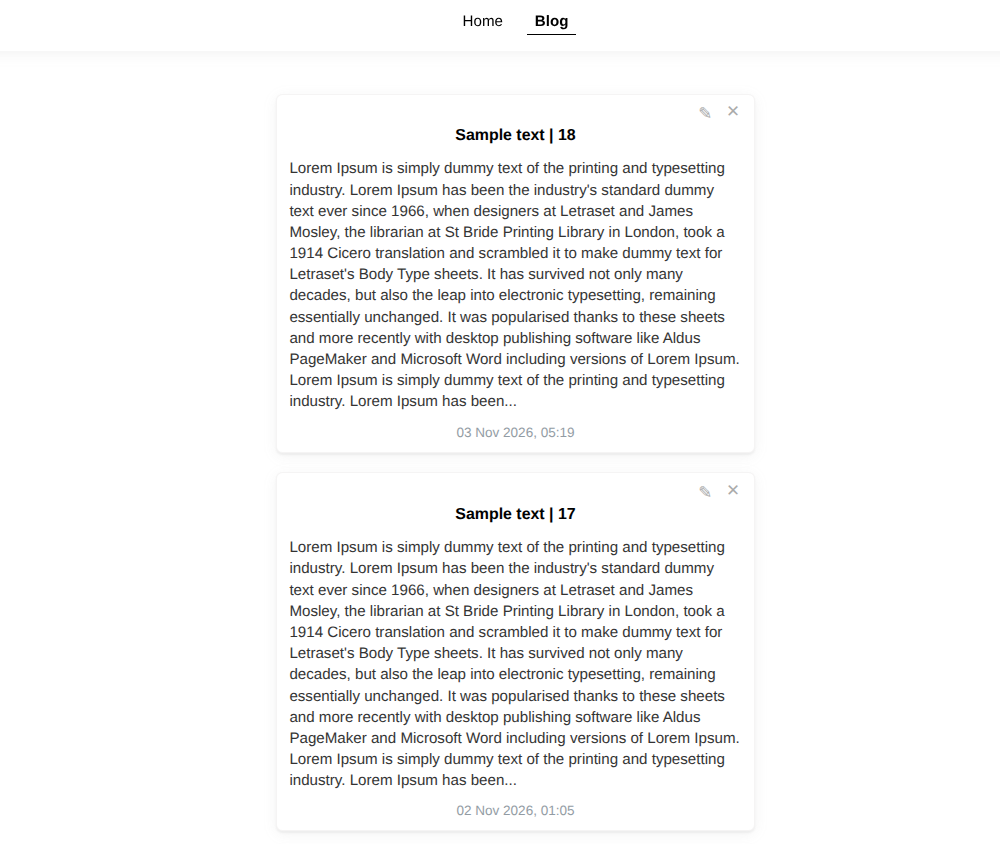

<strong>Скрин 7: Лента блога</strong>

  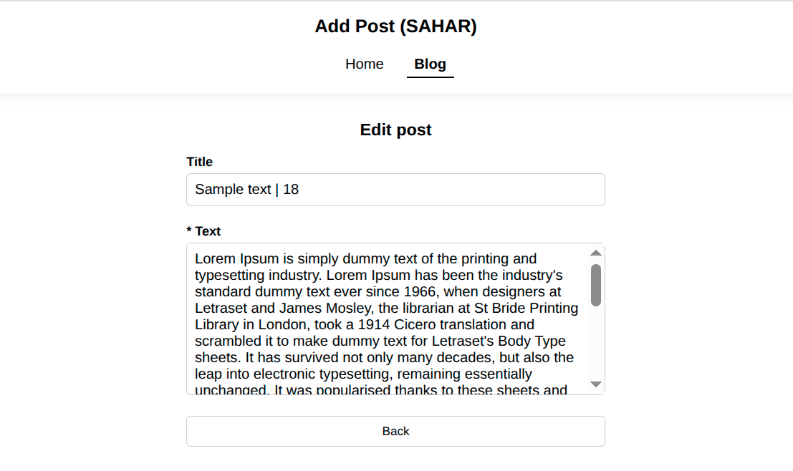

<strong>Скрин 8: Интерфейс редактирования поста</strong>

---

#### 2.8. Усиленная архитектура кибербезопасности
Прототип спроектирован в строгом соответствии с лучшими практиками кибербезопасности для исключения возможности взлома сайта или проникновения в систему (механизмы расположены в порядке от наиболее критических архитектурных барьеров к вспомогательным уровням защиты):

#### 1. Защита от CQL-инъекций на уровне драйвера БД (`src/db.rs`, `src/handlers.rs`)
100% пользовательских запросов к базе данных выполняются исключительно через предкомпилированные выражения `PreparedStatement` драйвера ScyllaDB (инициализируются при старте в `src/db.rs` и вызываются в `src/handlers.rs`). Пользовательские данные передаются отдельно от тела команды по бинарному протоколу CQL, что архитектурно исключает любую возможность CQL-инъекций.

#### 2. Бескомпромиссная политика Content Security Policy — CSP (`src/main.rs`, `templates/base.html`)
На уровне middleware HTTP-сервера в `src/main.rs` принудительно задан заголовок `Content-Security-Policy: default-src 'self'; script-src 'self'; style-src 'self'; img-src 'self';` с полным запретом `'unsafe-inline'` и `'unsafe-eval'`. Поскольку в архитектуре SAHAR отсутствуют инлайновые скрипты гидратации, серверу не требуется тратить ресурсы процессора на генерацию одноразовых `nonce`-ключей. Для соблюдения строгого правила `style-src 'self'` динамическая вставка инлайновых стилей индикаторов в HTMX 4 отключена в `templates/base.html` через `<meta name="htmx-config" content='{"includeIndicatorCSS": false}'>`.

#### 3. Двухуровневая защита от XSS на этапе компиляции и в частичных ответах (`templates/*.html`, `src/security.rs`, `static/style.css`)
* **В шаблонах (`templates/home.html`, `templates/post_items.html`, `templates/post_detail.html`, `templates/post_edit.html`, `templates/toast.html`):** Шаблонизатор Askama автоматически экранирует все пользовательские переменные (`{{ post.title }}`, `{{ post.content }}`) ещё на этапе компиляции Rust-кода. Многострочное форматирование текста сохраняется безопасно средствами CSS (`white-space: pre-wrap` в `static/style.css`) без использования неэкранированных HTML-тегов — ` `.
* **В частичных HTMX-ответах (`src/security.rs`):** Функция `html_escape_title()` принудительно санирует спецсимволы (`&`, `<`, `>`) внутри динамически формируемого тега `<title>`, исключая возможность инъекции HTML-тегов при SPA-переходах.

#### 4. Защита от межсайтовой подделки запросов — Anti-CSRF (`src/security.rs`, `src/handlers.rs`)
Функция `validate_origin()` в `src/security.rs` вызывается перед выполнением каждого мутирующего обработчика (`create_post`, `update_post`, `delete_post` в `src/handlers.rs`). Сервер жёстко сверяет заголовки `Origin` и `Referer` с белым списком доверенных источников `ALLOWED_ORIGINS` и мгновенно блокирует (`HTTP 403 Forbidden`) любые попытки создания, редактирования или удаления постов со сторонних сайтов.

#### 5. Эшелонированная защита от DoS-атак через переполнение буфера (`src/main.rs`, `src/handlers.rs`, `templates/home.html`, `templates/post_edit.html`)
Реализована тройная фильтрация объёма входящих данных:
* **На уровне HTTP-сервера (`src/main.rs`):** Лимит размера формы `web::FormConfig::default().limit(65536)` (64 КБ) рассчитан с запасом для приёма 150 символов заголовка и 3000 символов текста в многобайтовой UTF-8 кодировке (`application/x-www-form-urlencoded`), при этом надёжно отсекая попытки отправки мегабайтных спам-пакетов.
* **На уровне обработчиков запросов (`src/handlers.rs`):** Принудительное ограничение длины строк `.chars().take(150)` и `.chars().take(3000)` перед записью в БД, а также строгая типизированная валидация идентификаторов через `Uuid::parse_str`.
* **На уровне браузера (`templates/home.html`, `templates/post_edit.html`):** Клиентские ограничения `maxlength="150"` и `maxlength="3000"`.

#### 6. Защита от паники сервера (DoS via Panic) на границах символов UTF-8 (`src/security.rs`, `src/handlers.rs`)
Функция обрезки текста `truncate()` в `src/security.rs` и обработка форм в `src/handlers.rs` работают через итератор скалярных значений Unicode (`.chars()`) вместо байтовых срезов, что полностью исключает аварийное падение потока сервера (`panic`) при обрезке многобайтовых символов UTF-8 и эмодзи.

#### 7. Защита сетевого периметра, анти-сниффинг и HTTP-заголовки безопасности (`src/main.rs`, `src/security.rs`)
* **Защита от Clickjacking и UI Redressing (`src/main.rs`):** Заголовок `X-Frame-Options: DENY` запрещает встраивание сайта в сторонние `<iframe>` и `<frame>`.
* **Защита от MIME-sniffing и подмены кодировки (`src/main.rs`, `src/security.rs`):** Заголовок `X-Content-Type-Options: nosniff` в сочетании с явным указанием `text/html; charset=utf-8` в `render_page()` блокирует угадывание MIME-типов и атаки через смену кодировки.
* **Защита транспортного уровня, кэша и сокрытие системных ошибок (`src/main.rs`, `src/security.rs`):** Заголовки `Strict-Transport-Security` (HSTS), `Referrer-Policy: strict-origin-when-cross-origin`, запрет кэширования динамических ответов `Cache-Control: no-store, no-cache, must-revalidate` и безопасный рендеринг страницы `404 Not Found` (`render_not_found()`) без раскрытия внутренней структуры БД и системных стектрейсов.

<strong>main.rs (security часть)</strong>

~~~rust
            .app_data(app_state.clone())
            // Защита от DoS-атак (исчерпания оперативной памяти):
            // Жёсткое ограничение размера тела входящей формы до 64 КБ (65536 байт).
            // Пропускает заголовок (150 символов) + текст поста (3000 символов) в многобайтовой UTF-8 кодировке,
            // но мгновенно отсекает попытки залить мегабайтные спам-запросы.
            .app_data(web::FormConfig::default().limit(65536))
            // Глобальные заголовки кибербезопасности (нулевая терпимость к 'unsafe-inline')
            .wrap(
                middleware::DefaultHeaders::new()
                    // Защита от Clickjacking: запрещает встраивание сайта в сторонние <iframe> / <frame>
                    .add(("X-Frame-Options", "DENY"))
                    // Защита от MIME-sniffing: запрещает браузеру угадывать тип файла в обход Content-Type
                    .add(("X-Content-Type-Options", "nosniff"))
                    .add((
                        "Content-Security-Policy",
                        // Строгая политика CSP (Защита от XSS и инъекций данных):
                        // Запрещает любые инлайновые скрипты и стили ('unsafe-inline' и 'unsafe-eval' полностью исключены).
                        // Разрешает загрузку скриптов, стилей и изображений только с собственного домена ('self').
                        "default-src 'self'; script-src 'self'; style-src 'self'; img-src 'self';",
                    ))
                    .add((
                        "Strict-Transport-Security",
                        // Защита HSTS (принудительное использование HTTPS в течение 1 года, включая поддомены)
                        "max-age=31536000; includeSubDomains; preload",
                    ))
                    // Защита приватности URL при переходах на внешние ресурсы
                    .add(("Referrer-Policy", "strict-origin-when-cross-origin")),
            )
~~~

 

<strong>security.rs</strong>

~~~rust
use crate::models::{BaseTemplate, PostDetailTemplate};
use actix_web::{error, Error, HttpRequest, HttpResponse};
use askama::Template;

// Белый список доверенных источников (Origin) для защиты от межсайтовой подделки запросов (CSRF)
const ALLOWED_ORIGINS: [&str; 2] = ["http://127.0.0.1:8080", "http://localhost:8080"];

// Защита от CSRF (Cross-Site Request Forgery):
// Вызывается на всех мутирующих маршрутах (POST / DELETE).
// Сверяет заголовки Origin и Referer со списком ALLOWED_ORIGINS и блокирует (HTTP 403 Forbidden)
// любые попытки отправки форм или удаления данных со сторонних вредоносных сайтов.
pub fn validate_origin(req: &HttpRequest) -> Result<(), Error> {
    let origin = req.headers().get("Origin").and_then(|v| v.to_str().ok());
    let referer = req.headers().get("Referer").and_then(|v| v.to_str().ok());

    let is_valid_origin = origin.is_some_and(|o| ALLOWED_ORIGINS.contains(&o));
    let is_valid_referer =
        referer.is_some_and(|r| ALLOWED_ORIGINS.iter().any(|allowed| r.starts_with(allowed)));

    if !is_valid_origin && !is_valid_referer {
        return Err(error::ErrorForbidden("Security Alert: CSRF detected"));
    }
    Ok(())
}

// Безопасная инспекция заголовков HTMX 4:
// Возвращает true ТОЛЬКО тогда, когда HTMX ожидает частичный HTML-фрагмент (partial).
// При навигации кнопками мыши/браузера «Назад/Вперёд» HTMX 4 отправляет заголовок
// `hx-history-restore-request: true` (или `hx-request-type: full`) и ожидает полную страницу с `<main hx-history-elt>`.
pub fn is_htmx_partial_request(req: &HttpRequest) -> bool {
    let is_htmx =
        req.headers().contains_key("hx-request") || req.headers().contains_key("hx-request-type");
    let is_history_restore = req.headers().contains_key("hx-history-restore-request");
    let is_full_request = req
        .headers()
        .get("hx-request-type")
        .and_then(|v| v.to_str().ok())
        .is_some_and(|v| v == "full");

    is_htmx && !is_history_restore && !is_full_request
}

// Безопасная обрезка строк по символам Unicode (UTF-8):
// Использует итератор `.chars()` вместо байтовых срезов, что исключает панику сервера (panic)
// на границах многобайтовых символов (кириллицы или эмодзи).
pub fn truncate(s: &str, max: usize) -> String {
    let s = s.trim();
    if s.chars().count() > max {
        let mut truncated = s.chars().take(max).collect::<String>().trim_end().to_string();
        truncated.push_str("...");
        truncated
    } else {
        s.to_string()
    }
}

// Защита от XSS в динамическом теге <title> при частичных HTMX-переходах:
// Поскольку тег <title> формируется вручную при частичном ответе (вне шаблона BaseTemplate),
// функция принудительно экранирует опасные HTML-спецсимволы (&, <, >), исключая инъекцию тегов.
pub fn html_escape_title(s: &str) -> String {
    s.replace('&', "&amp;")
        .replace('<', "&lt;")
        .replace('>', "&gt;")
}

// Безопасный рендеринг страниц (SSR и частичные HTMX-ответы):
// Явно задаёт кодировку `charset=utf-8` (защита от атак подмены кодировки UTF-7)
// и заголовок `Cache-Control: no-store, no-cache, must-revalidate` для предотвращения кэширования устаревших данных.
pub fn render_page(
    req: &HttpRequest,
    partial: String,
    path: &str,
    page_title: &str,
    page_description: &str,
) -> Result<HttpResponse, Error> {
    if is_htmx_partial_request(req) {
        let safe_title = html_escape_title(page_title);
        Ok(HttpResponse::Ok()
            .content_type("text/html; charset=utf-8")
            .insert_header(("Cache-Control", "no-store, no-cache, must-revalidate"))
            .body(format!("<title>{safe_title}</title>\n{partial}")))
    } else {
        let base = BaseTemplate {
            page_title: page_title.to_string(),
            page_description: page_description.to_string(),
            content_html: partial,
            current_path: path.to_string(),
        };
        let body = base.render().map_err(error::ErrorInternalServerError)?;
        Ok(HttpResponse::Ok()
            .content_type("text/html; charset=utf-8")
            .insert_header(("Cache-Control", "no-store, no-cache, must-revalidate"))
            .body(body))
    }
}

// Безопасная обработка несуществующих ресурсов (HTTP 404 Not Found):
// Возвращает честный статус 404 без раскрытия внутренней структуры БД или системных ошибок (Stack Trace).
pub fn render_not_found(req: &HttpRequest, current_path: &str) -> Result<HttpResponse, Error> {
    let partial = PostDetailTemplate { post: None }
        .render()
        .map_err(error::ErrorInternalServerError)?;
    let page_title = "Post not found — Add Post (SAHAR)";

    if is_htmx_partial_request(req) {
        Ok(HttpResponse::NotFound()
            .content_type("text/html; charset=utf-8")
            .insert_header(("Cache-Control", "no-store, no-cache, must-revalidate"))
            .body(format!("<title>{page_title}</title>\n{partial}")))
    } else {
        let base = BaseTemplate {
            page_title: page_title.to_string(),
            page_description: "The requested post was not found.".to_string(),
            content_html: partial,
            current_path: current_path.to_string(),
        };
        let body = base.render().map_err(error::ErrorInternalServerError)?;
        Ok(HttpResponse::NotFound()
            .content_type("text/html; charset=utf-8")
            .insert_header(("Cache-Control", "no-store, no-cache, must-revalidate"))
            .body(body))
    }
}
~~~

---

#### 2.9. Информативное логирование сервера
При запуске система выводит в терминал наглядный отчёт о готовности схемы ScyllaDB и запуске веб-сервера:

    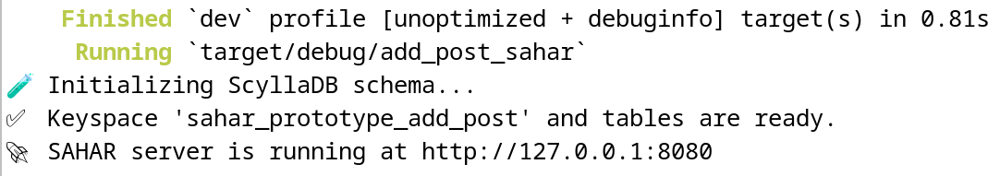

<strong>Скрин 9: Лог готовности ScyllaDB и запуска сервера</strong>

---

### 3. Установка и настройка

**Примечание о совместимости:** Данный проект протестирован на ОС Debian 12. Разработка на Windows не рекомендуется — для корректной работы требуется Linux-окружение.

**3.1. Подготовка окружения (Debian 12 и аналогичные дистрибутивы)** 

Установка системных зависимостей:

~~~bash
sudo apt update && sudo apt install build-essential pkg-config libssl-dev -y
~~~

**3.2. Установка Rust**

**3.2.1. Установите Rust (устанавливает текущую стабильную версию):**

~~~bash
curl --proto '=https' --tlsv1.2 -sSf https://sh.rustup.rs | sh
~~~

**3.2.2. Настройте переменные окружения:**

~~~bash
source $HOME/.cargo/env
~~~

**3.3. Установка и настройка ScyllaDB**

Установка выполняется непосредственно в систему Debian 12 с использованием официального репозитория ScyllaDB.

**3.3.1. Обновите индексы пакетов:**

~~~bash
sudo apt-get update
~~~

**3.3.2. Установите необходимые системные утилиты:**

~~~bash
sudo apt-get install -y apt-transport-https curl gnupg
~~~

**3.3.3. Добавьте официальный репозиторий ScyllaDB в систему:**

>📌 По умолчанию данный скрипт автоматически регистрирует репозиторий последней стабильной версии ScyllaDB Open Source. Чтобы явно установить версию ScyllaDB v2026.2.6, используемую в прототипе, выполните команду с флагом версии:

~~~bash
curl -sSf https://get.scylladb.com/server | sudo bash -s -- --scylla-version 2026.2
~~~

**3.3.4. Интерактивная настройка и установка ScyllaDB:**

~~~bash
sudo scylla_setup
~~~

**3.3.5. Запустите службу сервера ScyllaDB:**

~~~bash
sudo systemctl start scylla-server
~~~

**3.3.6. Проверьте статус узлов кластера:**

~~~bash
nodetool status
~~~

---

### 4. Подготовка базы данных

Благодаря встроенной функции `initialize_schema` в `src/db.rs`, пространство ключей **`sahar_prototype_add_post`** и все три таблицы (`posts`, `posts_by_id` и `post_counts`) **создаются автоматически** при первом запуске приложения.

Если вы хотите создать или проверить Keyspace вручную перед запуском, откройте консоль базы данных:

~~~bash
cqlsh
~~~

и выполните запрос:

~~~sql
CREATE KEYSPACE IF NOT EXISTS sahar_prototype_add_post
WITH REPLICATION = {'class': 'NetworkTopologyStrategy', 'replication_factor': 1};
~~~

---

### 5. Запуск проекта

**5.1. Клонирование репозитория проекта:**

~~~bash
git clone https://github.com/AndrewShedov/add-post--SAHAR && cd add-post--SAHAR/main
~~~

**5.2. Запуск проекта:**

~~~bash
cargo run
~~~

После завершения сборки приложение будет доступно по адресу:

`http://127.0.0.1:8080`

По умолчанию ScyllaDB настроена на работу по адресу `127.0.0.1:9042`. 
Проверить подключение можно, введя в терминале команду:

~~~bash
cqlsh
~~~

После ввода команды должен отобразиться адрес подключения: 
<code>Connected to at 127.0.0.1:9042</code>
 
 

    

  

 
 

       